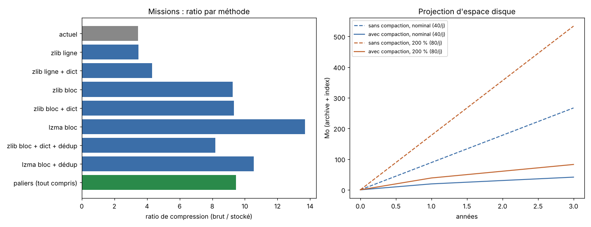

# Compaction SYFER — résultats du banc de mesure

_Généré par `compaction/mesure.py` le 2026-11-04 00:42 — Python 3.13.18, SQLite 3.53.1. Corpus synthétique : 10000 missions sur 250 jours, 5000 fiches de veille, 2000 connaissances (20 % de quasi-doublons)._

## 1. Missions : comparaison des méthodes (corpus complet, enregistrements intégraux)

Taille brute (JSON canonique des lignes d'archive) : **91.63 Mo**, soit 9.2 Ko par mission.

| Méthode | Taille | Ratio | Compaction | Lecture d'un enregistrement | Remarque |
|---|---:|---:|---:|---:|---|
| **Format actuel** (gzip par ligne, AAAA-MM.jsonl.gz) | 26.52 Mo | 3.45 | 2.7 s | 74.4 ms | lecture = décompresser et parcourir le mois |
| + index actuel archive_index/FTS (texte ≤ 4000) | 34.38 Mo | — | — | — | recherche 15.57 ms |
| zlib ligne | 26.32 Mo | 3.48 | 1.8 s | 0.10 ms | accès direct si l'offset est indexé |
| zlib ligne + dict | 21.32 Mo | 4.30 | 2.5 s | 0.08 ms | accès direct si l'offset est indexé |
| zlib bloc | 9.91 Mo | 9.25 | 2.0 s | 1.57 ms | 93 blocs |
| zlib bloc + dict | 9.83 Mo | 9.32 | 2.1 s | 2.08 ms | 93 blocs |
| lzma bloc | 6.69 Mo | 13.69 | 31.7 s | 6.48 ms | 93 blocs |
| zlib bloc + dict + dédup | 11.19 Mo | 8.19 | 7.7 s | 2.18 ms | 82 blocs, 19314 fragments dédupliqués |
| lzma bloc + dédup | 8.68 Mo | 10.55 | 35.3 s | 5.24 ms | 82 blocs, 19314 fragments dédupliqués |

## 2. Pipeline complet à paliers (module `app/compaction.py`)

Chaud ≤ 30 j laissé au format actuel ; tiède 31–180 j ; froid > 180 j. Enregistrements compactés : 6000 tièdes, 2800 froids.

| Palier | Avant (brut) | Fichiers de blocs | Ratio fichiers |
|---|---:|---:|---:|
| froid | 25.63 Mo | 1.11 Mo | 23.15 |
| tiede | 55.00 Mo | 4.25 Mo | 12.93 |

- Fragments dédupliqués : 251 (0.01 Mo stockés, 1.02 Mo de texte non répété).
- Index SQLite (blocs, enregistrements, feuilles de Merkle, FTS5, agrégats) : 3.29 Mo dont FTS5 1.10 Mo ; après entretien (VACUUM) : 3.15 Mo.
- Total dossier compact/ : **8.52 Mo** pour 80.63 Mo brut → ratio global **9.5** (index compris) ; 15.0 hors index.
- Temps : compaction tiède 11.55 s, migration froid 0.01 s, vérification complète 1.57 s (valide : True), vérification d'un enregistrement 4.14 ms.
- Lecture d'un enregistrement (cache vide) : tiède 2.237 ms (p95 6.561 ms), froid 10.8 ms (p95 17.529 ms).
- Recherche FTS5 : 8.04 ms par requête (13.26 ms avec extraits) ; format actuel : 15.57 ms.
- Effacement RGPD d'un enregistrement dans un bloc : 439.4 ms (bloc réécrit, racine recalculée).

Variantes (même corpus) :

| Variante | Dossier compact/ | Fichiers de blocs | Index après VACUUM | Compaction tiède | Lecture tiède | Recherche |
|---|---:|---:|---:|---:|---:|---:|
| **défaut** (tiède zlib + dict, FTS5 detail=none) | 8.52 Mo | 5.36 Mo | 3.15 Mo | 11.55 s | 2.237 ms | 8.04 ms |
| tiède en lzma (COMPACTION_ALGO_TIEDE=lzma) | 7.27 Mo | 4.11 Mo | 3.15 Mo | 24.35 s | 9.718 ms | 19.84 ms |
| FTS5 detail=full, classement bm25 (COMPACTION_FTS_DETAIL=full) | 11.09 Mo | 5.36 Mo | 5.73 Mo | 15.24 s | 3.347 ms | 7.73 ms |

## 3. Veille et mémoire de travail

- Veille : 5000 fiches sur 360 j ; base 5.97 Mo → 3.02 Mo après archivage des 2500 fiches expirées (> 180 j) en palier froid : 1.14 Mo au lieu de la suppression actuelle (ratio fichiers 7.42).
- Connaissances : 2000 dont 400 quasi-doublons injectés ; 293 fusionnées, 207 évincées (plafond 250/projet) vers l'archive ; base 2.97 Mo → 2.18 Mo en 7.26 s (archive 0.34 Mo, vérification True).

## 4. Projection d'espace disque (archive des missions + index)

Coût par mission mesuré : chaud 6.1 Ko (format actuel + index), tiède 1.07 Ko, froid 0.75 Ko (index compris).

| Rythme | Horizon | Missions | Sans compaction | Avec compaction | Gain | Veille actuelle (purge) | Veille archivée (sans perte) |
|---|---|---:|---:|---:|---:|---:|---:|
| nominal (40/j) | 1 an | 14600 | 88.9 Mo | 19.3 Mo | ×4.6 | 6.0 Mo | 8.4 Mo |
| nominal (40/j) | 3 an | 43800 | 266.8 Mo | 41.3 Mo | ×6.5 | 6.0 Mo | 17.7 Mo |
| 200 % (80/j) | 1 an | 29200 | 177.8 Mo | 38.6 Mo | ×4.6 | 12.0 Mo | 16.8 Mo |
| 200 % (80/j) | 3 an | 87600 | 533.5 Mo | 82.6 Mo | ×6.5 | 12.0 Mo | 35.4 Mo |

## 5. Choix retenus et justification

- **Blocs plutôt que lignes** : un membre gzip par ligne (format actuel) ne profite d'aucune répétition entre missions ; la concaténation en blocs divise encore la taille, et l'index (bloc, offset) garde une lecture d'un enregistrement en quelques millisecondes (un seul bloc décompressé, cache LRU).
- **Dictionnaire zlib** : utile surtout pour les petits objets (fragments, petits blocs) ; dans un bloc de 1 Mo son effet reste modeste car la fenêtre zlib (32 Ko) limite la portée — il est entraîné une fois, versionné (v1, v2…) et toujours relisible.
- **lzma pour le froid** : meilleure compression (fenêtre de 2 Mo, toutes les répétitions du bloc) ; lecture plus lente mais rare. **zlib pour le tiède** : décompression ~5× plus rapide.
- **Déduplication** : gain réel en zlib (consignes types, extraits de connaissances répétés par le COLLECTOR, brouillons du WRITER recopiés) ; quasi nul en lzma qui voit déjà tout le bloc.
- **Paliers** : le plus gros gain vient de la réduction du contenu (étapes réduites au tiède, résumé au froid), tout en gardant ce qui alimente la mémoire collective (problèmes du CHECKER, décisions, métriques, extrait d'exemple) et la chaîne d'empreintes de l'archive.
- **Index** : au-delà d'un ratio ~10, l'index FTS5 devient le premier poste ; il est contentless (texte non stocké deux fois) et limité à 1 500 caractères par enregistrement.

