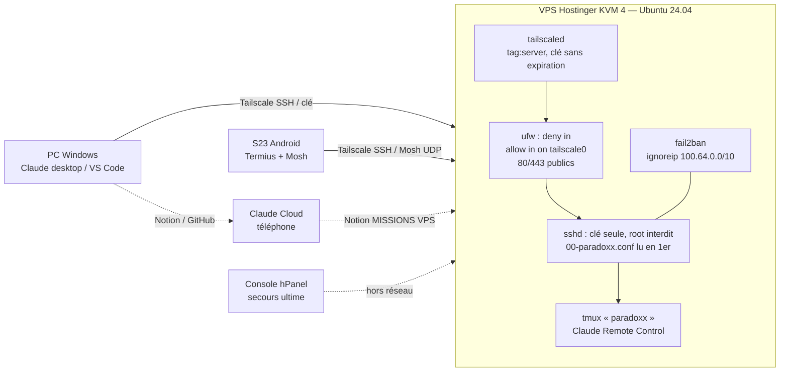

# Schéma de configuration de référence — VPS PARADOXX (v1, 04/11/2026)

Sources : documentation officielle Tailscale (expiration de clé, ufw), bug Ubuntu 2088207 (cloud-init / sshd), forums Tailscale et HestiaCP (fail2ban + Tailscale). Le reste est une synthèse NEXUS (SIMULÉ, à valider en réel).

## 1. Architecture des accès

## 2. Réglages de référence par brique

| Brique | Réglage | Source | Pourquoi |
|---|---|---|---|
| Tailscale | Étiquette `tag:server` sur le VPS **ou** « Disable Key Expiry » (Machines → ⋯) | Doc officielle Tailscale (kb/1028) : expiration par défaut 180 j ; un appareil étiqueté à l'authentification n'expire pas | Évite la coupure totale S7 |
| Tailscale | `tailscale up --ssh` ; tailscaled `enabled` | Doc Tailscale SSH | Accès même sans clé sur le S23 |
| ufw | `default deny incoming`, `allow in on tailscale0`, port 22 public supprimé, 80/443 gardés si site public | Doc officielle Tailscale « secure Ubuntu server with ufw » | Rien d'exposé hors Tailscale |
| ufw + Mosh | Aucun port à ouvrir : `allow in on tailscale0` couvre déjà l'UDP de Mosh | Synthèse (règle ufw par interface) | Mosh sans exposition publique |
| sshd | Fichier maison **lu en premier** (`00-…`) ; `50-cloud-init.conf` neutralisé | Bug Ubuntu 2088207 : 50-cloud-init.conf force `PasswordAuthentication yes` | Corrige S10 |
| sshd | `PasswordAuthentication no`, `PermitRootLogin no`, `KbdInteractiveAuthentication no` | Pratique standard | Clé seule |
| fail2ban | `ignoreip = 127.0.0.1/8 ::1 100.64.0.0/10 169.254.0.0/16` dans `jail.local` | Forum HestiaCP (IP Tailscale bloquée) ; doc fail2ban | Ne jamais se bannir soi-même (S11) ; 169.254 = console hPanel |
| Client SSH PC | `HostName` = IP Tailscale, `ServerAliveInterval 30` | Synthèse | Marche sans MagicDNS (S1, S2), coupures brèves (S5) |
| DNS PC | En cas de panne : couper Tailscale et retester ; sinon `accept-dns=false` | Doc officielle Tailscale (résolution DNS) | Isole la cause (S1) |
| Pare-feu Hostinger (hPanel) | Bloque **tout** par défaut, TCP **et UDP** ; s'ajoute à ufw (il faut passer les deux) ; changement actif sous 2 min, connexions établies conservées | Doc officielle Hostinger « managed VPS firewall » | Garder 80/443 ; **retirer 22** (inutile depuis Tailscale) ; **ajouter UDP 41641** pour garder le chemin Tailscale direct (sinon relais DERP plus lent) |
| Console navigateur hPanel | Indépendante de SSH (console série « serial0 ») ; un seul onglet ; connexion root par mot de passe hPanel ; si écran noir : redémarrer le VPS | Doc officielle Hostinger « browser terminal » | Secours ultime : ne jamais désactiver le mot de passe root **local** (seul SSH root est interdit) |
| Sauvegarde | Snapshot hPanel avant tout correctif ; sauvegarde tirée par le PC | Page VPS Nexus du QG | Retour arrière |

## 3. Ordre d'application (fusion des solutions)

0. **Jérémy, hPanel → Pare-feu « paradoxx-base »** : ajouter UDP 41641 (entrant), puis retirer TCP 22 une fois le test S5 vert (gratuit).
1. **Jérémy, console Tailscale** : étiqueter le VPS ou désactiver l'expiration de sa clé (2 min, gratuit).
2. **Jérémy, snapshot hPanel**, puis `sudo bash ~/correctifs-admin.sh` (S10 + S11 en un passage, sauvegarde et retour arrière inclus).
3. **Jérémy**, même session : `sudo bash ~/passerelle-s23.sh` (Mosh + ntfy, MSG-7).
4. **Claude PC** : bloc `~/.ssh/config` côté PC, puis `bash ~/vps-sante.sh` et tests S1–S5 → compte rendu Notion.
5. **Jérémy** : renouveler le VPS avant le 25/11 (S14, seule étape payante).
