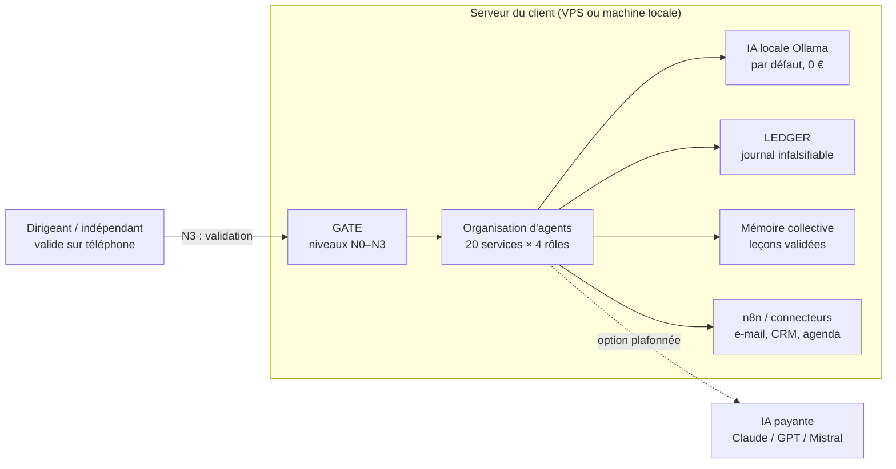

# SYFER V2 — Business plan

> Version 1.0 · 04/11/2026 · Statut : document de travail, **à valider par le propriétaire**
> Fichiers liés : [`previsionnel_3ans.csv`](previsionnel_3ans.csv) · [`tresorerie_an1_central.csv`](tresorerie_an1_central.csv) · [`hypotheses_previsionnel.csv`](hypotheses_previsionnel.csv) · [`modele_previsionnel.py`](modele_previsionnel.py) (régénère les CSV) · [`plan-de-production.md`](plan-de-production.md) · [`plan-action.md`](plan-action.md)
>
> **Règle de lecture.** Chaque chiffre porte une source (S1…S20, liste en fin de document) ou le marqueur **[H]** = hypothèse explicite, avec sa fourchette. Les montants de chiffre d'affaires sont **HT**. Les charges sont **TTC** tant que l'entreprise est en franchise de TVA (TVA non récupérable).

---

## 0. Résumé exécutif

**Ce qu'est SYFER.** Une organisation d'agents IA (93 rôles, 20 services) pilotée par **un seul humain qui valide** les décisions importantes (niveaux N0–N3), avec journal infalsifiable, bouclier anti-injection, charte par projet et mémoire collective sous contrôle humain. Elle tourne **sur le serveur du client**, avec une IA locale gratuite par défaut (Ollama) et une IA payante **plafonnée** en option. Le kit s'installe sur un VPS en 3 commandes et a été éprouvé (103 scénarios, 2 000 mini-scénarios, charge 200 %, jumeau numérique).

**Le problème.** Les TPE/PME veulent l'IA mais n'ont ni l'expertise ni la confiance : en 2025, 54 % des entreprises sans IA invoquent un manque d'expertise et 71 % n'en voient pas l'utilité (S1) ; en 2026, 40 % des TPE-PME utilisent l'IA mais seulement 19 % paient un outil (S2). Les plateformes existantes (Zapier, Make, n8n cloud, Lindy, Dust, Copilot Studio) sont soit techniques, soit facturées au siège ou à la consommation, et hébergent les données hors du client.

**La solution vendue.** Pas « 93 agents » : **des processus automatisés, gouvernés et hébergés chez le client**, livrés clé en main par un intégrateur qui utilise lui-même SYFER (effet vitrine).

**L'offre (3 paliers + 1 porte d'entrée)**

| Offre | Prix proposé (HT) | Justification courte |
|---|---|---|
| Porte d'entrée : **Diagnostic ÉCHO** (jumeau numérique : simulation avant achat) | 590–890 € (central 690–790 €) | ≈ 1,5 jour × TJM ; 7 à 17 fois moins cher que le Diag Data IA Bpifrance (10 000 € HT, ≈ 6 000 € après prise en charge, S11) |
| Palier 1 : **SYFER Solo** — installation clé en main + abonnement maintenance/évolution | 1 600–2 500 € + 99–169 €/mois (central 1 900 € + 129 €/mois) | 3 jours × TJM ; abonnement aligné sur n8n Pro (50 €/mois, S5) + temps humain de suivi |
| Palier 2 : **Agents sur mesure** | TJM 450–650 € (central 520 € an 1 → 600 € an 3) ou forfait 1 200–4 000 € | Médiane « automatisation IA » 650 €/j, fourchette 500–770 € (S9) ; décote de lancement sans références |
| Palier 3 : **Licence intégrateurs** (à partir de l'an 2, après V3) | 2 000–2 500 €/an + 25–30 €/mois par client déployé | **Hypothèse fragile** : aucun équivalent public direct ; à tester avec 1 intégrateur |

**Prévisionnel (scénario central, micro-entreprise BNC)** : CA **41 k€ (an 1, 2027)**, **70 k€ (an 2)**, **95 k€ (an 3)** ; revenu net disponible ≈ 2 000 €/mois en an 1, ≈ 3 700 €/mois en an 2, ≈ 5 100 €/mois en an 3. **Point mort des charges : ≈ 6 500 € de CA/an. Seuil de viabilité (revenu net ≈ 1 450 €/mois) : ≈ 30 600 € de CA/an.** Démarrage financé par un **apport de 2 500 € [H]** (dépenses de lancement ≈ 2 400 €), sans emprunt.

**Verdict d'expert : GO sous conditions** (§ 15). Le modèle réaliste en années 1–2 est **un freelance augmenté par SYFER** (prestations + installations + abonnements), pas un éditeur de logiciel. Les conditions bloquantes : dépôts privés, checklist juridique P1, qualité mesurée (V2.1) et 3 pilotes signés avant le 28/02/2027.

---

## 1. Problème

| Constat | Donnée | Source |
|---|---|---|
| Adoption encore minoritaire dans les entreprises ≥ 10 salariés | 18 % utilisent au moins une technologie d'IA en 2025 (15 % pour 10–49 sal., 31 % pour 50–249) ; UE : 20 % | S1 (Insee, enquête TIC 2025) |
| Adoption en forte hausse chez les TPE-PME, mais peu payante | 40 % utilisent l'IA (26 % en 2025, 13 % en 2024) ; 19 % paient (32 % des PME) | S2 (France Num 2026, Crédoc, 9 655 entreprises) |
| Manque d'expertise et d'utilité perçue | 54 % des non-utilisatrices manquent d'expertise ; 71 % n'en voient pas l'utilité | S1 |
| L'IA n'est pas la priorité budgétaire | 33 % n'ont rien dépensé en numérique en 2025 ; l'IA est dernière des priorités 2026-2027 (18 %), derrière la facture électronique (39 %) | S2 |
| Les petites entreprises achètent du « prêt à l'emploi » | 80 % des utilisatrices s'appuient sur des logiciels prêts à l'emploi, 73 % sur du cloud payant | S1 |
| Exposition cyber réelle | 39 % des TPE-PME ont subi au moins un incident en 12 mois ; MFA déployé par 39 % seulement | S2 |

**Lecture honnête.** Le besoin existe, mais **il ne s'achète pas sous la forme « une organisation de 93 agents »**. Il s'achète sous la forme « je gagne X heures par semaine sur la relance clients / le tri des e-mails / les devis, sans que mes données partent n'importe où ». Le marketing et l'offre doivent parler de **processus et de résultats**, la gouvernance étant l'argument de confiance.

## 2. Solution



- **Ce que le client obtient** : 1 à 3 processus automatisés en production, un cockpit de validation mobile, un journal des actions, des sauvegardes et une veille sécurité.
- **Ce que le client n'a pas à faire** : choisir des modèles, écrire des prompts, administrer un serveur.

## 3. Proposition de valeur et différenciation

| Axe | SYFER | Plateformes SaaS (Zapier, Make, Lindy, Dust, Copilot Studio) | Freelance automatisation « classique » |
|---|---|---|---|
| **Gouvernance humaine** | Native : N0–N3, validation mobile, journal infalsifiable, charte par projet | Variable ; journaux d'audit souvent réservés aux offres Enterprise (S6, S7) | Dépend du freelance ; rarement outillée |
| **Souveraineté / local** | Données sur le serveur du client ; IA locale par défaut | Hébergement éditeur (souvent US) ; Dust propose une région UE en Enterprise (S6) | Variable |
| **Coût prévisible** | Prix fixe ; IA payante plafonnée par le client | Facturation au siège et/ou aux crédits ; risque de dépassement (S7, S8) | TJM, sans abonnement |
| **Sécurité** | Bouclier anti-injection, tests d'attaque simulée, Tailscale, clés physiques | Bonne sécurité éditeur, mais surface SaaS partagée | Rarement formalisée |
| **Preuve** | 103 scénarios, 2 000 mini-scénarios, charge 200 %, jumeau numérique ; vitrines internes | Références clients nombreuses | Portfolio |

**Faiblesses à assumer** : marque inconnue, un seul opérateur (pas de continuité de service garantie), qualité de l'IA locale inférieure aux modèles de pointe (qwen2.5:3b jugé « moyen » sur le KVM 2, S18), pas de références clients à ce jour.

## 4. Marché (TAM / SAM / SOM)

**Méthode** : ascendante (*bottom-up*) = nombre d'entités × dépense annuelle plausible, recoupée par une source descendante.

| Niveau | Calcul | Résultat (ordre de grandeur) |
|---|---|---|
| **TAM** — France, entités pouvant acheter une automatisation IA gouvernée | PME hors microentreprises ≈ 159 000–164 000 (S12) × 3 500 €/an [H : installation amortie + maintenance, fourchette 2 500–5 000 €] ≈ 0,56 Md€ ; + TPE « numériques » : 10 % [H, 5–15 %] de ≈ 4,2 M microentreprises (S12) × 1 500 €/an [H] ≈ 0,63 Md€ | **≈ 1,2 Md€/an** (fourchette 0,6–2,4 Md€) |
| **SAM** — accessible à SYFER (France, francophone, déjà payeurs d'IA, sensibles à la souveraineté/gouvernance) | PME payant l'IA : 32 % × 160 000 ≈ 51 000 (S2, S12) + TPE/indépendants payant l'IA et outillés : ≈ 50 000 [H, 25 000–100 000] ; × 25 % sensibles souveraineté/gouvernance [H, 15–35 %] ≈ 25 000 entités × 3 000 €/an [H] | **≈ 75 M€/an** (fourchette 30–150 M€) |
| **SOM** — atteignable à 3 ans par un opérateur seul | Limité par la **capacité** (≈ 160 jours de production/an [H]) et non par le marché : 16 à 25 nouveaux clients/an, 19 abonnés en fin d'an 3 (central) | **≈ 95 k€/an en an 3 (central) = ≈ 0,13 % du SAM** |

**Recoupement descendant** : MarketsandMarkets estime le marché français de l'« agentic AI » à ≈ 233,5 M$ en 2025, mais sa projection 2030 (3,4 Md$) est incohérente avec le TCAC affiché (46,6 %) (S13). Ce chiffre ne couvre que le logiciel, pas les services d'intégration : il est **cité pour information, pas utilisé**. Le marché mondial 2025 serait ≈ 7 Md$ (S13).

**Conclusion marché** : la taille du marché n'est **pas** la contrainte ; la contrainte est la **capacité de production et de vente d'une personne**. Il faut donc chercher le revenu récurrent (abonnements) et la standardisation (offre Solo), puis un levier indirect (intégrateurs) en an 2–3.

## 5. Cibles et personas

| | **Persona A — « Sophie », dirigeante de PME de services** | **Persona B — « Marc », indépendant / TPE 1–5 personnes** | **Persona C — « Inès », intégratrice (agence web, ESN locale, cabinet de conseil)** |
|---|---|---|---|
| Profil | 15–60 salariés (cabinet d'expertise, agence, bureau d'études, négoce) ; pas de DSI | Consultant, artisan du numérique, petite agence ; seul à décider | 3–20 personnes ; vend du site, du CRM ou de l'automatisation à des PME |
| Douleur | Relances, tri d'e-mails, devis, comptes rendus : temps perdu ; peur RGPD et fuite de données clients | Back-office qui mange 1 jour/semaine ; budget serré | Clients qui demandent « de l'IA » ; pas de brique gouvernée à revendre |
| Ce qui la fait acheter | Données chez elle, validation humaine, journal = preuve en cas de contrôle | Prix fixe bas, gain de temps mesuré dans le Diagnostic ÉCHO | Marge sur l'intégration, produit déjà testé, licence claire |
| Offre cible | Diagnostic ÉCHO → Solo → agents sur mesure | Diagnostic ÉCHO → Solo (abonnement bas) | Licence intégrateurs (an 2+) |
| Panier annuel [H] | 3 500–8 000 € | 1 500–3 000 € | 2 000–6 000 € + redevances |
| Canal principal | Réseau, recommandation expert-comptable, LinkedIn | Malt, contenu, YouTube | Partenariats directs |

**Exclusions (charte et CGV)** : usages « haut risque » de l'AI Act (RH/recrutement, crédit, éducation, services essentiels), conseil juridique ou financier réglementé, ventes aux particuliers (B2C) au démarrage (S17).

## 6. Concurrence (prix publics relevés en 2026)

| Acteur | Prix public | Forces | Faiblesses vs SYFER | Source |
|---|---|---|---|---|
| **n8n cloud** | Starter 20 €/mois (2 500 exécutions), Pro 50 €/mois (10 000), Business 667 €/mois (facturation annuelle ; ≈ +20 % en mensuel) | Très puissant, open source auto-hébergeable, grande communauté | Outil, pas organisation gouvernée ; demande des compétences | S5 |
| **Make** | À partir de ≈ 9 $/mois (10 000 opérations) | Prix d'entrée bas, visuel | SaaS, pas d'IA gouvernée native | S10 |
| **Zapier** | Professional ≈ 19,99 $/mois (750 tâches), Team ≈ 69 $/mois | Notoriété, 7 000+ intégrations | Coût à la tâche élevé, données hors UE | S10 |
| **Dust** | Pro 24–30 $/siège/mois ; Max 120–150 $ ; Enterprise sur devis (SSO, audit, région UE) | Agents d'entreprise multi-modèles, éditeur français | Facturation au siège ; gouvernance avancée en Enterprise seulement | S6 |
| **Lindy** | 29,99 / 99,99 / 199,99 $ par utilisateur/mois ; pas d'offre gratuite permanente | Agents « assistants » prêts à l'emploi | Crédits non reportables, actions suspendues à épuisement | S7 |
| **Relevance AI** | Team ≈ 349 $/mois (7 000 actions) | Plateforme d'agents complète | Prix élevé pour une TPE ; source concurrente (biaisée) | S8 |
| **Mistral Le Chat** | Pro 14,99 $/mois ; Team 24,99 $/siège/mois | Souverain (FR), bon rapport qualité/prix | Assistant conversationnel, pas d'automatisation gouvernée | S14 |
| **Microsoft Copilot Studio** | Pack 25 000 crédits ≈ 200 $/mois ; paiement à l'usage 0,01 $/crédit ; M365 Copilot Business 18–21 $/utilisateur/mois | Intégration Microsoft 365, puissance commerciale | Coût difficile à prévoir ; agents coupés à 125 % de la capacité | S15 |
| **Freelances automatisation IA** | TJM médian 650 € (500–770 €) ; consultant IA 650 € (580–1 000 €) | Sur mesure, proximité | Pas de produit ni de gouvernance outillée | S9 |
| **Bpifrance Diag Data IA** | 10 000 € HT, 40 % pris en charge (≈ 6 000 € restant) ; PME ≥ 10 ETP et ≥ 1 M€ de CA | Label public, expert agréé | Diagnostic seulement, pas de mise en œuvre | S11 |

**Positionnement** : SYFER se place **entre le freelance et la plateforme** : prix forfaitaire de service, mais livré avec un produit testé, hébergé chez le client et gouverné.

## 7. Offre et tarification

```mermaid
flowchart LR
    A[Contenu / réseau / Malt] --> D[Diagnostic ÉCHO<br/>590–890 € HT]
    D -->|40–60 % (H)| S[SYFER Solo<br/>installation 1 600–2 500 €]
    S -->|70–85 % (H)| M[Maintenance<br/>99–169 €/mois]
    S --> P[Agents sur mesure<br/>TJM 450–650 €]
    M --> P
    I[Intégrateurs, an 2+] --> L[Licence<br/>2 000–2 500 €/an + 25–30 €/client/mois]
```

### 7.1 Porte d'entrée — Diagnostic ÉCHO (590–890 € HT)
- **Contenu** : atelier 2 h + simulation de 1 à 3 processus dans le jumeau numérique ÉCHO + rapport (gains de temps estimés, risques, coût d'exploitation, plan).
- **Justification** : ≈ 1,5 jour de travail [H] × 450–600 €/j ; déductible de l'installation si signée sous 60 jours (levier de conversion).

### 7.2 Palier 1 — SYFER Solo : installation clé en main + abonnement
| Élément | Prudent | Central | Ambitieux | Justification |
|---|---|---|---|---|
| Installation (≈ 3 jours [H]) | 1 600 € | 1 900 € | 2 200–2 500 € | 3 j × 530–830 €/j ; inclut 1 charte projet, 1 à 2 processus, formation 2 h |
| Abonnement maintenance/évolution | 99 €/mois | 129 €/mois | 149–169 €/mois | Référence n8n Pro 50 €/mois (S5) + ≈ 1,5 h/mois de suivi humain [H] ; inférieur à 1 siège Lindy Pro (≈ 100 $) |
| Pilotes (3 premiers clients) | 950 € | 950 € | 950 € | ≈ −50 % contre étude de cas publiable et témoignage |

**Inclus dans l'abonnement** : mises à jour mensuelles, correctifs de sécurité sous 72 h, supervision et sauvegarde externe, 1 évolution mineure/mois, support e-mail J+1 ouvré. **À la charge du client** : son VPS (≈ 9–27 € TTC/mois selon la puissance, S18) et l'éventuelle IA payante, plafonnée par lui.

### 7.3 Palier 2 — Agents sur mesure
- **Régie** : TJM 520 € (an 1) → 560 € (an 2) → 600 € (an 3) dans le central. Sous la médiane du marché (650 €, S9) tant qu'il n'y a pas de références ; à remonter dès 3 études de cas.
- **Forfait** : 1 200–4 000 € HT par agent ou processus (2–6 jours [H]), avec critères de recette écrits.

### 7.4 Palier 3 — Licence intégrateurs (à partir de V3, an 2)
- 2 000–2 500 € HT/an par intégrateur + 25–30 € HT/mois par client déployé ; formation et certification incluses.
- **Hypothèse la plus fragile du plan** : aucun prix public comparable ; à valider avec 1 intégrateur pilote avant toute généralisation. Elle ne pèse que 4 % du CA central en an 2 et 9 % en an 3.

### 7.5 Produits internes et vitrines
REDKARDS (BD), Poker Feeling (livre), Poker Winners (site), Top Solver (solver GTO) et la chaîne YouTube **ne sont pas inclus dans ce prévisionnel** : ils servent de **démonstrations** (« SYFER produit et gère ces projets »). Leur éventuel revenu est un bonus. **Vigilance** : l'univers poker peut brouiller le message auprès des PME (et relève des règles ANJ en cas d'affiliation, S17) ; présenter ces cas comme « études de cas de production de contenu », sur un canal distinct du canal B2B.

## 8. Canaux d'acquisition

| Canal | Action | Coût | Part attendue des clients an 1 [H] | Indicateur |
|---|---|---|---|---|
| **Réseau direct** | 10 contacts qualifiés/mois (ex-collègues, CCI, clubs d'entrepreneurs) | 0–50 €/mois | 40 % | RDV/mois |
| **Contenu LinkedIn + site** | 2 posts/semaine (cas réels, démonstrations ÉCHO), 1 étude de cas/mois | 0 € (temps) | 20 % | Leads entrants |
| **Malt** | Profil « automatisation IA gouvernée » ; commission 10 %, 5 % après 6 mois avec un même client (S9) | 10 % du CA concerné | 25 % | Missions Malt |
| **YouTube** | Démonstrations techniques (Top Solver, SYFER en action) ; chaîne B2B séparée de la chaîne poker | 0–300 € (micro, lumière) | 5 % | Vues → contacts |
| **Partenariats** | Experts-comptables, agences web, ESN locales (apport d'affaires 10 % [H]) ; programmes publics à explorer (activateurs France Num, IA Booster Bpifrance, S16) | 0 € + commissions | 10 % | Partenaires actifs |

## 9. Modèle de revenus

- **Ponctuel** : diagnostics, installations, forfaits sur mesure (≈ 43 % du CA central an 1).
- **Régie** : jours facturés (≈ 44 % an 1, en baisse à 28 % en an 3).
- **Récurrent** : abonnements de maintenance (12 % an 1 → **26 % an 3**) + redevances intégrateurs (0 % → 9 %).
- **Objectif structurel** : récurrent ≥ 30 % du CA en fin d'an 3 pour lisser la trésorerie et réduire la dépendance au temps vendu.

## 10. Plan de financement initial (dépenses de démarrage, nov. 2026 – févr. 2027)

| Poste | Montant TTC | Statut | Source |
|---|---|---|---|
| VPS Hostinger KVM 8 + KVM 2, 24 mois payés d'avance | ≈ 860 € (KVM 8 seul : ≈ 633 €) | Prix relevés le 04/11/2026 | S18 |
| 2 clés de sécurité physiques | 100–120 € | [H] ≈ 50–60 €/clé, à vérifier | — |
| Dépôt de marque INPI (3 classes : 9, 42, 35) | 270 € | Tarif 2026 | S17 |
| e-Soleau (code source) | 15 € (+15 € à V2.2) | Tarif | S17 |
| Relecture CGV B2B, licence, DPA RGPD par un avocat | 0–1 500 € (central 800 €) | [H] ; 0 € si modèles seuls (risqué) | — |
| RC professionnelle (1ʳᵉ mensualité) | 25–67 €/mois (300–800 €/an) | Devis à demander | S17 |
| Domaine + messagerie pro | 20–60 €/an | [H] | — |
| Supports de lancement (page de vente, cartes) | 0–300 € | [H] | — |
| Création de la micro-entreprise (guichet unique INPI) | 0 € | Démarche gratuite | — |
| **Total démarrage** | **≈ 2 400 € (fourchette 1 650–3 700 €)** | | |

**Financement proposé** : **apport personnel de 2 500 € [H]**, pas d'emprunt. Le modèle de trésorerie montre qu'avec 1 500 € d'apport, la trésorerie devient **négative en janvier 2027 (−466 €)** : il faut soit 2 500 € d'apport, soit des **acomptes de 50 % à la commande** (recommandé dans tous les cas).

**Aides — pistes à vérifier (non intégrées au prévisionnel)**
| Aide | État 2026 | Pertinence | Source |
|---|---|---|---|
| ACRE | Exonération ramenée à **25 %** pour les micro-entrepreneurs depuis le 01/07/2026, recentrée sur des publics prioritaires (demande sous 60 jours) | Probablement non éligible sauf statut prioritaire — à vérifier à l'Urssaf | S19 |
| ARCE (France Travail) | 60 % du reliquat d'ARE, en 2 versements (création puis +6 mois) ; exige l'ACRE | Seulement si bénéficiaire de l'ARE | S20 |
| Maintien partiel de l'ARE | ARE − 70 % du revenu (CA après abattement 34 % en BNC) | Idem | S20 |
| Prêt d'honneur (Initiative France, Réseau Entreprendre) | Prêt personnel à 0 % | Utile seulement si besoin > apport | À vérifier |
| Bpifrance (IA Booster, Diag Data IA) | Programmes pour PME/ETI clientes | **Canal de prescription**, pas un financement du propriétaire | S11, S16 |

## 11. Prévisionnel 3 ans (an 1 = 2027)

### 11.1 Hypothèses communes
| Hypothèse | Valeur | Source / statut |
|---|---|---|
| Régime | Micro-entreprise, prestations **BNC** relevant de la SSI | À confirmer selon le code APE (si BIC : 21,2 %) |
| Cotisations sociales | **25,6 %** du CA (BNC SSI 2026) | S4 (taux initialement annoncé à 26,1 %) |
| Formation professionnelle (CFP) | 0,2 % du CA | [H] taux usuel profession libérale, à vérifier |
| Impôt | Versement libératoire 2,2 % (si éligible et choisi) | [H] option, à vérifier selon le revenu fiscal du foyer |
| Plafond micro (services) | 83 600 € HT/an (2026-2028) ; sortie du régime après **2 années civiles consécutives** de dépassement | S3 |
| Franchise de TVA | Seuil 37 500 € ; seuil majoré 41 250 € (TVA due dès le dépassement) | S3 |
| Capacité de production | 160 jours/an ; au-delà : sous-traitance à 380 €/j [H, 350–450 €] | [H] |
| Temps par unité | Diagnostic 1,5 j ; pilote 4 j ; installation 3 j ; maintenance 1,5 h/client/mois ; intégrateur 4 j | [H] mesures à faire sur les pilotes |
| Attrition des abonnements | 20 %/an [H, 10–30 %] | [H] |
| Malt | 30 % de la régie via Malt, commission 10 % | S9 + [H] |
| Infrastructure | VPS prépayé amorti (≈ 860 €/24 mois) + sauvegardes ≈ 10 €/mois ; renouvellement an 3 ≈ 1 060 €/an | S18 |

Les volumes et prix par scénario sont dans [`hypotheses_previsionnel.csv`](hypotheses_previsionnel.csv).

### 11.2 Synthèse des 3 scénarios (en €)

| | Prudent An 1 | An 2 | An 3 | **Central An 1** | **An 2** | **An 3** | Ambitieux An 1 | An 2 | An 3 |
|---|---:|---:|---:|---:|---:|---:|---:|---:|---:|
| Nouveaux clients (diag + pilotes + installations) | 9 | 11 | 15 | **16** | **21** | **25** | 26 | 35 | 45 |
| Abonnés en fin d'année | 3,5 | 6,3 | 9,9 | **6,4** | **12,3** | **18,7** | 10,2 | 20,9 | 33,7 |
| **CA HT** | 17 291 | 33 901 | 51 224 | **41 147** | **70 375** | **95 344** | 69 157 | 121 719 | 181 676 |
| Charges d'exploitation | 2 967 | 3 565 | 5 005 | 5 206 | 6 221 | 7 825 | 8 243 | 15 448 | 46 131 |
| Cotisations + CFP (25,8 %) | 4 461 | 8 746 | 13 216 | 10 616 | 18 157 | 24 599 | 17 843 | 31 404 | 46 872 |
| Impôt (VL 2,2 %) | 380 | 746 | 1 127 | 905 | 1 548 | 2 098 | 1 521 | 2 678 | 3 997 |
| **Revenu net disponible** | 9 483 | 20 844 | 31 876 | **24 420** | **44 449** | **60 822** | 41 550 | 72 189 | 84 676 |
| Par mois | 790 | 1 737 | 2 656 | **2 035** | **3 704** | **5 069** | 3 463 | 6 016 | 7 056 |
| Jours de production | 44 | 66 | 92 | 82 | 116 | 148 | 118 | 174 | 244 |

**Détail des charges (central)** : voir [`previsionnel_3ans.csv`](previsionnel_3ans.csv) — infrastructure 550/550/1 060 €, IA payante plafonnée 360/480/600 €, outils 600/720/840 €, RC pro 550/600/650 €, juridique 1 100/415/515 €, marketing 1 200/2 000/2 500 €, commission Malt 546/756/810 €, formation 300/400/500 €, CFE 0/300/350 € (exonération la 1ʳᵉ année civile).

**Effets de seuil à piloter**
- **Central an 1 : 41 147 € — à 103 € du seuil majoré de TVA (41 250 €)**. Au-delà, la TVA est due dès le dépassement. Pour une clientèle 100 % B2B, la TVA est quasi neutre pour le client (il la récupère) et permet de récupérer la TVA sur les achats ; c'est une contrainte administrative, pas un drame. Préparer la facturation avec TVA dès le 2ᵉ semestre 2027.
- **Central an 3 : 95 k€ > plafond micro (83,6 k€)**. 1ʳᵉ année de dépassement : la micro reste possible une année, mais **l'étude du passage en SASU/EURL doit se faire en cours d'an 2** avec un expert-comptable (≈ 1 500–2 500 €/an [H]).
- **Ambitieux** : dépasse la capacité d'une personne dès l'an 2 (174 j) ; en an 3, 84 jours sous-traités (≈ 32 k€). Ce scénario **suppose une société et un associé ou sous-traitant**, non modélisés finement : le revenu net affiché est un majorant.

### 11.3 Seuil de rentabilité (central, an 1)
- Charges fixes hors commissions ≈ **4 660 €/an** ; prélèvements proportionnels ≈ **28 %** du CA (25,6 + 0,2 + 2,2).
- **Point mort des charges** = 4 660 / 0,72 ≈ **6 500 € de CA/an** (≈ 3,5 installations ou 12,5 jours de régie).
- **Seuil de viabilité** (revenu net 1 450 €/mois [H ≈ SMIC net, à vérifier]) = (17 400 + 4 660) / 0,72 ≈ **30 600 € de CA/an** (≈ 2 550 €/mois).
- **Revenu cible 2 000 €/mois** = ≈ **39 800 € de CA/an** → atteint dans le scénario central dès l'an 1, pas dans le prudent.

### 11.4 Trésorerie mensuelle an 1 (central, apport 1 500 € pour montrer le point bas)
Encaissement à 30 jours, cotisations déclarées et payées mensuellement sur les encaissements. Fichier : [`tresorerie_an1_central.csv`](tresorerie_an1_central.csv).

| Mois | CA facturé | Encaissements | Décaissements | Trésorerie fin de mois | Si prélèvement perso 1 000 €/mois dès M3 |
|---|---:|---:|---:|---:|---:|
| M0 nov.–déc. 2026 | 0 | 1 500 (apport) | −1 285 | 215 | 215 |
| M1 janv. 2027 | 1 640 | 0 | −681 | **−466** | **−466** |
| M2 févr. | 2 093 | 1 640 | −1 092 | 82 | 82 |
| M3 mars | 3 406 | 2 093 | −782 | 1 393 | 393 |
| M4 avr. | 4 460 | 3 406 | −894 | 3 905 | 1 905 |
| M5 mai | 2 493 | 4 460 | −1 277 | 7 088 | 4 088 |
| M6 juin | 5 083 | 2 493 | −1 572 | 8 009 | 4 009 |
| M7 juil. | 1 556 | 5 083 | −990 | 12 102 | 7 102 |
| M8 août | 1 726 | 1 556 | −1 700 | 11 958 | 5 958 |
| M9 sept. | 5 186 | 1 726 | −759 | 12 925 | 5 925 |
| M10 oct. | 5 289 | 5 186 | −806 | 17 305 | 9 305 |
| M11 nov. | 3 492 | 5 289 | −1 775 | 20 819 | 11 819 |
| M12 déc. | 4 702 | 3 492 | −1 804 | 22 507 | 12 507 |

**Enseignements** : (1) le creux est en janvier 2027 → apport de 2 500 € ou acomptes de 50 % ; (2) le prélèvement personnel n'est soutenable qu'à partir de mars–avril 2027 ; (3) l'été (juillet–août) est creux : constituer une réserve d'au moins 3 mois de charges + prélèvements avant juillet.

## 12. Juridique

| Sujet | Décision / action | Échéance | Source |
|---|---|---|---|
| **Statut** | Micro-entreprise (BNC) dès décembre 2026 ; étude SASU/EURL en cours d'an 2 si CA > 70 k€ (rythme annuel) | SIREN avant le 1ᵉʳ pilote | S3, S17 |
| **Marque SYFER** | Recherche d'antériorité (data.inpi.fr, TMview, EUIPO) **avant** tout dépôt ; risque réel de conflit (proximité phonétique avec « cipher ») ; dépôt INPI classes 9, 42, 35 : 270 € ; EUIPO ≈ 1 050 € seulement si clients hors de France | Recherche avant le 30/11/2026 | S17 |
| **Propriété du code** | e-Soleau 15 € à chaque version majeure ; historique Git ; **dépôt actuellement public sur GitHub alors que la licence est « tous droits réservés » → passage en privé immédiat** | Avant le 15/11/2026 | S17, constat sur le README |
| **Licences tierces** | Vérifier : licence *Sustainable Use* de n8n (usage interne du client OK ; revente de n8n hébergé en service = interdit sans accord), licences des modèles (Gemma, Qwen), conditions d'usage commercial d'Ollama Cloud | Avant V2.3 | [H] à vérifier |
| **CGV B2B + licence** | Obligation de moyens, plafond de responsabilité (ex. 12 mois de redevances), usages haut risque interdits, propriété des résultats au client, pas de conseil réglementé | Avant le 1ᵉʳ pilote | S17 |
| **RGPD** | Installation/maintenance avec accès = SYFER **sous-traitant** → contrat art. 28 (DPA) + registre ; kit sans accès = client seul responsable | Avant le 1ᵉʳ pilote | S17 |
| **AI Act** | Le propriétaire est *fournisseur*, le client *déployeur* ; transparence art. 50 applicable depuis le 02/08/2026 (mention « généré par IA ») ; notice de maîtrise de l'IA (art. 4) ; report éventuel des obligations haut risque par l'« omnibus numérique » **à vérifier sur EUR-Lex** | Avant V2.3 | S17 |
| **Facturation** | Mention « TVA non applicable, art. 293 B du CGI » ; réception des factures électroniques obligatoire depuis le 01/09/2026 ; émission pour les micro-entreprises au 01/09/2027 (à vérifier) | Dès la 1ʳᵉ facture | S17 |
| **Assurance** | RC pro **incluant les risques informatiques et cyber** (300–800 €/an) | Avant le 1ᵉʳ pilote | S17 |

## 13. Risques

| # | Risque | Probabilité | Impact | Parade |
|---|---|---|---|---|
| R1 | **Ventes trop lentes** (IA dernière priorité des TPE-PME, S2) | Élevée | Élevé | Vendre un processus et un gain mesuré, pas la plateforme ; Diagnostic ÉCHO bon marché ; critère d'arrêt au 28/02/2027 |
| R2 | **Capacité d'une seule personne** (vente + production + support) | Élevée | Élevé | Standardiser Solo ; agents SYFER pour la documentation et les tests ; plafonner la régie ; sous-traitance identifiée dès l'an 2 |
| R3 | **Code source exposé** (dépôt public) | Certaine aujourd'hui | Élevé | Dépôts privés sous 10 jours ; e-Soleau ; nettoyage des secrets de l'historique |
| R4 | **Conflit de marque « SYFER »** | Moyenne | Moyen | Recherche d'antériorité avant dépôt ; nom de repli prêt (ex. ATLAS) |
| R5 | **Qualité insuffisante de l'IA locale** (modèles 3–8B) | Moyenne | Élevé | V2.1 : banc d'essai mesuré par rôle ; IA payante plafonnée pour les livrables critiques ; promettre des processus simples |
| R6 | **Incident de sécurité chez un client** (injection, fuite, action non voulue) | Faible–moyenne | Très élevé | N3 obligatoire pour toute action externe ; bouclier ; Tailscale + clés physiques ; RC pro cyber ; plafond contractuel |
| R7 | **Dépendance à des offres gratuites** (Ollama Cloud, quotas) | Moyenne | Moyen | IA locale par défaut ; secours payant plafonné ; vérifier les conditions commerciales |
| R8 | **Licences tierces** (n8n, modèles) incompatibles avec la revente | Moyenne | Élevé | Audit des licences avant V2.3 ; installation chez le client pour son usage interne |
| R9 | **Disponibilité du propriétaire** (maladie, surcharge) → pas de support | Moyenne | Élevé | Support J+1/J+2 ouvré seulement ; runbooks ; sauvegardes testées ; clause de force majeure |
| R10 | **Régulation** (AI Act, RGPD) mal appliquée | Faible | Élevé | Checklist P1 ; mentions IA ; DPA ; exclusions haut risque |
| R11 | **Concurrence par les prix** des plateformes (Make à 9 $) | Élevée | Moyen | Différencier par le service, la gouvernance et le local ; ne pas se battre sur l'outil |
| R12 | **Confusion d'image** avec l'univers poker | Moyenne | Faible–moyen | Canaux séparés ; vitrines présentées comme cas de production de contenu |

## 14. Indicateurs clés (tableau de bord mensuel)

| Indicateur | Cible an 1 (central) | Fréquence |
|---|---|---|
| Rendez-vous qualifiés | ≥ 6/mois | Hebdomadaire |
| Conversion diagnostic → installation | ≥ 40 % [H, 40–60 %] | Mensuelle |
| Nouveaux clients | 16/an | Mensuelle |
| Revenu récurrent mensuel (MRR) | ≥ 800 € fin 2027 | Mensuelle |
| Attrition des abonnements | ≤ 20 %/an | Trimestrielle |
| Jours de production / jours facturés | ≤ 1,3 | Mensuelle |
| Temps réel d'installation Solo | ≤ 3 jours (mesuré sur les pilotes) | Par projet |
| Qualité : missions validées N3 sans retouche | ≥ 80 % (à mesurer en V2.1) | Hebdomadaire |
| Coût IA payante par client | ≤ plafond fixé (5–30 €/mois) | Mensuelle |
| Incidents de sécurité | 0 majeur | Continue |
| Trésorerie | ≥ 3 mois de charges + prélèvements | Mensuelle |
| Satisfaction (NPS) | ≥ +30 | Par projet |

## 15. Avis d'expert

**Ce qui est solide.** Le produit est techniquement en avance sur ce qu'un indépendant propose habituellement : gouvernance outillée, tests poussés, installation reproductible, coûts d'exploitation quasi nuls (≈ 90 € TTC/mois tout compris). Le positionnement « IA gouvernée, chez vous, à coût plafonné » répond à des freins documentés (expertise, données, coûts imprévisibles). Le marché n'est pas la contrainte.

**Ce qui est fragile.**
1. **Aucune preuve commerciale** : zéro client, zéro prix testé. Tous les volumes de vente sont des hypothèses.
2. **Le récit « 93 rôles / 20 services » est un argument de constructeur**, pas d'acheteur. Il peut effrayer une TPE.
3. **Capacité** : au-delà de ≈ 70 k€ de CA, une personne seule sature ; le scénario ambitieux n'est pas tenable sans structure.
4. **La licence intégrateurs** est une intuition, pas encore un marché.
5. **Le code est public** alors qu'il est censé être protégé.

**Verdict : GO, sous 5 conditions** (toutes datées dans le plan d'action) :
1. Dépôts passés en **privé** et e-Soleau déposée **avant le 15/11/2026**.
2. **Serveur renouvelé/migré avant le 25/11/2026** (sinon arrêt du service le 30/11).
3. **Checklist juridique P1 complète** avant le premier pilote (SIREN, recherche de marque, CGV, DPA, RC pro, mention IA).
4. **Qualité mesurée (V2.1)** avant de vendre une installation au prix plein.
5. **3 pilotes signés avant le 28/02/2027**. Si moins de 2 : **pivot** vers une activité de freelance en automatisation IA classique (TJM), SYFER restant un outil interne de productivité et une vitrine. Ce pivot reste rentable dès ≈ 60 jours facturés/an à 520 € (≈ 31 k€ de CA).

**Recommandation de forme** : vendre d'abord du **service récurrent** adossé au produit (modèle « intégrateur avec produit maison »). Repousser toute ambition d'éditeur (licences, entreprise V3) à la preuve de 10 clients actifs et d'une attrition ≤ 20 %.

---

## Sources

| Réf. | Source | Date |
|---|---|---|
| S1 | Insee Première, « Intelligence artificielle dans les entreprises », enquête TIC 2025 — [insee.fr/fr/statistiques/9025878](https://www.insee.fr/fr/statistiques/9025878) | 2025 |
| S2 | Baromètre France Num 2026 (DGE, Crédoc, 9 655 entreprises), relayé par le Blog du Modérateur — [blogdumoderateur.com](https://www.blogdumoderateur.com/ia-cyber-budgets-10-chiffres-numerique-tpe-pme-2026/) ; présentation officielle : [entreprises.gouv.fr](https://www.entreprises.gouv.fr/la-dge/actualites/transformation-numerique-les-tpe-et-pme-confirment-leur-engagement-mais-expriment) | 2026 |
| S3 | Légifiscal, « Nouveaux seuils micro-entreprises 2026 » — [legifiscal.fr](https://www.legifiscal.fr/actualites-fiscales/4436-nouveaux-seuils-micro-entreprises-annee-2026.html) | 2026 |
| S4 | Le Coin des Entrepreneurs, « Taux de cotisations sociales 2026 micro-entrepreneur » — [lecoindesentrepreneurs.fr](https://www.lecoindesentrepreneurs.fr/taux-cotisations-sociales-2026-micro-entrepreneur/) (à recouper sur urssaf.fr) | 2026 |
| S5 | Toolradar, « n8n Pricing 2026 » — [toolradar.com](https://toolradar.com/blog/n8n-pricing-2026) | MAJ 02/11/2026 |
| S6 | Automation Atlas, « Dust pricing 2026 » — [automationatlas.io](https://automationatlas.io/answers/dust-pricing-explained-2026/) (site tiers) | 07/2026 |
| S7 | Automation Atlas, « Lindy pricing 2026 » — [automationatlas.io](https://automationatlas.io/answers/lindy-pricing-explained-2026/) | 29/09/2026 |
| S8 | Lindy (concurrent, biaisé), « Relevance AI pricing » — [wf.lindy.ai](https://wf.lindy.ai/blog/relevance-ai-pricing) | 16/03/2026 |
| S9 | Le Freelance, « Devenir consultant IA freelance » (TJMètre, 16 645 réponses) — [lefreelance.fr](https://lefreelance.fr/articles/devenir-consultant-ia-freelance/) ; repère complémentaire : [freelance-solution.fr](https://www.freelance-solution.fr/barometre-tjm-freelance-2026/) | 10/2026 |
| S10 | DEV Community, « Zapier vs Make vs n8n vs Lindy 2026 » — [dev.to](https://dev.to/dr_hernani_costa/zapier-vs-make-n8n-lindy-2026-pricing-platform-guide-48co) (liens affiliés) | 01/2026 |
| S11 | Les-aides.fr, « Diagnostic Data IA (Bpifrance) » — [les-aides.fr](https://les-aides.fr/aide/aVkf3w/bpifrance/diagnostic-data-intelligence-artificielle.html) | 2026 |
| S12 | Tool Advisor, « Les TPE-PME en France en chiffres 2026 » (d'après Insee, totaux à recouper) — [tool-advisor.fr](https://tool-advisor.fr/blog/tpe-pme-chiffres/) ; Urssaf via TPE Actu : 3,186 M d'auto-entrepreneurs administrativement actifs mi-2025, 49,8 % économiquement actifs — [tpeactu.fr](https://tpeactu.fr/2026/01/29/auto-entrepreneurs-chiffre-affaires-urssaf-2025/) | 2025–2026 |
| S13 | MarketsandMarkets, « France Agentic AI Market » — [marketsandmarkets.com](https://www.marketsandmarkets.com/Market-Reports/geography/agentic-ai-market/France) (incohérence interne relevée) | 2025 |
| S14 | Krater, « Mistral (Le Chat) pricing 2026 » — [krater.ai](https://krater.ai/pricing/mistral) | 10/2026 |
| S15 | CloudZero, « Copilot Studio pricing » — [cloudzero.com](https://www.cloudzero.com/blog/copilot-studio-pricing/) | MAJ 04/09/2026 |
| S16 | Le Journal des Entreprises, « IA Booster de Bpifrance » — [lejournaldesentreprises.com](https://www.lejournaldesentreprises.com/article/le-programme-ia-booster-de-bpifrance-veut-accompagner-500-pme-et-eti-adopter-lia-chaque-annee-2100685) ; Siècle Digital, « 32 % des PME utilisent l'IA » (Bpifrance Le Lab) — [siecledigital.fr](https://siecledigital.fr/2025/06/05/seulement-32-des-pme-francaises-utilisent-lia-une-revolution-encore-timide/) | 2025 |
| S17 | Document interne `SYFER_V2/juridique/cadre_juridique_vente_SYFER.md` (synthèse documentaire du 03/11/2026 : INPI, e-Soleau, AI Act, RGPD, ANJ) | 03/11/2026 |
| S18 | Document interne `SYFER_V2/vps/SYFER_Plan_amelioration_VPS.pdf` (prix Hostinger relevés le 04/11/2026, état du VPS) | 04/11/2026 |
| S19 | WebLex, « ACRE : le tour de vis est confirmé » — [weblex.fr](https://www.weblex.fr/weblex-actualite/acre-le-tour-de-vis-est-confirme) (décret n° 2026-69 du 06/02/2026) | 2026 |
| S20 | Socic, « Micro-entreprise et chômage en 2026 : ARE, ARCE, ACRE » — [socic.fr](https://www.socic.fr/ressources-comptabilite/articles/micro-entreprise-et-chomage-en-2026-are-arce-acre-demission-legitime-et-reconversion) | 2026 |

Les prix des concurrents proviennent souvent de sites tiers : **les vérifier sur les sites officiels avant toute communication commerciale comparative.**

---

*Ce document n'est pas un conseil financier ou juridique. Il doit être relu par un expert-comptable et, pour les contrats, par un avocat avant toute décision engageante.*
