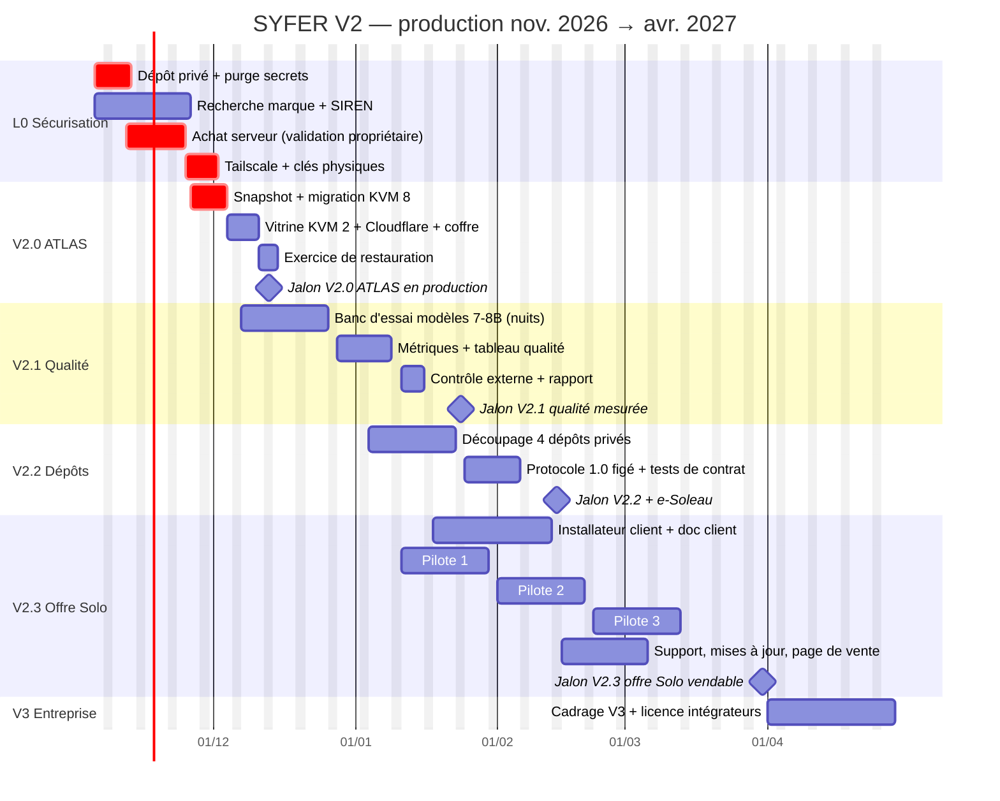
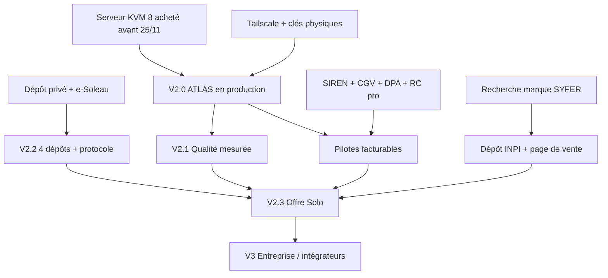

# SYFER V2 — Plan de production

> Version 1.0 · 04/11/2026 · Horizon : 6 mois (04/11/2026 → 30/04/2027) · Liés : [`business-plan.md`](business-plan.md) · [`plan-action.md`](plan-action.md)
> **[H]** = hypothèse explicite. Les durées sont des estimations à recaler après chaque jalon.

---

## 1. Point de départ (constaté le 03–04/11/2026)

| Élément | État | Conséquence pour la vente |
|---|---|---|
| SYFER V1 | En service sur Hostinger KVM 2 (2 vCPU, 8 Go) : 93 rôles, cockpit, Décideur mobile, passerelle, sauvegarde nocturne, veille cyber | Démontrable, mais serveur trop faible pour l'IA locale 7–8B |
| Kit V2 (`espacetravail-public`) | Installation en 3 commandes, MVP + version complète, tests (103 scénarios, 2 000 mini-scénarios, charge 200 %, jumeau numérique), protocole, sécurité IA | Base technique suffisante pour des pilotes |
| IA locale | qwen2.5:3b : gratuit, lent, qualité moyenne (confusion de marques constatée) | **Qualité non mesurée de façon systématique** → bloquant pour le prix plein |
| Dépôt de code | **Public** sur GitHub (URL de clonage dans le README) | Incompatible avec « tous droits réservés » → à corriger d'abord |
| Sécurité d'administration | Mot de passe SSH actif, administration exposée sur Internet | À fermer avant toute ouverture de service client |
| Serveur | **Expire le 30/11/2026**, renouvellement automatique désactivé | Échéance dure : action avant le 25/11 |
| Juridique | Aucune structure (pas de SIREN), marque non vérifiée | Impossible de facturer |

## 2. Capacité de production

| Ressource | Rôle | Capacité [H] |
|---|---|---|
| **Propriétaire** | Décide (N3), vend, valide, installe chez les pilotes, paie | ≈ 30 h/semaine, dont ≈ 10 h de production SYFER, ≈ 10 h de commercial, ≈ 5 h de validation, ≈ 5 h d'administration ; congés du 24/12 au 01/01 |
| **Claude (sessions de travail)** | Code, tests, documentation, migration, audits, rapports | ≈ 4–6 sessions/semaine ; **limité par le temps de validation du propriétaire**, pas par la vitesse d'écriture |
| **Agents SYFER** | Veille, banc d'essai de nuit, contrôles, brouillons de contenu, journal | File de nuit sur le KVM 8 : dizaines de missions/nuit (S18) ; aucune action externe sans N3 |

**Goulot principal : le temps de validation du propriétaire (≈ 5 h/semaine).** Toute tâche est donc découpée pour qu'une validation prenne moins de 15 minutes (résumé + différences + bouton accepter/refuser).

## 3. Lots et jalons

| Jalon | Contenu | Début → fin | Effort propriétaire [H] | Effort Claude/agents [H] |
|---|---|---|---|---|
| **L0 — Sécurisation et propriété** | Dépôt passé en privé, purge des secrets de l'historique, e-Soleau, Tailscale + clés physiques, achat serveur | 04/11 → 25/11/2026 | 8 h | 6 sessions |
| **V2.0 — ATLAS en production** | Snapshot, migration SYFER sur KVM 8, partitions et limites, vitrine sur KVM 2 derrière Cloudflare, coffre externe, 1ᵉʳ exercice de restauration | 23/11 → 13/12/2026 | 10 h | 10 sessions |
| **V2.1 — Qualité mesurée** | Banc d'essai des modèles 7–8B par rôle, métriques (réussite, retouches, latence, coût), tableau qualité, plafond IA payante, contrôle externe | 07/12/2026 → 24/01/2027 | 12 h | 12 sessions + nuits |
| **V2.2 — 4 dépôts privés + protocole figé** | `nexus-bridge`, `nexus-agents`, `mini-mothership` (ATLAS), `nexus-mothership` ; protocole versionné 1.0 (gel des formats de messages, niveaux N0–N3, journal) ; versionnage sémantique ; e-Soleau V2.2 | 04/01 → 14/02/2027 | 8 h | 10 sessions |
| **V2.3 — Offre Solo prête à vendre** | Installateur client, documentation client, Diagnostic ÉCHO packagé, support, mises à jour, CGV/DPA intégrés, page de vente ; **3 pilotes livrés** | 18/01 → 31/03/2027 | 40 h (dont 12 j de pilotes) | 14 sessions |
| **V3 — Entreprise (cadrage)** | Multi-utilisateurs, rôles, export d'audit, SSO, licence intégrateurs, kit partenaire | Cadrage 01/04 → 30/04/2027 ; livraison visée S2 2027 | 8 h | 6 sessions |

## 4. Calendrier (6 mois)

## 5. Dépendances

**Chemin critique** : achat serveur → migration V2.0 → qualité V2.1 → Solo V2.3. Un retard sur l'achat du serveur décale tout et, au-delà du 30/11, **coupe le service existant**.

## 6. Définition de « prêt à livrer » par produit

| Produit | Prêt à livrer quand… | Cible commerciale |
|---|---|---|
| **nexus-bridge** (passerelle Claude/ChatGPT/Gemini + mémoire partagée) | Protocole 1.0 figé ; tests de contrat verts sur les 3 connecteurs ; aucun secret en clair ; quotas et plafond de coût par fournisseur ; mode dégradé si un fournisseur tombe ; doc d'installation ≤ 2 pages | Brique incluse dans Solo ; vente séparée **non prévue** avant V3 |
| **nexus-agents** (bibliothèque d'agents) | Chaque agent a : fiche (rôle, entrées, sorties, niveau N), jeu de tests, score qualité mesuré en V2.1 ≥ seuil, exemple d'usage ; licence d'usage claire | Base des forfaits « agents sur mesure » |
| **mini-mothership / SYFER ATLAS** (kit installable) | Installation depuis zéro sur un VPS neuf réussie 3 fois de suite par une personne autre que l'auteur (ou une session Claude sans contexte) en ≤ 45 min ; restauration testée ≤ 30 min ; désinstallation propre ; 103 scénarios ≥ 98 % de réussite ; 0 faille critique ou haute ouverte ; doc client relue | **Offre Solo (palier 1)** |
| **nexus-mothership** (architecture complète / entreprise) | Multi-utilisateurs et rôles ; export d'audit ; séparation stricte des données par projet ; SSO (au moins OIDC) ; montée en charge 200 % reproduite sur la cible ; PRA écrit | V3 (S2 2027), licence intégrateurs |
| **SYFER ÉCHO** (jumeau numérique : simulation avant achat) | Modèle de rapport client ; simulation d'un processus en < 1 jour ; écart simulation/réalité mesuré sur les 3 pilotes (cible ≤ 30 % [H]) ; mention « estimation, pas engagement » | **Diagnostic ÉCHO (porte d'entrée)** |

## 7. Portes de qualité (critères de passage)

Aucun jalon n'est franchi sans **tous** ses critères verts et la **validation N3 du propriétaire** consignée au journal.

| Porte | Critères obligatoires |
|---|---|
| **→ V2.0** | Snapshot pris avant migration ; tous les services répondent après migration ; SSH par mot de passe et root distant désactivés ; administration accessible **uniquement** via Tailscale ; 2FA par clé physique sur Hostinger, GitHub, Google, Bitwarden ; sauvegarde externe chiffrée faite et **restaurée** une fois avec succès |
| **→ V2.1** | Banc d'essai sur ≥ 3 modèles 7–8B et ≥ 5 types de missions ; pour chaque rôle IA : taux de réussite, taux de retouche, latence médiane, coût ; tableau qualité publié dans le cockpit ; plafond IA payante actif et testé (coupure à 100 %) ; contrôle de sécurité externe sans faille critique |
| **→ V2.2** | 4 dépôts **privés**, aucun secret dans l'historique (scan) ; protocole 1.0 documenté et couvert par des tests de contrat ; versions sémantiques et notes de version ; e-Soleau déposée |
| **→ V2.3** | Critères ATLAS du § 6 ; CGV, licence, DPA et mention IA joints au bon de commande ; procédure de support écrite ; canal de mises à jour stable avec retour arrière testé ; **3 pilotes livrés**, dont ≥ 2 satisfaits (NPS ≥ +30) et ≥ 1 étude de cas publiable ; temps réel d'installation mesuré (cible ≤ 3 jours) |
| **→ V3 (lancement)** | ≥ 10 clients actifs ; attrition ≤ 20 % ; 1 intégrateur pilote prêt à signer ; audit des licences tierces terminé |

## 8. Packaging de l'offre Solo

| Volet | Contenu | Responsable |
|---|---|---|
| **Installation** | Vérification préalable (CPU, RAM, disque, ports, DNS) ; 3 commandes ; rapport post-installation automatique (services, sécurité, sauvegarde) ; aucun secret affiché ni journalisé | Claude (script) / Propriétaire (exécution chez le client) |
| **Documentation** | Guide client (≤ 15 pages, illustré) ; runbook d'exploitation ; FAQ ; notice de maîtrise de l'IA (AI Act art. 4) ; fiche transparence (art. 50) ; charte projet type | Claude + agents (brouillons) / Propriétaire (validation) |
| **Support** | E-mail + formulaire ; réponse J+1 ouvré (abonnés) ; incident sécurité : prise en charge le jour même ouvré ; pas de support téléphonique 24/7 (à écrire dans les CGV) | Propriétaire |
| **Mises à jour** | Canal stable mensuel ; correctifs de sécurité ≤ 72 h ; snapshot avant chaque mise à jour ; retour arrière en une commande ; notes de version en français | Claude / Propriétaire (N3) |
| **Contrat** | Bon de commande + CGV B2B + licence + DPA RGPD ; acompte 50 % ; recette écrite | Propriétaire (relecture avocat) |
| **Mesure** | Tableau qualité et coût IA visible par le client dans le cockpit | Agents SYFER |

## 9. Risques de production

| Risque | Parade |
|---|---|
| La migration KVM 8 échoue ou perd des données | Snapshot + sauvegarde externe avant ; ancien KVM 2 conservé jusqu'à validation |
| Les modèles 7–8B restent insuffisants pour certains rôles | Les marquer « IA payante recommandée » avec plafond ; réduire le périmètre promis |
| Le découpage en 4 dépôts casse l'installation | Tests de contrat du protocole avant découpage ; kit de bout en bout testé à chaque version |
| Les pilotes consomment plus de temps que prévu | Périmètre écrit (1–2 processus) ; temps mesuré ; tout ajout = forfait sur mesure |
| Surcharge du propriétaire | Validation par lots de 15 min ; report de V3 si V2.3 glisse |

---

*Ce document n'est pas un conseil financier ou juridique.*
