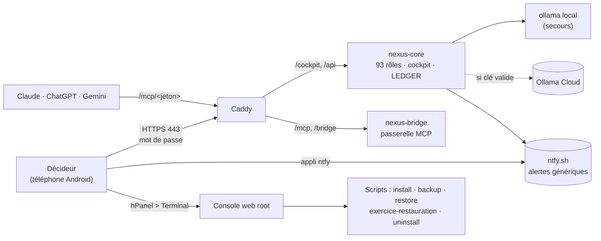

# SYFER V2 — Documentation opérationnelle (manuel d'exploitation)

> **Pour qui ?** Le Décideur, propriétaire unique de SYFER, qui exploite le serveur le plus souvent
> depuis un **téléphone Android**, par la **console web Hostinger** (hPanel > VPS > Terminal, déjà root).
> **Version du document :** 1.0 — 04/11/2026 — branche `v2` du dépôt `espacetravail-public`.

## 1. Les noms à connaître

| Nom | Ce que c'est | État au 04/11/2026 |
|---|---|---|
| **SYFER** | Le projet total : agents, cockpit, passerelle, outils de test, documentation. | — |
| **SYFER ATLAS** | La version **réelle**, installée sur le VPS Hostinger (`srvXXXX.hstgr.cloud`). | **[FAIT]** v1.0.0 en service sur KVM 2 · **[EN COURS]** V2 prête, non déployée |
| **SYFER ÉCHO** | La version **virtuelle** : le jumeau numérique (`jumeau-numerique/`) qui simule ATLAS avant tout achat. | **[FAIT]** outil prêt |
| **Décideur** | Le seul humain. Il valide les décisions N3 dans le cockpit. | — |
| **Cockpit** | `https://srvXXXX.hstgr.cloud/cockpit` et la page mobile `/cockpit/decideur`. | **[FAIT]** |

## 2. Repères de lecture

- **[FAIT]** : existe et fonctionne (code présent, testé, ou mesuré sur le VPS).
- **[EN COURS]** : le code évolue encore, ou c'est prêt mais pas encore déployé.
- **[PRÉVU]** : décidé ou recommandé, pas encore réalisé.
- `> Avis d'expert` : recommandation tranchée, avec son niveau de certitude.
- Aucun secret n'est écrit ici. Pour lire un secret : `grep NOM .env` dans `/srv/p1/nexus-mothership`.
- Aucune adresse IP n'est écrite ici. Le nom d'hôte est noté `srvXXXX.hstgr.cloud` (ancien serveur)
  et `srvYYYY.hstgr.cloud` (nouveau serveur KVM 8).

## 3. Sommaire

| Fichier | Contenu | Quand l'ouvrir |
|---|---|---|
| [01-routines.md](01-routines.md) | Routines quotidienne (5 min), hebdomadaire, mensuelle, trimestrielle | Tous les jours |
| [02-procedures.md](02-procedures.md) | 13 procédures pas à pas : commandes exactes, résultat attendu, retour arrière | Avant toute intervention |
| [03-incidents.md](03-incidents.md) | Arbre de décision et 9 fiches réflexes | Quand quelque chose ne va pas |
| [04-supervision.md](04-supervision.md) | Indicateurs, seuils, alertes, liste complète des tâches planifiées, porte de qualité | Chaque semaine |
| [05-calendrier-et-checklists.md](05-calendrier-et-checklists.md) | Calendrier et checklists imprimables | Mise en production, fin de mois, achat, vente |

Voir aussi la **documentation structurelle** : [../structurel/00-index.md](../structurel/00-index.md)
(organisation, gouvernance, mémoire, projets, produits).

## 4. Vue d'ensemble en un schéma

## 5. Les 10 règles d'or de l'exploitation

1. **Toujours** commencer par `cd /srv/p1/nexus-mothership`.
2. **Une commande à la fois** au téléphone. Attendre la fin avant la suivante.
3. **Snapshot hPanel** avant toute grosse modification (mise à jour majeure, migration, pare-feu, SSH).
4. **`bash backup.sh`** avant toute mise à jour, même petite.
5. **Jamais** de secret copié dans une IA, un e-mail, Notion ou une capture d'écran.
6. **Jamais** supprimer `LEDGER_HMAC_KEY`. **Jamais** perdre `BACKUP_PASSPHRASE` (notez-la hors du VPS).
7. Les décisions N3 se prennent **uniquement dans le cockpit**. Aucune IA, aucun script ne décide.
8. **Aucune dépense** sans votre accord explicite, coût estimé à l'appui. Claude n'achète rien.
9. La **console web hPanel** est votre accès de secours : elle marche même si SSH ou Tailscale tombent.
10. **L'absence d'une alerte attendue est une alerte** (sauvegarde, rapport cyber, exercice).

> **Avis d'expert** (certitude élevée) — Ce manuel est volontairement redondant avec le `README.md`
> du kit : le README explique *comment installer* ; ce manuel explique *comment exploiter au quotidien*.
> En cas de contradiction, **le code et le README font foi** ; signalez l'écart pour corriger ce manuel.

## 6. Points incertains connus (à vérifier sur le serveur)

| Point | Pourquoi c'est incertain | Où |
|---|---|---|
| Vérifications par `--resolve` | Le dossier ATLAS du 04/11 utilise l'adresse locale `127.0.0.1`, mais Caddy écoute sur `NEXUS_BIND_IP` (adresse publique). Ce manuel lit donc `NEXUS_BIND_IP` dans `.env`. | 02-procedures, §1 |
| Migration avec `restore.sh --avec-env` | Le `.env` restauré contient l'ancien `NEXUS_HOST` et l'ancien `NEXUS_BIND_IP`. Il faut les corriger (procédure 3). À répéter sur un serveur de test avant le jour J. | 02-procedures, §3 |
| Chemin de la veille | `veille/README.md` cite `/opt/syfer/...` ; `install.sh` utilise `/srv/p1/nexus-mothership/veille`. Ce manuel suit `install.sh`. | 02-procedures, §13 |
| Tailscale | Aucune procédure dans le dépôt. Les commandes données suivent la documentation publique de Tailscale. | 02-procedures, §7 |
