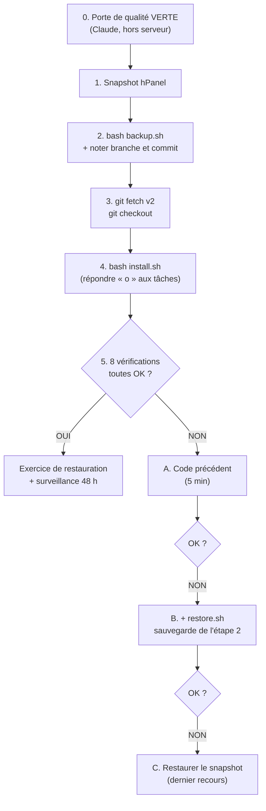
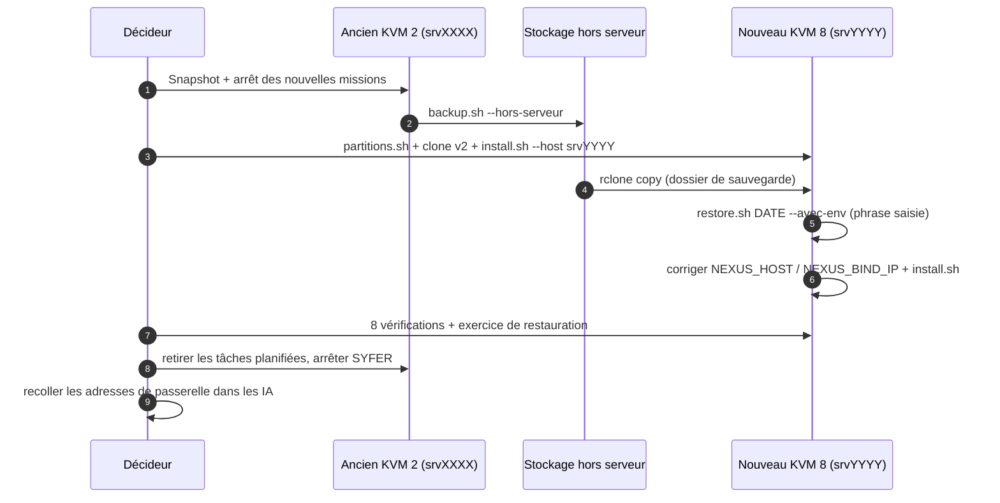
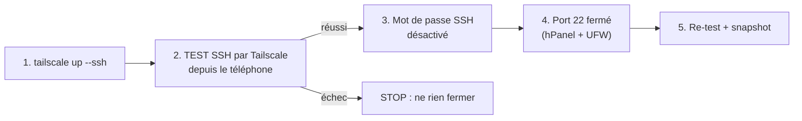

# 02 — Procédures pas à pas

> **Format de chaque procédure** : but · prérequis · étapes (commandes exactes) · résultat attendu ·
> retour arrière · durée. Toutes les commandes se tapent dans **hPanel > VPS > Terminal** (root),
> **une à la fois**, après `cd /srv/p1/nexus-mothership`.
> Astuce Android : appui long > Coller. Pour `nano` : Ctrl+O, Entrée (enregistrer), Ctrl+X (quitter).

## Sommaire

| # | Procédure | Durée | Risque |
|---|---|---|---|
| 1 | [Vérifier l'état](#1-vérifier-létat) | 2 min | nul |
| 2 | [Déployer ou mettre à jour](#2-déployer-ou-mettre-à-jour) | 10 min à 1 h | moyen |
| 3 | [Migrer vers le nouveau serveur (KVM 8)](#3-migrer-vers-le-nouveau-serveur-kvm-8) | 3 à 4 h | élevé |
| 4 | [Sauvegarder et restaurer](#4-sauvegarder-et-restaurer) | 5 à 20 min | faible à moyen |
| 5 | [Ajouter la clé Ollama Cloud (méthode fichier)](#5-ajouter-la-clé-ollama-cloud-méthode-fichier) | 5 min | faible |
| 6 | [Changer mots de passe, code Décideur, jetons](#6-changer-mots-de-passe-code-décideur-jetons) | 5 min par secret | faible |
| 7 | [Activer Tailscale et fermer le SSH public](#7-activer-tailscale-et-fermer-le-ssh-public) | 45 min | élevé |
| 8 | [Brancher Claude sur la passerelle](#8-brancher-claude-sur-la-passerelle) | 10 min | faible |
| 9 | [Purger ou effacer une donnée (RGPD)](#9-purger-ou-effacer-une-donnée-rgpd) | 10 min | moyen |
| 10 | [Ajouter un projet](#10-ajouter-un-projet) | 15 min | faible |
| 11 | [Ajouter une charte](#11-ajouter-une-charte) | 20 min | faible |
| 12 | [Ajouter une source de veille](#12-ajouter-une-source-de-veille) | 15 min | faible |

### Bloc « variables de vérification » (réutilisé plusieurs fois)

Sur le VPS lui-même, le nom d'hôte peut pointer vers une adresse locale incorrecte. On force donc
l'adresse où Caddy écoute, **lue dans `.env`** (aucune IP n'est écrite dans ce document) :

```bash
cd /srv/p1/nexus-mothership
H=$(grep '^NEXUS_HOST=' .env | cut -d= -f2)
B=$(grep '^NEXUS_BIND_IP=' .env | cut -d= -f2)
{ [ -z "$B" ] || [ "$B" = "0.0.0.0" ]; } && B=127.0.0.1
R="--resolve $H:443:$B"
echo "Hôte : $H"
```

> Ces variables disparaissent si vous fermez la console : recollez le bloc à chaque nouvelle session.

---

## 1. Vérifier l'état

**But** : savoir en 2 minutes si SYFER ATLAS va bien. **[FAIT]**

| # | Commande | Résultat attendu |
|---|---|---|
| 1 | `docker compose ps` | 4 services `running` / `healthy` en MVP (caddy, nexus-core, nexus-bridge, ollama). |
| 2 | `docker stats --no-stream` | Aucun service collé à sa limite de RAM. |
| 3 | `df -h /srv/p*` | Chaque partition sous 80 % d'utilisation. |
| 4 | `free -h` | Au moins 500 Mo disponibles. |
| 5 | `ls -t backups/ \| head -3` | Un dossier daté de **moins de 24 h**. |
| 6 | `ls /etc/cron.d/ \| grep nexus` | 6 tâches en V2 (voir [04-supervision.md](04-supervision.md)). |
| 7 | Bloc « variables » puis `curl -s $R https://$H/api/sante` | `"statut":"ok"`, `"ledger_hmac":true`, `"avertissements":[]`. |
| 8 | Intégrité du LEDGER (ci-dessous) | Réponse indiquant une chaîne valide. |

```bash
grep '^NEXUS_API_KEY=' .env | sed 's/^NEXUS_API_KEY=/X-Nexus-Key: /' \
  | curl -s $R -H @- https://$H/api/ledger/verifier
```
La clé passe par l'entrée standard : elle n'apparaît jamais dans la ligne de commande ni l'historique.

**Depuis le navigateur du téléphone** : `https://srvXXXX.hstgr.cloud/api/sante` (page publique, sans secret).

**Retour arrière** : sans objet (lecture seule).

---

## 2. Déployer ou mettre à jour

### 2A. Petite mise à jour (même version, correctifs) — 10 min **[FAIT]**

```bash
cd /srv/p1/nexus-mothership
bash backup.sh
git pull
docker compose up -d --build
```
**Résultat attendu** : `docker compose ps` tout `healthy`. Si un message dit « … manquant dans `.env` » :
`bash install.sh` (ajoute les réglages manquants, ne change aucun mot de passe).
**Retour arrière** : `git log --oneline -3`, puis `git checkout <commit précédent>` et `docker compose up -d --build`.

### 2B. Déployer une nouvelle version (exemple : passage à la V2) — 1 h **[EN COURS]**

La V2 est prête et testée sur la branche `v2`, **non déployée** au 04/11/2026.



**Étape 0 — Porte de qualité (avant de toucher au serveur)** **[EN COURS]**
Claude exécute, hors du VPS, dans une copie du dépôt :
```bash
python3 syfer-test-system/syfer_test.py porte --relancer
```
Critères bloquants (fichier `syfer-test-system/config/porte.json`) : tests unitaires verts ;
simulations ≥ 99 % ; 0 défaut critique ouvert (`iterations-100`) ; attaque simulée ≥ 95 % et 0 faux
positif bloquant ; 0 secret dans le dépôt ; banc sans baisse de plus de 5 points ; charge 200 % sans
perte de données. **Résultat attendu** : `Déploiement AUTORISÉ.` (code 0). Code 1 = refusé → **stop**.
L'intégration continue GitHub (`.github/workflows/ci.yml`) doit aussi être verte.

**Étape 1 — Snapshot** : hPanel > VPS > Snapshots > **Créer un snapshot**. Attendre la fin (≈ 5 min).
Hostinger ne garde qu'un snapshot : le nouveau remplace l'ancien.

**Étape 2 — Sauvegarde et état de départ**
```bash
cd /srv/p1/nexus-mothership
bash backup.sh && ls -t backups/ | head -1     # notez le nom du dossier créé
git branch --show-current                       # notez la branche (ex. nexus-mothership-kit)
git rev-parse --short HEAD                      # notez le commit
git status --short                              # doit être VIDE ; sinon : stop, demandez à Claude
```

**Étape 3 — Récupérer le code**
```bash
git fetch --depth 1 origin v2
git checkout -B v2 FETCH_HEAD
```

**Étape 4 — Installer**
```bash
apt-get install -y python3-yaml     # nécessaire à la veille V2
bash install.sh
```
Répondez **o** aux tâches planifiées proposées (sauvegarde, exercice, banc, attaque simulée, veille,
veille cyber). Les mots de passe existants sont **conservés**.

**Étape 5 — Les 8 vérifications** (collez d'abord le bloc « variables »)
```bash
docker compose ps                                                    # 1. tout healthy
curl -s -o /dev/null -w '%{http_code}\n' $R https://$H/cockpit       # 2. 401
curl -s -o /dev/null -w '%{http_code}\n' -X POST $R https://$H/mcp   # 3. 401
curl -sI $R https://$H/api/sante | grep -ciE 'strict-transport|x-frame|content-security'  # 4. 3
curl -s $R https://$H/api/sante                                      # 5. ledger_hmac true, avertissements []
ls /etc/cron.d/ | grep -c nexus                                      # 6. 6
bash exercice-restauration.sh                                        # 7. « Restauration testée : OK »
python3 securite-ia/attaque_simulee.py                               # 8. bouclier hors ligne, taux ≥ 95 %
```
Dans le navigateur : `/cockpit/decideur` s'ouvre après le mot de passe ; vérification LEDGER (procédure 1).

**Retour arrière (du plus léger au plus lourd)**
```bash
# A. Revenir au code précédent (5 min) — remplacez BRANCHE par celle notée à l'étape 2
git fetch --depth 1 origin BRANCHE
git checkout -B BRANCHE FETCH_HEAD
docker compose up -d --build
# B. Si les données posent problème : remettre la sauvegarde de l'étape 2
bash restore.sh NOM_DU_DOSSIER        # tapez RESTAURER
# C. Dernier recours : hPanel > Snapshots > Restaurer (efface tout ce qui suit le snapshot)
```

> **Avis d'expert** (certitude élevée) — Déployez un jour calme, téléphone chargé, avec 1 heure devant
> vous et **sans session N3 en cours**. Le retour A prend 5 minutes ; ne passez au C que si A et B
> échouent. Après un déploiement réussi, **refaites un snapshot** : c'est votre nouveau point sûr.

---

## 3. Migrer vers le nouveau serveur (KVM 8)

**But** : déplacer SYFER ATLAS du KVM 2 actuel (`srvXXXX`) vers un **KVM 8 neuf** (`srvYYYY`), puis
garder l'ancien KVM 2 comme **vitrine publique**. **[PRÉVU]** — achat avant le 25/11/2026, échéance
du KVM 2 le 30/11/2026.

**Prérequis**
- Achat validé **par vous** (budget retenu ≈ 90 € TTC/mois), prix et conservation des données confirmés dans hPanel.
- V2 déployée et stable sur l'ancien serveur depuis au moins 48 h.
- `BACKUP_PASSPHRASE` et `COCKPIT_PASSWORD` notés **hors du VPS** (`grep -E 'BACKUP_PASSPHRASE|COCKPIT_PASSWORD=' .env`).
- Copie hors serveur configurée (`rclone`, procédure 4C) **ou** Tailscale actif sur les deux serveurs (procédure 7).
- Une **répétition** faite au moins une fois (voir avis d'expert).



**Phase 1 — Ancien serveur (srvXXXX)**
```bash
cd /srv/p1/nexus-mothership
# a) Snapshot hPanel de l'ancien serveur (filet)
# b) Plus de nouvelle mission : traiter ou refuser les N3 en attente dans le cockpit
bash backup.sh --hors-serveur
ls -t backups/ | head -1          # notez le NOM du dossier (ex. 2026-11-26_101500)
```

**Phase 2 — Nouveau serveur (srvYYYY), console hPanel du nouveau VPS**
```bash
git clone -b v2 --depth 1 https://github.com/redkards/espacetravail-public /srv/p1/nexus-mothership
cd /srv/p1/nexus-mothership
bash partitions.sh --dry-run      # lire ce qui sera fait
bash partitions.sh                # ou --size 80G : taille à décider (voir avis)
cd /srv/p1/nexus-mothership
bash install.sh --email VOTRE_EMAIL --host srvYYYY.hstgr.cloud
```
Si le dépôt est passé en **privé** (prévu le 12/11), le `git clone` demandera une authentification :
demandez à Claude la méthode du moment (jeton en lecture seule saisi par vous). **[EN COURS]**

**Phase 3 — Rapatrier la sauvegarde et restaurer**
```bash
apt-get install -y rclone gnupg
rclone config                                      # même remote « gdrive » que sur l'ancien serveur
rclone copy gdrive:nexus-sauvegardes/NOM backups/NOM
sed -i '/^BACKUP_PASSPHRASE=/d' .env               # pour que restore.sh DEMANDE l'ancienne phrase
bash restore.sh NOM --avec-env                     # tapez RESTAURER, puis l'ancienne phrase (masquée)
```
Le `.env` restauré est celui de l'**ancien** serveur : il garde `LEDGER_HMAC_KEY` (journal vérifiable),
les mots de passe et les jetons. Il faut corriger le nom d'hôte et l'adresse d'écoute :
```bash
sed -i '/^NEXUS_BIND_IP=/d' .env
bash install.sh --host srvYYYY.hstgr.cloud
```

**Phase 4 — Vérifier** : les 8 vérifications de la procédure 2B, puis `/api/ledger/verifier` et la
présence de vos missions dans le cockpit. Réabonnez-vous à ntfy si `NTFY_TOPIC` a changé (normalement non).

**Phase 5 — Basculer les usages**
- Claude, ChatGPT, Gemini : `bash bridge-connecteurs.sh` sur le **nouveau** serveur, puis recoller chaque adresse (procédure 8).
- Écran d'accueil Android : supprimer l'ancien raccourci du cockpit, installer le nouveau.
- Gestionnaire de mots de passe : noter le nouveau nom d'hôte.

**Phase 6 — Neutraliser l'ancien serveur (vitrine)**
```bash
# Sur l'ANCIEN serveur, sinon il continue d'envoyer des alertes et des sauvegardes
ls /etc/cron.d/ | grep nexus
rm -i /etc/cron.d/nexus-*                       # confirmer chaque fichier par « y »
cd /srv/p1/nexus-mothership && bash uninstall.sh   # conteneurs supprimés, données GARDÉES
```
Garder les données de l'ancien serveur **14 jours**, puis réinstaller l'OS du KVM 2 pour la vitrine
(hPanel > Système d'exploitation). **[PRÉVU]**

**Retour arrière** : tant que la phase 6 n'est pas faite, l'ancien serveur est intact : relancez
`docker compose up -d` sur l'ancien serveur et oubliez le nouveau. Après la phase 6 : snapshot de l'ancien.

> **Avis d'expert** (certitude moyenne) — Trois pièges réels dans le code actuel :
> 1. `restore.sh` essaie d'abord la `BACKUP_PASSPHRASE` du `.env` **courant** : sur un serveur neuf,
>    elle est différente, d'où la suppression de la ligne avant la restauration.
> 2. Le `.env` restauré contient l'ancien `NEXUS_BIND_IP` : Caddy ne pourrait pas démarrer.
> 3. `docker-compose.yml` limite P1 à 5 Go de RAM (conçu pour le KVM 2). Pour exploiter les 32 Go du
>    KVM 8 (modèles 7–8B, 2 à 3 missions en parallèle), les limites devront être relevées dans le code :
>    **[EN COURS]**, à faire valider par la porte de qualité.
> Répétez la migration **une fois** à blanc (par exemple sur le nouveau serveur avant la bascule) :
> c'est le seul moyen de découvrir les écarts sans pression. Taille des partitions : sur 400 Go,
> 4 × 80 Go laisse une marge confortable (règle du script : espace libre ≥ 4 × taille + 10 Go).

---

## 4. Sauvegarder et restaurer

### 4A. Sauvegarder maintenant **[FAIT]**
```bash
cd /srv/p1/nexus-mothership
bash backup.sh                    # 7 dernières gardées
bash backup.sh --garder 14        # en garder 14
```
**Contenu** : `nexus-core.tar.gz` (base `nexus.db` cohérente, livrables, archive, leçons acceptées),
`nexus-bridge.tar.gz` (mémoire commune des IA), `veille.tar.gz`, `.env` **chiffré** (`env.sauvegarde.gpg`).
**Résultat attendu** : `Sauvegarde terminée : backups/AAAA-MM-JJ_HHMMSS (taille)`.

### 4B. Restaurer **[FAIT]**
```bash
bash restore.sh                          # liste les sauvegardes, la plus récente en haut
bash restore.sh 2026-11-03_033000        # tapez RESTAURER
```
Le script vérifie les archives **avant** de couper quoi que ce soit, met les données actuelles de côté
(`data/.avant-restauration-<date>/`), restaure, remet les droits, redémarre et contrôle `/api/sante`.
`--avec-env` remplace aussi `.env`.
**Retour arrière** : les anciennes données sont dans `data/.avant-restauration-<date>/` (ne rien effacer
sans Claude) ; sinon, restaurer une autre sauvegarde.

### 4C. Copie hors serveur (Google Drive, gratuit) **[PRÉVU]** pour la nuit, **[FAIT]** à la main
```bash
apt-get install -y rclone
rclone config          # n, nom gdrive, type drive, accès 1, « Use web browser » : n, suivre le lien
bash backup.sh --hors-serveur
```
Chaque nuit : `nano /etc/cron.d/nexus-mothership-sauvegarde`, ajouter ` --hors-serveur` juste après
`backup.sh`, enregistrer.

> **Avis d'expert** (certitude élevée) — Sur Drive, **seul le `.env` est chiffré** : les bases (missions,
> mémoire des IA) y sont en clair. C'est acceptable à court terme pour des données personnelles à vous,
> pas pour des données de clients. Le coffre chiffré hors Hostinger (zone 3, ≈ 3 €/mois) est la cible.

### 4D. Exercice de restauration à la main **[FAIT]** (V2)
```bash
bash exercice-restauration.sh
```
Codes : 0 réussi · 1 configuration · 2 vérification échouée · 3 P2 non montée · 4 déjà en cours.
P1 n'est jamais touchée.

---

## 5. Ajouter la clé Ollama Cloud (méthode fichier)

**But** : utiliser l'IA cloud gratuite (plus rapide que l'IA locale 3B). **[FAIT]** (outil) —
la clé actuelle est refusée : une **nouvelle clé** est à créer.

1. Sur le téléphone : `https://ollama.com/settings/keys` > *Add API key* > copier.
2. Console hPanel :
```bash
nano /root/cle-ollama.txt          # appui long > Coller, puis Ctrl+O, Entrée, Ctrl+X
cd /srv/p1/nexus-mothership
bash install.sh --cloud --cle-fichier /root/cle-ollama.txt
```
3. Répondre **o** pour effacer le fichier.

**Résultat attendu** : « clé validée », liste des modèles, `/api/sante` montre `ollama_cloud`.
Une clé refusée **ne change rien** (SYFER reste sur l'IA locale).
**Retour arrière** : `sed -i '/^OLLAMA_API_KEY=/d' .env && bash install.sh --local`.

> **Avis d'expert** (certitude élevée) — Avec Ollama Cloud, les consignes partent sur des serveurs
> tiers. Gardez le cloud pour les missions **non sensibles** ; pour le droit, les données de personnes
> ou les secrets d'affaires, préférez le local (F1) ou attendez le KVM 8 et ses modèles 7–8B.

---

## 6. Changer mots de passe, code Décideur, jetons

**Principe** : supprimer la ligne dans `.env`, relancer `bash install.sh` (qui régénère **seulement** ce
qui manque), lire la nouvelle valeur avec `grep`, la ranger dans le gestionnaire de mots de passe. **[FAIT]**

| Quoi | Commandes | Ensuite |
|---|---|---|
| Mot de passe du cockpit | `sed -i '/^COCKPIT_PASSWORD/d' .env` puis `bash install.sh` | `grep COCKPIT_PASSWORD= .env` |
| Code Décideur (6 chiffres) | `sed -i '/^COCKPIT_CODE_DECIDEUR=/d' .env` puis `bash install.sh` | affiché une seule fois à la fin ; sinon `grep COCKPIT_CODE_DECIDEUR .env` |
| Jeton d'une IA | `sed -i '/^BRIDGE_TOKEN_CLAUDE=/d' .env` (ou `_CHATGPT`, `_GEMINI`, `_PROPRIETAIRE`) puis `bash install.sh` | `bash bridge-connecteurs.sh claude`, recoller l'adresse dans l'IA |
| Clé API | `sed -i '/^NEXUS_API_KEY=/d' .env` puis `bash install.sh` | mettre à jour l'identifiant n8n « NEXUS API » (mode complet) |
| Secret interne | `sed -i '/^COCKPIT_INTERNAL=/d' .env` puis `bash install.sh` | rien |
| Sujet ntfy | `sed -i '/^NTFY_TOPIC=/d' .env` puis `bash install.sh` | `grep NTFY_TOPIC .env`, ressaisir le sujet dans l'appli ntfy |

**Ne jamais supprimer** : `LEDGER_HMAC_KEY` (le journal ne serait plus vérifiable) ; `BACKUP_PASSPHRASE`
sans l'avoir notée (les sauvegardes chiffrées deviendraient illisibles).
**Résultat attendu** : l'ancien secret ne marche plus (401), le nouveau oui.
**Retour arrière** : restaurer `.env` depuis la dernière sauvegarde (`bash restore.sh NOM --avec-env`).

---

## 7. Activer Tailscale et fermer le SSH public

**But** : plus aucun port d'administration ouvert sur Internet. SSH ne passe plus que par votre
réseau privé Tailscale. **[PRÉVU]** (échéance du plan : 14/11/2026). Le dépôt ne contient **pas** de
script pour cela : les commandes suivent la documentation publique de Tailscale (à vérifier le jour J).

**Prérequis** : snapshot hPanel ; appli **Tailscale** installée sur le téléphone, connectée à votre compte ;
console hPanel ouverte dans un autre onglet (**accès de secours**, indépendant de SSH).



**Étape 1 — Tailscale sur le serveur**
```bash
tailscale status || curl -fsSL https://tailscale.com/install.sh | sh
tailscale up --ssh
```
Ouvrez le lien affiché sur le téléphone et approuvez le serveur. `tailscale status` doit lister le
serveur et le téléphone.

**Étape 2 — Tester** depuis le téléphone (appli Termux ou un client SSH), via le **nom Tailscale** du
serveur, sans mot de passe (Tailscale SSH). **Ne continuez que si ça marche.**

**Étape 3 — Désactiver la connexion SSH par mot de passe**
```bash
printf '%s\n' 'PasswordAuthentication no' 'KbdInteractiveAuthentication no' 'PermitRootLogin prohibit-password' \
  > /etc/ssh/sshd_config.d/00-syfer.conf
sshd -t && systemctl reload ssh
sshd -T | grep -iE 'passwordauthentication|permitrootlogin'
```
Résultat attendu : `passwordauthentication no`. Le nom `00-` est voulu : dans SSH, **la première valeur
lue l'emporte**, et un fichier `50-cloud-init.conf` peut réactiver le mot de passe.

**Étape 4 — Fermer le port 22 public**
- hPanel > VPS > Sécurité > Pare-feu : supprimer la règle **22** ; garder **80** et **443**.
- UFW :
```bash
ufw status numbered
ufw allow in on tailscale0
ufw delete allow 22/tcp          # ou « ufw delete allow OpenSSH » selon la règle listée
ufw status
```

**Étape 5** : re-tester SSH par Tailscale, vérifier le cockpit (procédure 1), **nouveau snapshot**.

**Retour arrière** (depuis la console hPanel, toujours disponible)
```bash
rm /etc/ssh/sshd_config.d/00-syfer.conf && systemctl reload ssh
ufw allow 22/tcp
```
puis rouvrir 22 dans le pare-feu hPanel.

> **Avis d'expert** (certitude élevée sur le principe, moyenne sur les commandes exactes) — Ordre
> impératif : Tailscale **testé** avant de couper le mot de passe. Le **cockpit reste public** (mot de
> passe + code Décideur) : le passer derrière Tailscale casserait le renouvellement automatique du
> certificat HTTPS (Let's Encrypt a besoin du port 80 public). Cela relève du plan « 3 zones »
> (Cloudflare devant la vitrine, administration privée) : **[PRÉVU]**, à concevoir avec la migration.

---

## 8. Brancher Claude sur la passerelle

**But** : Claude lit et écrit la mémoire commune, crée des tâches, lance des missions et suit leur
statut. Il **ne peut jamais valider** une décision N3. **[FAIT]**

1. Console hPanel :
```bash
cd /srv/p1/nexus-mothership
bash bridge-connecteurs.sh claude
```
Une adresse `https://srvXXXX.hstgr.cloud/mcp/<jeton>` s'affiche. **C'est un mot de passe.** Appui long > Copier.
2. Sur le téléphone : Chrome en mode **« Version pour ordinateur »** > `claude.ai` > Paramètres >
   Connecteurs > **Ajouter un connecteur personnalisé** > nom « NEXUS Passerelle » > coller l'adresse.
3. Dans l'appli Claude Android : « + » > Connecteurs > activer « NEXUS Passerelle ».
4. Premier essai, dans Claude : *« Utilise la passerelle NEXUS : lis tes messages, puis écris en
   mémoire que la passerelle fonctionne pour toi. »*
5. Contrôle : `https://srvXXXX.hstgr.cloud/bridge` (identifiants du cockpit) montre l'écriture de Claude.

**Résultat attendu** : l'écriture apparaît dans `/bridge`, attribuée à Claude.
**Limites** : offre gratuite de Claude = 1 seul connecteur personnalisé ; les menus changent souvent de nom.
**Retour arrière** : supprimer le connecteur dans Claude ; si l'adresse a pu fuir, changer le jeton (procédure 6).

**Bonnes habitudes à donner à Claude** : début de session « lis tes messages, la dernière passation du
projet X et les tâches ouvertes » ; fin de session « écris une passation pour X ».

---

## 9. Purger ou effacer une donnée (RGPD)

**But** : répondre à une demande d'effacement (la vôtre ou celle d'une personne citée). Délai légal
de réponse : **1 mois** (RGPD art. 12.3), prolongeable dans certains cas. **[FAIT]** pour les
missions et la veille ; **[EN COURS]** pour la passerelle.

| Où est la donnée | Action | Effet |
|---|---|---|
| Une mission archivée (consigne, livrable, étapes) | Cockpit > mission > **Effacer** + motif | Effacement **en cascade** : archive (pierre tombale sans casser la chaîne), mémoire du projet, exemples, références dans les leçons, commentaire de note, étapes, fichier du livrable. Le LEDGER garde seulement « effacée le … à la demande de … ». |
| Une personne citée dans la veille | voir commande ci-dessous | Fiches contenant le texte supprimées. |
| Une fiche projet `projets/<code>.md` | corriger le fichier (via Claude, dans le dépôt), puis `docker compose restart nexus-core` | La connaissance n'est plus importée. |
| La mémoire de la passerelle (`bridge.db`) | outil `memoire_oublier` (par l'IA autrice ou votre jeton propriétaire) | **Archive**, n'efface pas : rien n'est jamais effacé dans la passerelle. Effacement définitif **non outillé** : à demander à Claude. |
| Les sauvegardes | rien à faire | Elles gardent l'ancien contenu jusqu'à leur rotation (**7 jours**, et 7 sur Drive si `--hors-serveur`). |

```bash
cd /srv/p1/nexus-mothership/veille
VEILLE_DB=../data/veille/veille.db python3 collecteur.py supprimer --texte "Prénom Nom"
```

**Tenir un registre** (une ligne par demande) : date de la demande · demandeur · données visées ·
actions faites · date de réponse · date de fin de rotation des sauvegardes.

**Retour arrière** : aucun (c'est le but). Avant un effacement important : `bash backup.sh`
**n'est pas** souhaitable (la sauvegarde recopierait la donnée) ; vérifiez plutôt deux fois la cible.

> **Avis d'expert** (certitude moyenne, ce n'est pas un avis d'avocat) — Pour vos propres données,
> la cascade du cockpit suffit. Avant de traiter des données de **clients**, il faudra : registre des
> traitements, contrat de sous-traitance (art. 28), procédure d'effacement définitif dans la passerelle
> et des sauvegardes chiffrées. Information générale, ne remplace pas l'avis d'un avocat.

---

## 10. Ajouter un projet

**But** : qu'un nouveau projet ait son code, ses services conseillés et sa mémoire. **[FAIT]**

1. **Dans le dépôt** (via Claude, recommandé) ou, à défaut, sur le serveur : `nano nexus-core/projets.yaml`.
   Ajouter un bloc **avant** `divers` (qui doit rester) :
```yaml
  - code: mon-projet            # minuscules, chiffres, tirets
    actif: false                # true = inclus dans le pilote du lundi
    nom: Mon Projet
    alias: [mon projet]         # facultatif
    description: Une phrase claire.
    services: [OPS-CORE/projets, CONTENT-ARENA/redaction]
```
2. Vérifier la syntaxe : `python3 -c "import yaml; yaml.safe_load(open('nexus-core/projets.yaml')); print('OK')"`
3. Recharger sans redémarrer (bloc « variables » d'abord) :
```bash
grep '^NEXUS_API_KEY=' .env | sed 's/^NEXUS_API_KEY=/X-Nexus-Key: /' \
  | curl -s $R -H @- "https://$H/api/projets?recharger=1" | head -c 400
```
4. Mémoire du projet (facultatif) : créer `projets/mon-projet.md` (faits durables, **aucun secret**),
   puis `docker compose restart nexus-core`.
5. Charte (facultatif, conseillé si le projet publie) : procédure 11.

**Résultat attendu** : le projet apparaît dans le cockpit et dans l'outil `projets_lister` de la passerelle.
**Retour arrière** : retirer le bloc, recharger.

> **Avis d'expert** (certitude élevée) — Modifier un fichier suivi par git **sur le serveur** provoquera
> un conflit au prochain `git pull`. Faites la modification dans le dépôt (Claude prépare, vous validez),
> puis déployez par la procédure 2A. N'utilisez l'édition sur le serveur qu'en dépannage.

---

## 11. Ajouter une charte

**But** : des règles **vérifiées par du code** avant le CHECKER (termes interdits, mentions
obligatoires, vouvoiement, mélange de marques). **[FAIT]**

1. Partir d'une charte existante : `cp nexus-core/chartes/poker-winners.yaml nexus-core/chartes/mon-projet.yaml`
2. Adapter (`nano`) les champs :
   - `projet:` le **code** du projet ;
   - `marque:` `nom` et `contexte` ;
   - `marques_interdites:` les autres marques à ne pas mélanger (`variantes`, `gravite`) ;
   - `termes_interdits:` `{terme, gravite: bloquant|avertissement, motif}` ;
   - `mentions_obligatoires:` `nom`, `types` (`publication`, `commercial`, `juridique`), `toutes` (liste de groupes d'alternatives), `gravite` ;
   - `ton:` `vouvoiement: true|false`, `gravite`.
3. Vérifier : `python3 -c "import yaml; yaml.safe_load(open('nexus-core/chartes/mon-projet.yaml')); print('OK')"`
4. Appliquer : `docker compose restart nexus-core`

Les règles de `_commun.yaml` s'appliquent à **tous** les projets (marqueurs « À COMPLÉTER » bloquants
en publication, mention juridique, « garanti à 100 % » interdit).
**Résultat attendu** : une mission de test du projet contenant un terme interdit revient à l'ANALYST avec la raison.
**Retour arrière** : supprimer le fichier ou restaurer l'ancienne version, puis redémarrer.

> **Avis d'expert** (certitude moyenne) — Une charte trop stricte bloque des livrables légitimes.
> Commencez en **avertissement**, observez deux semaines, puis passez en **bloquant**. Le **test fantôme**
> (rejeu de 5 missions avant/après, la nuit) sait comparer une charte candidate : demandez-le depuis le
> cockpit **[EN COURS]** (interface en évolution).

---

## 12. Ajouter une source de veille

**But** : enrichir la base de veille (fiches courtes, sources sérieuses). **[FAIT]**

1. Ouvrir `veille/catalogue.yaml` (dans le dépôt via Claude, recommandé), copier un bloc existant et
   l'adapter : `id`, `nom`, `domaines`, `services_syfer`, `projets`, `type`, `confiance` (A à D),
   `acces` (rss, atom, api, document, manuel), `url`, `url_flux`, `licence`, `stockage`
   (integral, extrait, metadonnees, agrege), `type_doc`, `conditions`, `donnees_personnelles`,
   `verifie`, `collecte`.
2. Valider puis tester **une seule fois** sans rien stocker :
```bash
cd /srv/p1/nexus-mothership/veille
python3 collecteur.py valider                     # « N source(s), 0 erreur(s). »
python3 collecteur.py verifier --source mon-id
python3 collecteur.py tableau                     # met à jour CATALOGUE.md
VEILLE_DB=../data/veille/veille.db python3 collecteur.py stats
```
3. La source sera lue à la prochaine collecte (toutes les 6 h, minute 17).

**Règles** : respect de robots.txt et des CGU ; au moins 2 s entre deux requêtes vers un même site ;
le stockage effectif est **toujours le plus restrictif** entre la demande et la licence ; aucune source
payante sans votre accord sur le coût ; pas de profils de personnes.
**Retour arrière** : passer `collecte: non` (avec `raison`) ou retirer le bloc.
