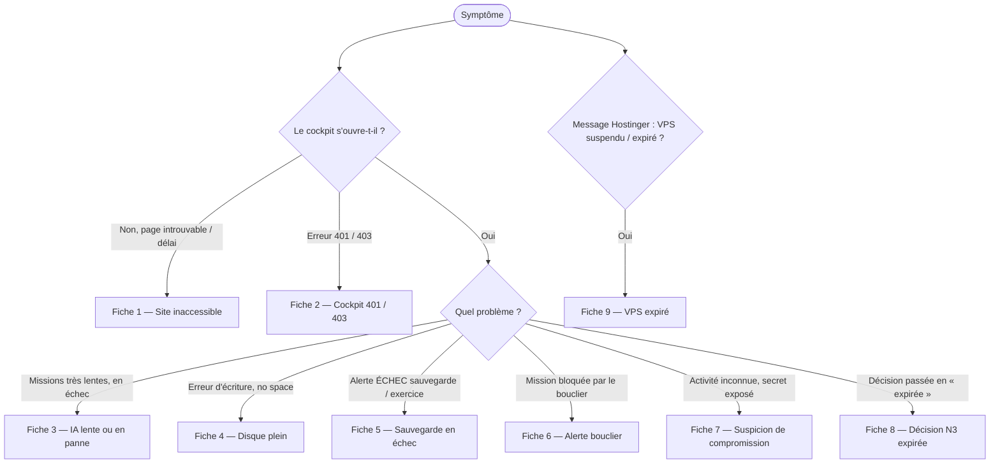
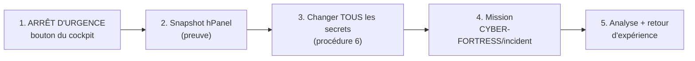

# 03 — Incidents : arbre de décision et fiches réflexes

> **Trois réflexes avant tout** : 1) **ne rien supprimer** ; 2) **noter l'heure et le message exact**
> (capture d'écran **sans secret**) ; 3) suivre la fiche du symptôme.
> La console web hPanel reste l'accès de secours : elle ne dépend ni de SSH, ni de Tailscale, ni du cockpit.

## 1. Échelle de gravité

| Gravité | Définition | Délai d'action | Exemple |
|---|---|---|---|
| **G1 — Critique** | Risque de perte de données, de fuite ou d'action non voulue | **Immédiat** | Suspicion de compromission, VPS expiré |
| **G2 — Élevée** | SYFER inutilisable, aucune perte en cours | Dans l'heure | Site inaccessible, disque plein |
| **G3 — Moyenne** | Fonction dégradée, contournement possible | Dans la journée | IA lente, sauvegarde en échec une nuit |
| **G4 — Faible** | Gêne, sans conséquence | À la prochaine routine | Décision N3 expirée sans enjeu |

## 2. Arbre de décision



## 3. Qui prévenir

| Qui | Quand | Comment |
|---|---|---|
| **Vous (Décideur)** | Toujours | Vous êtes le seul à décider. |
| **Claude** (session de travail) | Pour diagnostiquer, préparer une correction | Copier le **message d'erreur** et la sortie des commandes, **jamais** le `.env` ni un secret. |
| **Support Hostinger** | Panne matérielle, réseau, facturation, VPS suspendu | hPanel > Aide (chat). |
| **Bêta-testeurs d'un projet** | Si un site public d'un projet est touché | Message court et factuel, après stabilisation. |
| **CNIL** | Violation de données personnelles **de tiers** présentant un risque | Notification sous **72 h** (RGPD art. 33) ; mission `CYBER-FORTRESS/incident` pour préparer, vous décidez. |
| **CERT-FR / ANSSI** | Incident significatif (signalement volontaire pour un particulier) | Site cert.ssi.gouv.fr. |

> Information générale, ne remplace pas l'avis d'un avocat.

---

## 4. Fiches réflexes

### Fiche 1 — Site inaccessible · **G2**

**Signes** : le navigateur affiche « délai dépassé », « introuvable » ou une erreur de certificat.

| Étape | Commande / action | Si… |
|---|---|---|
| 1 | hPanel : le VPS est-il **en marche** ? | Arrêté → Démarrer. Suspendu → Fiche 9. |
| 2 | `cd /srv/p1/nexus-mothership && docker compose ps` | Un service arrêté → `docker compose logs --tail=50 NOM` puis `docker compose up -d`. |
| 3 | `df -h /srv/p*` | Partition absente → `mount -a && systemctl start docker`. |
| 4 | `systemctl status docker --no-pager` | Docker arrêté → `journalctl -u docker --no-pager | tail -30`. |
| 5 | hPanel > Sécurité > Pare-feu | 80 et 443 doivent être ouverts. |
| 6 | Erreur de certificat juste après une installation | Attendre 2 min ; `docker compose logs caddy --tail=50`. |

**Résolu quand** : `/api/sante` répond `"statut":"ok"`.

### Fiche 2 — Cockpit 401 / 403 · **G3**

| Code | Cause probable | Action |
|---|---|---|
| **401** au premier chargement | **Normal** : le navigateur demande le mot de passe. | Saisir `decideur` + mot de passe (`grep COCKPIT_PASSWORD= .env`). |
| **401** en boucle | Mot de passe changé ou mal recopié. | Relire `grep COCKPIT_PASSWORD= .env` ; vider les identifiants enregistrés dans Chrome. |
| **403** « Cockpit verrouillé : COCKPIT_INTERNAL… » | Secret interne absent ou différent entre Caddy et nexus-core. | `bash install.sh` (ajoute le secret manquant), puis `docker compose up -d`. |
| **403** sur une action (Valider…) | Contrôle anti-falsification (origine de la page) ou **code Décideur** refusé. | Recharger la page depuis l'adresse officielle ; vérifier le code. Après **5 erreurs** : verrou de **15 min**, attendre. |
| **409** « Confirmation requise ou expirée » | La confirmation en deux temps a expiré (2 min). | Appuyer de nouveau sur l'action. |

> **Avis d'expert** (certitude élevée) — Un 403 n'est **jamais** une raison de baisser la sécurité
> (ne passez pas `NEXUS_API_PEUT_DECIDER` à 1, ne retirez pas le code). C'est la protection qui marche.

### Fiche 3 — IA lente ou en panne · **G3**

**Signes** : missions qui durent, statut `plafond_atteint` ou `echouee`, `/api/sante` sans `ollama_cloud`.

| Étape | Commande / action | Lecture |
|---|---|---|
| 1 | `curl -s $R https://$H/api/sante` (bloc « variables », procédure 1) | Champ `llm` : fournisseur actif et repli. |
| 2 | `docker stats --no-stream` | `ollama` près de sa limite de RAM → modèle trop gros pour le KVM 2. |
| 3 | `docker compose logs --tail=50 nexus-core` | « clé refusée », « 429 », « timeout ». |
| 4 | Clé Ollama refusée | Procédure 5 (nouvelle clé). SYFER bascule seul sur l'IA locale en attendant. |
| 5 | IA locale seule | **Normal** : 10 à 60 s par étape sur 2 vCPU. Préférer F1 pour l'urgent ; regrouper les missions la nuit. |
| 6 | `plafond_atteint` | Livrable partiel gardé : relancer au niveau F supérieur depuis le cockpit. |

### Fiche 4 — Disque plein · **G2**

```bash
df -h / /srv/p*                                  # quelle partition ?
du -sh /srv/p1/nexus-mothership/* | sort -h | tail -8
docker system df                                 # images, conteneurs, cache
```
| Cause | Action (avec votre accord) |
|---|---|
| Anciennes images Docker (le dossier ATLAS en relevait 8,5 Go récupérables) | `docker image prune` (supprime seulement les images **non utilisées**) |
| Trop de sauvegardes | `bash backup.sh --garder 5` à la prochaine sauvegarde (la rotation fait le ménage) |
| Journaux | Déjà limités à 3 × 10 Mo par service ; vérifier `/var/log/nexus-securite-ia.log` |
| Base de veille | `cd veille && VEILLE_DB=../data/veille/veille.db python3 collecteur.py purger` |

**Jamais** : `rm -rf` dans `data/` ou `backups/`. Une partition P1 pleine ne déborde pas sur le reste du
VPS (taille fixe) : c'est voulu.

### Fiche 5 — Sauvegarde en échec · **G3** (G2 si 2 nuits de suite)

**Signes** : alerte « ÉCHEC exercice de restauration », ou aucune sauvegarde de moins de 24 h.

```bash
cd /srv/p1/nexus-mothership
ls -t backups/ | head -3
tail -n 30 backups/backup.log
tail -n 30 backups/exercice-restauration.log
bash backup.sh                                   # relancer à la main et lire le message
```
| Message | Action |
|---|---|
| « gpg absent » / `.env` non chiffré | `apt-get install -y gnupg` puis `bash install.sh` |
| « rclone… remote n'existe pas » | `rclone config` (procédure 4C) |
| Exercice code **3** | P2 non montée : `mount -a`, `df -h /srv/p2` |
| Exercice code **2** | Une vérification a échoué : rapport dans `backups/exercices/`, le transmettre à Claude |

> **Avis d'expert** (certitude élevée) — Aucune alerte n'est encore envoyée quand la **sauvegarde de
> nuit** échoue (seul l'exercice mensuel alerte) : **[PRÉVU]** pour une version suivante. D'ici là, le
> contrôle « sauvegarde de moins de 24 h » de la routine est votre seule sentinelle.

### Fiche 6 — Alerte bouclier (injection) · **G3** (G1 si un secret est sorti)

**Signes** : mission relevée en **N2** ou bloquée avec la mention d'une tentative d'injection ; rapport
mensuel d'attaque simulée sous 95 %.

1. Ouvrir la mission : d'où vient le texte (veille, document fourni, mémoire, consigne) ?
2. **Ne pas valider** le livrable concerné. Refuser avec le motif « contenu suspect ».
3. Si la source est une fiche de veille : passer la source en `collecte: non` (procédure 12).
4. Si c'est la mémoire de la passerelle : identifier l'IA autrice dans `/bridge`, archiver l'entrée.
5. Si un **secret** apparaît dans un livrable : Fiche 7.
6. Ajouter le cas au corpus `securite-ia/corpus.json` (via Claude) pour l'attaque simulée suivante.

### Fiche 7 — Suspicion de compromission · **G1**

**Signes** : connexions inconnues, missions que vous n'avez pas lancées, secret vu dans une capture,
un livrable ou une conversation, téléphone perdu.


1. **Arrêt d'urgence** dans le cockpit (toute la grille). Les missions passent en `suspendue`.
2. **Snapshot** hPanel : il fige l'état pour l'analyse.
3. **Rotation** : mot de passe du cockpit, code Décideur, 4 jetons de passerelle, clé API, secret
   interne, sujet ntfy, clé Ollama (sur ollama.com), mot de passe hPanel et compte Hostinger (2FA).
4. Vérifier le journal : `/api/ledger/verifier` (procédure 1) et `docker compose logs --since 24h caddy | tail -100`.
5. Lancer une mission `CYBER-FORTRESS/incident` (qualification, confinement, éradication, reprise).
   Les agents **proposent** ; toute action sur la production revient en **N3**.
6. Données personnelles de tiers touchées ? → évaluer la notification CNIL (72 h).
7. Lever l'arrêt d'urgence **seulement** après la rotation et la vérification du LEDGER.

### Fiche 8 — Décision N3 expirée · **G4**

**Règle** : sans réponse sous **24 h** (`N3_TIMEOUT_HOURS`), la décision passe en `expiree` = **refus
par défaut** (contrôle toutes les 10 min). Rien n'a été exécuté. Plafond : **15 N3 par jour** (`N3_DAILY_CAP`),
au-delà les fiches sont mises en file.

| Situation | Action |
|---|---|
| La décision était utile | Relancer la mission depuis le cockpit (nouvelle décision). |
| Elles expirent souvent | Respecter les sessions 12 h 30 / 19 h ; vérifier l'abonnement ntfy ; réduire les missions cochées au pilote du lundi. |
| Plan de la semaine expiré | Aucune mission de la semaine n'est partie : relancer celles qui comptent à la main. |

### Fiche 9 — VPS expiré ou suspendu · **G1**

**Contexte** : le KVM 2 actuel expire le **30/11/2026**, renouvellement automatique **désactivé**.
Délai de grâce après expiration : **à confirmer** auprès d'Hostinger, ne pas compter dessus.

| Moment | Action |
|---|---|
| **Avant** (prévention) | Achat avant le 25/11 ; migration (procédure 3) ; copie hors serveur à jour (procédure 4C). |
| VPS **suspendu** | hPanel > Facturation : régler ou renouveler ; puis Fiche 1. |
| VPS **supprimé** | VPS neuf → `partitions.sh` → `install.sh` → rapatrier la dernière sauvegarde hors serveur → `restore.sh NOM --avec-env` (procédure 3, phases 2 à 5). Sans copie hors serveur : **perte totale**. |

> **Avis d'expert** (certitude élevée) — C'est le seul incident qui **ne se rattrape pas** s'il n'a
> pas été préparé. Mettez un rappel téléphone au **20/11** et au **25/11**.

## 5. Après chaque incident (retour d'expérience, 10 minutes)

1. Que s'est-il passé, quand, comment l'avez-vous vu ?
2. Qu'est-ce qui a marché ? Qu'est-ce qui a manqué (alerte, procédure, accès) ?
3. Une action corrective, un responsable, une date.
4. Écrire le résumé (bref) dans le QG Notion et, si utile, une mission `CYBER-FORTRESS/incident` pour formaliser.
