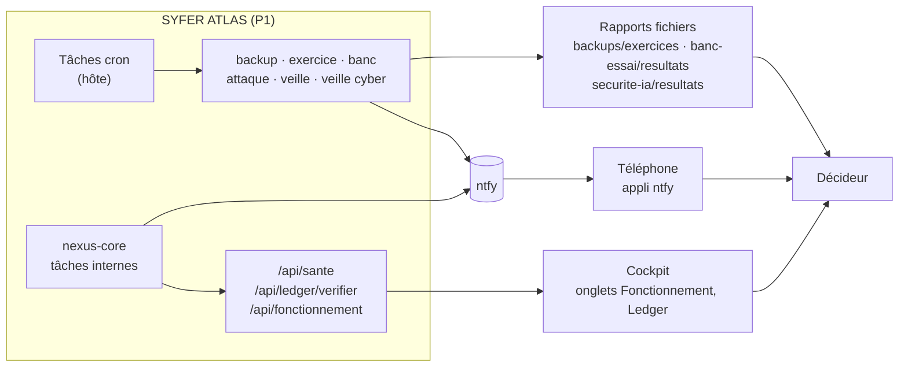

# 04 — Supervision : indicateurs, seuils, alertes, tâches planifiées

> **Principe** : SYFER prévient par **ntfy** (texte toujours générique, aucun détail métier ni secret).
> Les détails se lisent dans le cockpit. Les seuils marqués **(proposé)** sont des recommandations de ce
> manuel, pas encore codées.

## 1. Chaîne de supervision



## 2. Indicateurs et seuils

### 2.1 Santé technique

| Indicateur | Où le lire | Normal | Alerte (proposé) | Critique (proposé) |
|---|---|---|---|---|
| Services Docker | `docker compose ps` | tous `healthy` | 1 `unhealthy` > 10 min | 1 service arrêté |
| `/api/sante` → `statut` | navigateur ou `curl` | `ok` | — | pas de réponse |
| `/api/sante` → `ledger_hmac` | idem | `true` | — | `false` (journal non signé) |
| `/api/sante` → `avertissements` | idem | liste vide | 1 avertissement | — |
| Intégrité LEDGER | `/api/ledger/verifier` | chaîne valide | — | chaîne cassée → Fiche 7 |
| Intégrité archive | `/api/archive/verifier` (clé API) | chaîne valide | — | chaîne cassée |
| Disque des partitions | `df -h /srv/p*` | < 70 % | ≥ 80 % | ≥ 90 % |
| RAM du serveur | `free -h` | > 1 Go disponible | < 500 Mo | < 200 Mo |
| RAM par service | `docker stats --no-stream` | < 80 % de la limite | ≥ 90 % | tué par manque de mémoire |
| Certificat HTTPS | navigateur (cadenas) | valide | < 15 jours | expiré |

### 2.2 Continuité

| Indicateur | Où | Normal | Alerte |
|---|---|---|---|
| Âge de la dernière sauvegarde | `ls -t backups/ \| head -1` | < 24 h | ≥ 26 h (proposé) |
| Copie hors serveur | `rclone lsf gdrive:nexus-sauvegardes \| tail -1` | < 24 h | ≥ 48 h |
| Exercice de restauration | alerte ntfy du 1er dimanche | « OK » | « ÉCHEC » ou **aucune alerte** |
| Snapshot hPanel | hPanel > Snapshots | < 30 jours, et après chaque déploiement | > 30 jours |
| Échéance du VPS | hPanel > Facturation | > 30 jours | ≤ 10 jours |

### 2.3 Activité et décisions

| Indicateur | Où | Normal | Alerte |
|---|---|---|---|
| N3 en attente | `/cockpit/decideur` | traitées à chaque session | > 5 en attente |
| N3 du jour | cockpit | < 15 (`N3_DAILY_CAP`) | plafond atteint (fiches en file) |
| Décisions expirées par semaine | cockpit / bilan | 0 à 1 | ≥ 3 (proposé) |
| Missions `echouee` | bilan du jour | 0 | ≥ 2 par jour |
| Missions `plafond_atteint` | cockpit | rares | > 20 % des missions |
| Missions en file (`en_attente_place`) | cockpit | 0 à 2 | > 5 |
| Export QG en échec | cockpit (statut « echec ») | 0 | ≥ 1 (10 tentatives épuisées) |

### 2.4 Qualité et sécurité de l'IA

| Indicateur | Où | Normal | Alerte |
|---|---|---|---|
| Note livrable du banc (sur 100) | `banc-essai/tableau.html` | stable | baisse > 5 points vs semaine précédente |
| Note système du banc (routage + niveau N) | idem | stable | baisse > 5 points |
| Pièges du banc | idem | tous réussis | 1 échec |
| Attaque simulée — taux de blocage | `securite-ia/resultats/AAAA-MM.md` | ≥ 95 % | < 95 % |
| Attaque simulée — faux positifs bloquants | idem | 0 | ≥ 1 |
| Canari (secret factice) | idem | jamais ressorti | ressorti → Fiche 7 |
| Leçon suspendue automatiquement | cockpit (Leçons) | rare | baisse de qualité > 10 points |

### 2.5 Coûts

| Indicateur | Où | Normal | Alerte |
|---|---|---|---|
| Dépense IA du mois | onglet *Fonctionnement* (€ par niveau F) | 0 € (budget 0) | toute dépense non validée |
| Budget mensuel IA | `grep BUDGET_MONTHLY_EUR .env` | 0 aujourd'hui ; 30 € après achat (prévu) | valeur changée sans décision |
| Tokens Ollama Cloud | ollama.com/settings/usage | sous la limite gratuite | refus 429 fréquents |
| Facture Hostinger | hPanel > Facturation | conforme au devis | écart |

## 3. Alertes ntfy (texte générique)

| Alerte | Émetteur | Quand | Réaction |
|---|---|---|---|
| « NEXUS : decisions en attente » | nexus-core (Décideur) | sessions 12 h 30 et 19 h ; immédiat si expiration < 4 h | Ouvrir `/cockpit/decideur` |
| Rappel avant refus automatique | nexus-core | 2 h avant expiration | Décider ou laisser expirer |
| Résumé quotidien | nexus-core | 19 h (`NEXUS_RESUME_QUOTIDIEN`) | Lecture rapide |
| « Lecons de la semaine : N a examiner » | nexus-core | lundi dès 8 h, si des leçons sont proposées | Carte Leçons |
| Plan de la semaine | nexus-core (pilote) | lundi 7 h 30 | Cocher, valider |
| « Rapport cyber hebdo prêt » | `veille-cyber.sh` | dimanche après 3 h 17 | Lire les 2 missions |
| « Restauration testée : OK » / « ÉCHEC exercice de restauration » | `exercice-restauration.sh` | 1er dimanche après 4 h 47 | Fiche 5 si ÉCHEC |

> **Avis d'expert** (certitude élevée) — En MVP, ntfy passe par le service public **ntfy.sh** : toute
> personne qui connaît le sujet peut lire les alertes. Le texte reste générique, mais **gardez le sujet
> secret** et changez-le à la moindre fuite (procédure 6).

## 4. Liste complète des tâches planifiées

### 4.1 Tâches de l'hôte (`/etc/cron.d/`, proposées par `install.sh`, heure du serveur)

| Fichier | Planification cron | En clair | Script | Journal / rapport | État |
|---|---|---|---|---|---|
| `nexus-mothership-sauvegarde` | `30 3 * * *` | chaque nuit 3 h 30 | `backup.sh` | `backups/backup.log` | **[FAIT]** installée (V1) |
| `nexus-veille-cyber` | `17 3 * * 0` | dimanche 3 h 17 | `automatisations/veille-cyber.sh` | missions du projet `nexus` | **[FAIT]** installée (V1) |
| `nexus-banc-hebdo` | `17 4 * * 0` | dimanche 4 h 17 | `banc-essai/hebdo.sh` | `banc-essai/resultats/hebdo.log`, `tableau.json` | **[EN COURS]** à activer avec la V2 |
| `nexus-exercice-restauration` | `47 4 1-7 * *` + test « dimanche » | 1er dimanche 4 h 47 | `exercice-restauration.sh` | `backups/exercices/`, `backups/exercice-restauration.log` | **[EN COURS]** à activer avec la V2 |
| `nexus-attaque-simulee` | `17 5 8-14 * *` + test « dimanche » | 2e dimanche 5 h 17 | `securite-ia/attaque_simulee.py --mode complet` | `securite-ia/resultats/`, `/var/log/nexus-securite-ia.log` | **[EN COURS]** à activer avec la V2 |
| `nexus-veille` | `17 */6 * * *` | 0 h 17, 6 h 17, 12 h 17, 18 h 17 | `veille/collecteur.py collecter` | `veille/journal/cron.log` | **[EN COURS]** à activer avec la V2 |
| *(non proposée)* | `43 3 * * 1` | lundi 3 h 43 | `veille/documents/ingestion.py` | `veille/journal/cron.log` | **[PRÉVU]** décrite dans `veille/README.md`, à ajouter à la main |

Pourquoi « jours 1-7 + test du dimanche » ? En cron, renseigner **à la fois** le jour du mois et le jour
de la semaine signifie « l'un **ou** l'autre ». Le script vérifie donc lui-même que c'est dimanche.

Retirer une tâche : `rm /etc/cron.d/NOM` (ou `bash uninstall.sh --purge`, qui retire tout).

### 4.2 Tâches internes de nexus-core (heure de Paris)

| Fréquence | Tâche | Réglage |
|---|---|---|
| Chaque minute | Sessions N3 (12 h 30, 19 h), notification immédiate si expiration < 4 h, rappel 2 h avant refus | `NEXUS_SESSIONS_N3=12:30,19:00` |
| Chaque minute | Pilote hebdomadaire (lundi 7 h 30) | `NEXUS_PILOTE_HEBDO=07:30` (`off` pour arrêter) |
| Chaque minute | Revue des leçons (lundi dès 8 h, une fois par semaine) | — |
| Chaque minute | Résumé quotidien (19 h) | `NEXUS_RESUME_QUOTIDIEN=19:00` |
| Chaque minute | Tests fantômes, dans la fenêtre de nuit | `NEXUS_FENETRE_NUIT=01:00-06:00`, `NEXUS_FANTOME_K=5` |
| Chaque minute | Export QG (envois en attente, reprise 1, 2, 4… min, max 6 h, 10 essais) | `NEXUS_WEBHOOK_QG` (vide = désactivé) |
| Toutes les 10 min | Expiration des N3 (> 24 h = refus), reprise de la file N3, contrôle de régression des leçons | `N3_TIMEOUT_HOURS=24`, `N3_DAILY_CAP=15`, `NEXUS_LECONS_BAISSE=10` |

### 4.3 Workflows n8n (mode complet seulement, **désactivés** par défaut)

| Workflow | Heure | Rôle |
|---|---|---|
| NEXUS — Veille quotidienne | 8 h | crée une mission `R&D-PARADOX/veille` (à compléter avant activation) |
| NEXUS — Rapport du soir | 19 h | lit les décisions en attente et envoie un récapitulatif (lecture seule) |
| NEXUS — Mission par webhook | à la demande | crée une mission |

### 4.4 Le dimanche matin, vue d'ensemble

```mermaid
gantt
    title Dimanche (exemple : 1er dimanche du mois)
    dateFormat HH:mm
    axisFormat %H:%M
    Veille sources       :00:17, 10m
    Fantômes (fenêtre)   :01:00, 300m
    Veille cyber F3      :03:17, 45m
    Sauvegarde           :03:30, 15m
    Banc d'essai         :04:17, 60m
    Exercice restauration:04:47, 20m
    Veille sources       :06:17, 10m
```



> **Avis d'expert** (certitude moyenne) — L'enchaînement est bien étalé, mais sur le **KVM 2** le banc
> (IA locale) peut encore tourner à 4 h 47 pendant l'exercice de restauration et les tests fantômes :
> la RAM devient juste. Sur le KVM 8, aucun souci. Vérifiez chaque **lundi matin** que les alertes
> attendues sont arrivées : **l'absence d'alerte est une alerte**.

## 5. Tableau de bord qualité (porte de qualité)

La **porte de qualité** décide si une version peut partir sur le VPS. **[EN COURS]** : le fichier de
critères existe (`syfer-test-system/config/porte.json`), la commande aussi, son usage systématique est
à installer dans la routine de déploiement.

| Critère (bloquant) | Seuil | Source |
|---|---|---|
| Tests unitaires | 100 % verts | pytest (noyau, passerelle, veille…) |
| Simulations | ≥ 99 % | `simulations/` |
| Défauts critiques ouverts | 0 | `iterations-100/` |
| Attaque simulée | ≥ 95 % et 0 faux positif bloquant | `securite-ia/` |
| Secrets dans le dépôt | 0 | analyse statique |
| Banc d'essai | pas de baisse > 5 points vs dernier passage | `banc-essai/` |
| Charge 200 % | aucune perte de données | `charge-200/` |

```bash
python3 syfer-test-system/syfer_test.py porte             # verdict sur le dernier passage
python3 syfer-test-system/syfer_test.py porte --relancer  # relance « tout » puis évalue
python3 syfer-test-system/syfer_test.py rapport           # rapport PDF
```
Codes : 0 = déploiement autorisé · 1 = refusé · 3 = aucun passage disponible.
Un critère sans preuve compte comme **bloquant** (« pas de preuve = pas de déploiement »).

**Profils de version testés** (`syfer-test-system/versions/`) :

| Code | Nom | Résumé | Coût cible |
|---|---|---|---|
| A | Éco | KVM 2, modèle local 3B, 30 rôles essentiels | ≈ 10 €/mois |
| B | Local Pro | KVM 8, modèles locaux 7–8B, contrôleur différent, 93 rôles, 0 € d'IA | ≈ 26 €/mois |
| C | Hybride | B + IA payante plafonnée (F4) à 30 €/mois | ≈ 56 €/mois |
| D | Forteresse | 3 zones, administration par Tailscale, F3 minimum partout | ≈ 26 €/mois |
| E | Autonome Max | KVM 8 + vitrine, IA payante ≤ 80 €/mois, pilote, veille et mémoire actifs | ≈ 115 €/mois |

> **Avis d'expert** (certitude moyenne) — Le budget retenu (≈ 90 € TTC/mois, configuration complète)
> correspond à **C + zones de D** (vitrine séparée, coffre externe). Faites tourner la porte avec le
> profil **C** avant la migration, puis comparez avec SYFER ÉCHO : si les deux concordent, achetez.
