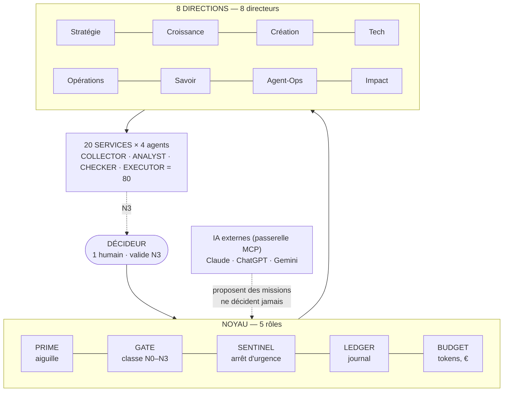

# SYFER V2 — Documentation structurelle (organisation et gouvernance)

> **Pour qui ?** Le Décideur, et toute personne (ou IA) qui doit comprendre **comment SYFER est
> organisé, qui décide quoi, et comment il apprend**, sans lire le code.
> **Version du document :** 1.0 — 04/11/2026 — branche `v2`. Schémas en Mermaid (affichés par GitHub).

## 1. SYFER en une phrase

**Une organisation d'agents IA en directions et services, où un seul humain — le Décideur — valide
tout ce qui engage, et où chaque action est tracée dans un journal infalsifiable.**

## 2. Sommaire

| Fichier | Question à laquelle il répond |
|---|---|
| [01-organisation.md](01-organisation.md) | Qui fait quoi ? Organigramme, 8 directions, 12 départements, 20 services, 93 rôles ; cible 246. |
| [02-gouvernance-decisions.md](02-gouvernance-decisions.md) | Qui décide ? Matrice RACI, niveaux N0–N3, règles par domaine, plafonds, interdits. |
| [03-fonctionnement-F1-F4.md](03-fonctionnement-F1-F4.md) | Avec quel effort ? Niveaux F1 à F4, coûts, délais, planchers. |
| [04-memoire-et-apprentissage.md](04-memoire-et-apprentissage.md) | Comment SYFER apprend-il sans dériver ? Archive, leçons, test fantôme. |
| [05-projets.md](05-projets.md) | Pour quels projets ? Registre, services conseillés, chartes. |
| [06-produits-et-versions.md](06-produits-et-versions.md) | Que livre-t-on ? SYFER, ATLAS, ÉCHO, 4 produits, versions SemVer. |

Voir aussi la **documentation opérationnelle** : [../operationnel/00-index.md](../operationnel/00-index.md).

## 3. Repères

- **[FAIT]** existe et fonctionne · **[EN COURS]** code en évolution ou non déployé · **[PRÉVU]** décidé, pas réalisé.
- Les **chiffres** viennent des fichiers du dépôt (`nexus-core/agents/*.yaml`, `projets.yaml`,
  `fonctionnement.yaml`, `chartes/`, `app/*.py`) au 04/11/2026. Si le code change, le code fait foi.
- `> Avis d'expert` : recommandation tranchée, avec son niveau de certitude.

## 4. Vue d'ensemble

## 5. Les cinq principes de gouvernance

1. **Un seul humain décide** de ce qui engage (argent, envoi, publication, contrat, production, données sensibles).
2. **Le code classe, l'IA conseille** : le GATE classe par règles ; l'avis d'une IA peut **monter** un niveau, jamais le **baisser**.
3. **Rien ne sort seul** : l'EXECUTOR n'effectue **aucune** action externe ; il enregistre et prépare.
4. **Tout est tracé** : LEDGER chaîné et signé (HMAC), archive chaînée, aucun effacement silencieux.
5. **Gratuit par défaut** : budget IA à 0 € ; toute dépense est une décision N3 avec coût estimé.
