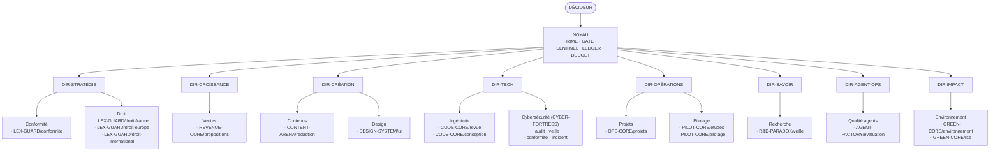
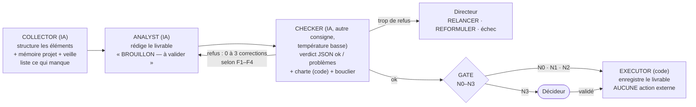

# 01 — Organisation : directions, départements, services, rôles

> Source : les 93 fiches `nexus-core/agents/*.yaml` (un fichier par rôle), lues le 04/11/2026. **[FAIT]**

## 1. Le compte exact des rôles

| Niveau | Nombre | Détail | Appelle l'IA ? |
|---|---|---|---|
| Décideur | **1 humain** | Vous. Valide les décisions N3 dans le cockpit. | — |
| Noyau | **5** | NEXUS-PRIME, NEXUS-GATE, NEXUS-SENTINEL, NEXUS-LEDGER, NEXUS-BUDGET | PRIME (seulement en cas d'égalité de routage) et GATE (avis consultatif) ; SENTINEL, LEDGER, BUDGET : **non** |
| Directeurs | **8** | DIR-STRATEGIE, DIR-CROISSANCE, DIR-CREATION, DIR-TECH, DIR-OPERATIONS, DIR-SAVOIR, DIR-AGENTOPS, DIR-IMPACT | oui, lors d'une escalade |
| Directions | **8** (+ le noyau = 9) | Stratégie, Croissance, Création, Tech, Opérations, Savoir, Agent-Ops, Impact | — |
| Départements | **12** | Conformité, Droit, Ventes, Contenus, Design, Ingénierie, Cybersécurité, Projets, Pilotage, Recherche, Qualité agents, Environnement | — |
| Services | **20** | voir §4 | — |
| Agents de service | **80** | 20 services × 4 (COLLECTOR, ANALYST, CHECKER, EXECUTOR) | COLLECTOR, ANALYST, CHECKER : **oui** (60) ; EXECUTOR : **non** (20) |
| **Total des rôles** | **93** | 5 + 8 + 80 | 23 rôles déterministes (20 EXECUTOR + SENTINEL, LEDGER, BUDGET) |

## 2. Organigramme

## 3. Le quadrant d'un service

Chaque service a **4 agents**, toujours dans le même ordre :

| Rôle | Fait | Ne fait jamais |
|---|---|---|
| **COLLECTOR** | Rassemble et structure les éléments ; signale ce qui manque. | Pas d'accès Web direct ; n'invente rien. |
| **ANALYST** | Produit le brouillon ; corrige tous les problèmes signalés. | N'envoie, ne publie, ne signe rien. |
| **CHECKER** | Vérifie (consigne différente) et rend `{ok, problemes}`. | Ne réécrit pas le livrable. |
| **EXECUTOR** | Enregistre le livrable (base + fichier `livrables/<id>.md`), prépare l'action pour un humain. | **Aucune** action externe. |
| **Directeur** | Reçoit les escalades N2 de sa direction ; décide RELANCER (une fois), REFORMULER ou échec. | Ne valide pas un N3. |

## 4. Les 20 services et leur mission

| Direction | Département | Service | Mission (résumé de la fiche YAML) |
|---|---|---|---|
| Stratégie | Conformité | LEX-GUARD/conformite | Conformité RGPD / AI Act, relecture de CGV |
| Stratégie | Droit | LEX-GUARD/droit-france | Codes, CNIL, ANJ, DGCCRF, droit des sociétés et de la micro-entreprise |
| Stratégie | Droit | LEX-GUARD/droit-europe | RGPD, AI Act, DSA/DMA, protection des consommateurs |
| Stratégie | Droit | LEX-GUARD/droit-international | Comparaison de juridictions, export, conventions, conflits de lois |
| Croissance | Ventes | REVENUE-CORE/propositions | Brouillons de devis et de propositions commerciales |
| Création | Contenus | CONTENT-ARENA/redaction | Articles, posts, newsletters |
| Création | Design | DESIGN-SYSTEM/ui | Parcours, maquettes décrites, charte, accessibilité RGAA/WCAG |
| Tech | Ingénierie | CODE-CORE/revue | Revue de code, spécifications |
| Tech | Ingénierie | CODE-CORE/conception | Architecture, découpage en tâches, choix de stack, pseudo-code |
| Tech | Cybersécurité | CYBER-FORTRESS/audit | Audit du code, des configurations (Docker, Caddy, SSH, pare-feu), dépendances ; OWASP, ASVS, ANSSI, CIS |
| Tech | Cybersécurité | CYBER-FORTRESS/veille | CVE et avis CERT-FR sur la pile (Ubuntu, Docker, Caddy, Ollama, n8n, Python) |
| Tech | Cybersécurité | CYBER-FORTRESS/conformite | NIS2 si applicable, RGPD art. 32, notification CNIL 72 h, sauvegardes 3-2-1, PCA/PRA |
| Tech | Cybersécurité | CYBER-FORTRESS/incident | Qualification, confinement, éradication, reprise, retour d'expérience, rotation des clés |
| Opérations | Projets | OPS-CORE/projets | Plans de projet, checklists opérationnelles |
| Opérations | Pilotage | PILOT-CORE/etudes | Marché, concurrence, business plan, prévisionnel, rentabilité |
| Opérations | Pilotage | PILOT-CORE/pilotage | Tableaux de bord, indicateurs, OKR, plan d'action, revue mensuelle |
| Savoir | Recherche | R&D-PARADOX/veille | Synthèse de veille à partir de textes fournis |
| Agent-Ops | Qualité agents | AGENT-FACTORY/evaluation | Évaluation des sorties d'autres agents |
| Impact | Environnement | GREEN-CORE/environnement | Impact environnemental, sobriété numérique, réglementation |
| Impact | Environnement | GREEN-CORE/rse | Démarche RSE, éco-conception, communication responsable sans écoblanchiment |

**Répartition** : Tech 6 services (24 agents) · Stratégie 4 (16) · Opérations 3 (12) · Création 2 (8) ·
Impact 2 (8) · Croissance 1 (4) · Savoir 1 (4) · Agent-Ops 1 (4).

## 5. Rôle de chaque direction

| Direction | Raison d'être | Particularité de gouvernance |
|---|---|---|
| **Stratégie** | Sécuriser juridiquement chaque projet. | Tout avis juridique est **N2 minimum**, **N3** s'il est destiné à un tiers ; F3 minimum pour `droit-*` ; mention « ne remplace pas l'avis d'un avocat » obligatoire. |
| **Croissance** | Préparer les ventes (devis, propositions). | Un devis contient « devis » ou un montant : **N3**. |
| **Création** | Produire contenus et design. | `CONTENT-ARENA/redaction` est **N2 minimum** (publication). Chartes de marque appliquées par le code. |
| **Tech** | Concevoir, relire le code, défendre le système. | CYBER-FORTRESS : posture **strictement défensive**, N2 minimum, N3 si action sur la production, F3 minimum. |
| **Opérations** | Planifier et piloter. | PILOT-CORE : F3 minimum ; **N3** pour toute décision financière ou engagement. Porte le **pilote du lundi**. |
| **Savoir** | Synthétiser la connaissance. | Lit la veille (fiches courtes, confiance A à D) ; jamais d'accès Web libre. |
| **Agent-Ops** | Évaluer la qualité des agents eux-mêmes. | Relié au banc d'essai et à la mémoire collective. |
| **Impact** | Environnement et RSE. | `GREEN-CORE/rse` : **N3** pour toute communication externe (risque d'écoblanchiment). |

## 6. Le noyau en détail

| Rôle | Mission | Nature |
|---|---|---|
| **PRIME** | Choisit le service (mots-clés pondérés, IA seulement en cas d'égalité) et le directeur. | Hybride |
| **GATE** | Classe chaque mission N0–N3 par règles fixes sur la consigne **et** le livrable ; l'avis IA ne peut que monter. | Règles + avis consultatif |
| **SENTINEL** | Surveille l'**arrêt d'urgence** (grille entière, une direction, un agent) et suspend. | Déterministe |
| **LEDGER** | Journal append-only, chaîné SHA-256 et signé HMAC ; aucune route de suppression. | Déterministe |
| **BUDGET** | Compte tokens et euros ; arrête une mission qui dépasse son plafond ; refuse au-delà du budget mensuel. | Déterministe |

## 7. Cible NEXUS MOTHERSHIP : 246 agents **[PRÉVU]**

Le projet NEXUS MOTHERSHIP décrit une architecture cible de **246 agents** : le Décideur → noyau →
**7 directions** → **18 départements** → **54 services × 4 agents**.

| Bloc | Réel (Mini Mothership, 04/11/2026) | Cible NEXUS MOTHERSHIP |
|---|---|---|
| Noyau | 5 | 5 |
| Directions / directeurs | 8 | 7 |
| Départements | 12 (sans chef dédié) | 18 |
| Services | 20 | 54 |
| Agents de service | 80 | 216 |
| **Total** | **93** | **246** |

Décomposition reconstituée de 246 : 216 agents de service + 5 noyau + 7 directeurs + 18 responsables de
département. **Point incertain** : la documentation de la cible ne détaille pas ce calcul ; elle compte
aussi **7** directions alors que le réel en a **8** (la direction Impact a été ajoutée le 03/11/2026).

> **Avis d'expert** (certitude élevée) — N'allez pas vers 246 par principe. Chaque nouveau service coûte
> du temps de calibrage (consignes, charte, banc) et de la RAM. Règle proposée : **un service n'est créé
> que s'il reçoit au moins 4 missions par mois** pendant deux mois dans le service le plus proche. Les
> 20 services actuels couvrent déjà tous vos projets ; la priorité est leur **qualité** (banc, leçons),
> pas leur nombre.
