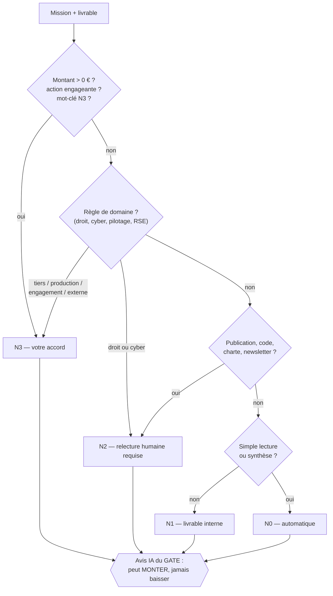

# 02 — Gouvernance et décisions

> Sources : `nexus-core/app/gate.py` (classement N0–N3), `decideur.py` (risque, code, sessions),
> `pipeline.py` (escalade), SPEC.md, `.env.example`. **[FAIT]** sauf mention.

## 1. Matrice RACI

**R** = réalise · **A** = approuve (une seule personne responsable du résultat) · **C** = consulté · **I** = informé · **—** = aucun rôle / interdit.

| Activité | Décideur | Noyau | Directeurs | Services | IA externes (passerelle) | Claude (session de travail) |
|---|---|---|---|---|---|---|
| Créer une mission | **A**, R | I (LEDGER) | — | — | R (`mothership_mission`) | R (passerelle ou script) |
| Router vers un service | I | **A**, R (PRIME) | I | — | — | — |
| Produire un livrable | I | C (BUDGET) | A | **R** (COLLECTOR, ANALYST) | — | — |
| Contrôler la qualité (CHECKER, charte, bouclier) | I | R (bouclier) | A | **R** (CHECKER) | — | — |
| Classer N0–N3 | I | **A**, R (GATE) | — | C (avis IA, ne peut que monter) | — | — |
| Trancher une escalade N2 | I | I | **A**, R | C | — | — |
| **Valider / refuser / réviser une décision N3** | **A**, R (cockpit seul) | C (fiche, risque) | — | — | **—** (interdit) | **—** (interdit) |
| Lancer une mission en F4 (payant) | **A**, R | C (BUDGET : estimation) | — | — | — | C |
| Arrêt d'urgence | **A**, R | R (SENTINEL applique) | — | — | — | C |
| Journaliser | I | **A**, R (LEDGER) | — | — | — | — |
| Accepter / rejeter une leçon | **A**, R | C (test fantôme, régression) | — | I | — | C |
| Modifier projet, charte, consignes d'agents | **A** | — | — | I | — | R (prépare dans le dépôt) |
| Déployer une version | **A**, R (console) | — | — | — | — | R (porte de qualité, procédure) |
| Dépense, achat | **A**, R | C (BUDGET) | — | — | — | C (estimation) |
| Effacement RGPD | **A**, R (bouton) | R (cascade, trace LEDGER) | — | — | — | C |
| Mémoire commune de la passerelle | A (jeton propriétaire) | — | — | — | **R** | R |
| Réponse à incident cyber | **A** | R (SENTINEL) | I | R (CYBER-FORTRESS/incident propose) | — | C |

> **Avis d'expert** (certitude élevée) — La colonne qui compte est la ligne **« Valider une décision
> N3 »** : un seul **A**, un seul **R**, et deux **interdits**. Tant que cette ligne tient, aucune IA
> ne peut engager votre argent, votre nom ou vos données.

## 2. Les niveaux de décision N0 à N3

| Niveau | Sens | Ce qui se passe | Exemples réels (règles du code) |
|---|---|---|---|
| **N0** | Lecture, synthèse interne | Enregistré automatiquement. | « Fais une **synthèse** de… », « **résume** », « note interne » |
| **N1** | Livrable interne | Enregistré automatiquement. | « Rédige une checklist de démarrage du Mothership » (mission de test d'`install.sh`, OPS-CORE/projets) |
| **N2** | À relire | Enregistré ; relecture humaine requise ; le niveau F1 est relevé en F2. | Tout livrable de `CONTENT-ARENA/redaction` ; « **code** », « **script** », « **newsletter** », « **charte** » ; tout avis `LEX-GUARD/*` ; tout livrable `CYBER-FORTRESS/*` ; contenu suspect détecté par le bouclier |
| **N3** | Engageant | **Fiche de décision** dans le cockpit, alerte ntfy, rien n'est exécuté avant votre accord. | « 1 500 € », « mille euros » (montant en lettres) ; « **devis** », « **facture** », « **envoyer** au client », « **publier** », « **contrat** », « **signer** », « **mot de passe** », « **données personnelles** », « **déployer** », « **supprimer** » ; actions `envoyer_client`, `publier`, `signer`, `mise_en_production`, `depense`, `supprimer`, `donnees_sensibles` ; lancement en F4 |

**Finesse du code** (réelle, testée) :
- « **sans** paiement », « **aucun** envoi », « ne **pas** publier » : la négation proche annule le mot-clé.
- « Ne pas **oublier** de payer » reste N3 (la négation porte sur « oublier »).
- « Envoie-**moi** », « envoyez-**nous** » : envoi au propriétaire, pas à un tiers → pas N3 pour ce motif.
- « Ligne de **commande** », « commande **docker** » : neutralisés (pas un achat).
- Un montant écrit dans le **livrable** seul (étude chiffrée) ne déclenche pas N3 ; dans la **consigne**, oui.
- Montants reconnus : chiffres français et anglais, « k » et « M », et montants **en lettres**.

> **[EN COURS]** — `gate.py` a encore été enrichi le 04/11/2026 (détection des montants). Les
> principes ci-dessus sont stables ; la liste exacte des mots-clés est celle du code.

## 3. Règles par domaine

| Domaine | Plancher de décision | Passe en N3 si… | Plancher de fonctionnement | Garde-fou spécifique |
|---|---|---|---|---|
| **Droit** (`LEX-GUARD/*`) | **N2** | destiné à un tiers : client, partenaire, fournisseur, CGV, CGU, mentions légales, politique de confidentialité, grand public, « à remettre » | **F3** pour `droit-*` | Mention « ne remplace pas l'avis d'un avocat » **bloquante** ; « référence à vérifier » au lieu d'un article incertain ; aucune jurisprudence inventée |
| **Cyber** (`CYBER-FORTRESS/*`) | **N2** | le livrable recommande une action sur la production (pare-feu, ports, comptes, clés, jetons, rotation, redémarrage, suppression, restauration…) ou une notification à une autorité | **F3** | Posture **strictement défensive** ; secret ou action offensive → refus, secret **masqué** avant stockage (`cyber.py`) |
| **Pilotage** (`PILOT-CORE/*`) | — | décision financière ou engagement : investir, emprunter, financer, recruter, allouer un budget, changer les prix, dépenser | **F3** | Pilote du lundi : tout décoché par défaut |
| **RSE** (`GREEN-CORE/rse`) | — | communication externe : campagne, site web, réseaux sociaux, rapport public, label, slogan, publicité, clients | — | Pas d'écoblanchiment |
| **Publication** (`CONTENT-ARENA/redaction`) | **N2** | publier, diffuser, mettre en ligne | — | Charte du projet appliquée par le code avant le CHECKER |
| **Argent** (tous services) | — | tout montant > 0 € dans la consigne ou `montant_eur` | — | Risque **élevé** (code à 6 chiffres) dès **1 000 €** |

## 4. Le risque d'une décision N3

Chaque fiche N3 affiche un **risque explicable**, avec la liste de ses raisons :

| Risque | Déclencheurs (règles de `decideur.py`) | Code Décideur exigé ? |
|---|---|---|
| **Élevé** | montant ≥ `NEXUS_SEUIL_RISQUE_ELEVE_EUR` (1 000 €) ; **irréversible** (signer, supprimer, payer, virement, résilier, acheter, effacer…) ; **production** (déployer, pare-feu, redémarrer, ouvrir un port) ; **données sensibles** (données personnelles, mot de passe, santé, IBAN, numéro de carte) | **Oui** (6 chiffres) |
| **Moyen** | **tiers** : client, partenaire, publier, envoyer, diffuser, CGV, contrat | Non |
| **Faible** | aucun critère détecté | Non |

## 5. Plafonds et expirations

| Règle | Valeur | Variable |
|---|---|---|
| Délai de réponse à une N3 | **24 h**, puis `expiree` = **refus par défaut** (contrôle toutes les 10 min) | `N3_TIMEOUT_HOURS=24` |
| Nombre de N3 par jour | **15** ; au-delà, mise en file avec message clair | `N3_DAILY_CAP=15` |
| Sessions de décision | **12 h 30 et 19 h** (une alerte par session) | `NEXUS_SESSIONS_N3` |
| Alerte immédiate | si l'expiration tombe dans moins de **4 h** | — |
| Rappel | **2 h** avant le refus automatique | — |
| Code Décideur | 6 chiffres ; **5 erreurs → verrou de 15 min** | `COCKPIT_CODE_DECIDEUR` |
| Confirmation d'une action | en deux temps, jeton à usage unique valable **2 min** | — |
| Budget IA mensuel | **0 €** aujourd'hui ; 30 € prévu après l'achat | `BUDGET_MONTHLY_EUR` |
| Coût max d'une mission F4 | **0,50 €** | `fonctionnement.yaml` |
| Missions simultanées | automatique selon la machine | `NEXUS_MAX_MISSIONS` |
| Passerelle | 8 Ko par champ, 60 appels/min par IA | `BRIDGE_LIMITE_PAR_MINUTE` |
| Leçons injectées | ≤ 5 leçons et ≤ 800 caractères par message | code (`lecons.py`) |

## 6. Ce que la passerelle (et toute IA externe) ne peut **jamais** faire

| Interdit | Garantie technique |
|---|---|
| Valider, refuser ou faire réviser une décision N3 | Aucun outil MCP pour cela ; `mothership_decisions_en_attente` est en **lecture seule** ; décisions réservées aux routes `/cockpit` derrière le mot de passe ; `NEXUS_API_PEUT_DECIDER=0` |
| Lancer une mission F4 sans votre accord | Le lancement F4 est lui-même une décision N3 (`objet=lancement_f4`) |
| Écrire un secret en mémoire | Refus des textes ressemblant à une clé, un mot de passe, une carte (contrôle de Luhn), un jeton du Mothership |
| Effacer définitivement | « Oublier » **archive** seulement, et seulement par l'IA autrice ou votre jeton propriétaire |
| Modifier ou supprimer le journal | Journal append-only, aucune route de modification |
| Se faire passer pour une autre IA | Un jeton par identité ; le jeton fixe l'auteur de chaque écriture |
| Activer une leçon, changer une charte, déclencher l'arrêt d'urgence | Aucun outil MCP pour cela |
| Voir son jeton dans les journaux | Adresses `/mcp/<jeton>` remplacées par `/mcp/***` |

**n8n** (mode complet) : ses workflows **lisent** `/api/decisions` et ne décident jamais.

> **Avis d'expert** (certitude élevée) — En V1 (version en service au 04/11/2026), l'API à clé pouvait
> encore valider une décision à risque élevé sans code. **La V2 corrige ce point** : c'est la première
> raison de la déployer rapidement.

## 7. Arrêt d'urgence (kill switch)

| Portée | Effet | Qui |
|---|---|---|
| Grille entière | Toutes les nouvelles missions passent en `suspendue` | Décideur (bouton du cockpit, confirmation intégrée) |
| Une direction | Les missions de cette direction sont suspendues | Décideur |
| Un agent | Cet agent est bloqué | Décideur |

SENTINEL vérifie l'état **avant** chaque mission. Lever l'arrêt : même bouton. Tout est journalisé.
