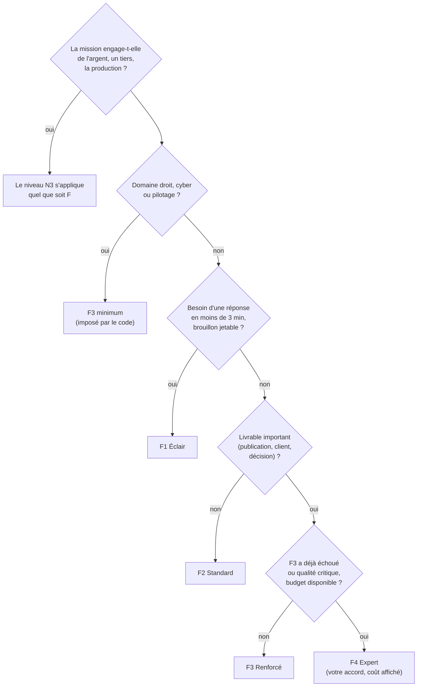

# 03 — Niveaux de fonctionnement F1 à F4

> Source unique : `nexus-core/fonctionnement.yaml` (lu au démarrage de nexus-core). **[FAIT]**
> **À ne pas confondre** : **F** règle l'**effort** (IA, tokens, corrections, délai, coût) ;
> **N** dit si **votre accord** est nécessaire. Une mission a toujours un F **et** un N.

## 1. La grille

| | **F1 Éclair** | **F2 Standard** (défaut) | **F3 Renforcé** | **F4 Expert** |
|---|---|---|---|---|
| IA utilisée | locale (`qwen2.5:3b` aujourd'hui) | fournisseur courant : Ollama Cloud si clé valide, sinon locale | comme F2 + **2e contrôle** par l'IA locale | Anthropic : Sonnet pour ANALYST et CHECKER, Haiku pour les autres rôles |
| Tokens max par mission | 6 000 | 20 000 | 40 000 | 80 000 |
| Corrections (ANALYST après refus du CHECKER) | 0 | 1 | 2 | 3 |
| Double contrôle | non | non | **oui** (les deux doivent valider) | **oui** |
| Taille max d'un message | 4 000 car. | 12 000 car. | 16 000 car. | 24 000 car. |
| Contexte Ollama | 4 096 | 8 192 | 8 192 | 8 192 |
| Délai max (chrono global) | **3 min** | **10 min** | **20 min** | **30 min** |
| Coût max | 0 € | 0 € | 0 € | **≤ 0,50 €** |
| Mémoire projet fournie aux agents | 800 car. | 2 000 car. | 2 000 car. | 3 000 car. |
| Lancement | immédiat | immédiat | immédiat | **décision N3** « Lancer en F4 — coût estimé X € » |
| État au 04/11/2026 | **[FAIT]** | **[FAIT]** (en local : la clé cloud est refusée) | **[FAIT]** | **[PRÉVU]** indisponible tant que `BUDGET_MONTHLY_EUR=0` |

## 2. Quand utiliser chaque niveau

| Niveau | Bon usage | Mauvais usage |
|---|---|---|
| **F1** | Idée rapide, reformulation, liste, tri, brouillon interne | Tout ce qui sera publié ou envoyé |
| **F2** | Le quotidien : plans, checklists, articles à relire, synthèses | Droit, cyber, pilotage (relevés en F3 de toute façon) |
| **F3** | Droit, cybersécurité, pilotage, livrables destinés à un tiers | Questions simples (gaspille du temps machine) |
| **F4** | Après un échec en F3 sur un sujet important ; texte final d'un contrat ou d'une offre (avant relecture humaine) | Essais, brouillons, tâches répétitives |

## 3. Planchers et relèvements (le code ne fait que **monter**)

| Règle | Effet | Raison tracée |
|---|---|---|
| GATE pré-classe la mission **N2 ou N3** | F1 → **F2** | « GATE N2 : F1 relevé en F2 » |
| GATE classe le **livrable** N2+ | F1 → **F2**, puis nouveau passage qualité | idem |
| IA locale injoignable | F1 → **F2** | IA locale absente |
| Service `LEX-GUARD/droit-*`, `PILOT-CORE/*`, `CYBER-FORTRESS/*` | → **F3 minimum** | plancher du domaine |
| Relance demandée par un **directeur** | F + 1 (jamais F4 sans votre accord) | relance automatique |
| F4 demandé mais indisponible (budget 0 €, pas de clé, budget restant insuffisant) | **F3** si la case « repli F3 » est cochée (par défaut), sinon refus | « F4 indisponible : budget IA à 0 € — mission lancée en F3 » |

Chaque relèvement est affiché sur la mission (`fonctionnement_raison`) et journalisé au LEDGER.

## 4. Coûts et délais

### 4.1 Coût

| Niveau | Coût IA | Remarque |
|---|---|---|
| F1, F2, F3 | **0 €** | IA locale ou Ollama Cloud gratuit. Le coût réel est le **temps machine** et, avec le cloud, le fait que les consignes sortent du serveur. |
| F4 | ≤ **0,50 €** par mission (plafond dur) | Tarifs en configuration (en dollars par million de tokens, convertis avec `EUR_PAR_USD=0.92`) : **à vérifier sur la grille officielle avant activation**. Estimation affichée avant lancement (75 % des tokens comptés en entrée). |

Ordre de grandeur F4 avec un budget de **30 €/mois** (budget retenu, **[PRÉVU]**) : **au moins 60 missions
F4 par mois** au plafond de 0,50 €, davantage en pratique.

### 4.2 Délais

| Niveau | Délai max | Mesuré ou estimé |
|---|---|---|
| F1 | 3 min | Banc rapide (8 missions) en F1 sur KVM 2 : 30 min à 1 h (**estimation**) |
| F2 | 10 min | Une mission réelle réussie en **2 min 11 s** et 1 611 tokens (V1, IA locale, **mesuré** le 03/11) |
| F3 | 20 min | Banc rapide en F3 : 1 h 30 à 3 h (**estimation**) |
| F4 | 30 min | non mesuré (jamais activé) |

Si le délai, les tokens ou le coût max sont atteints : statut **`plafond_atteint`**, livrable partiel
**gardé**, proposition de relance au niveau supérieur. **Jamais de dépassement silencieux.**

## 5. Suivi

- Cockpit, onglet **Fonctionnement** : grille et consommation du mois par niveau (missions, tokens, €, durée moyenne).
- API : `GET /api/fonctionnement` (clé `X-Nexus-Key`).
- Choisir le niveau : menu du formulaire *Nouvelle mission* ; paramètre `fonctionnement` de l'outil
  `mothership_mission` des IA ; variable `FONCTIONNEMENT=F3` des scripts ; défaut `NEXUS_FONCTIONNEMENT_DEFAUT=F2`.

> **Avis d'expert** (certitude moyenne) — Sur le KVM 2, la vraie limite n'est pas le coût mais la
> **lenteur** de l'IA locale 3B. La priorité n'est donc pas F4 : c'est (1) une clé Ollama Cloud valide
> pour les missions non sensibles, puis (2) le KVM 8 avec un modèle local 7–8B et un **contrôleur
> différent** (profil B), qui rend F3 réellement « double ». Activez F4 en dernier, avec un plafond
> mensuel bas, et mesurez au banc ce qu'il apporte vraiment avant de l'utiliser couramment.
