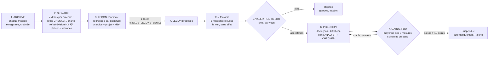
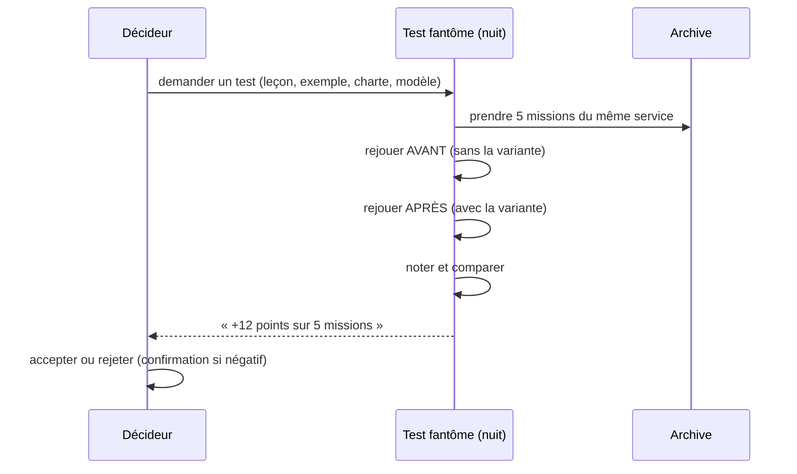

# 04 — Mémoire et apprentissage

> Sources : `nexus-core/app/archive.py`, `lecons.py`, `memoire.py`, `exemples.py`, `avis.py`,
> `fantome.py`, `compaction.py`. Les fonctions de cette page arrivent avec la **V2** : **[FAIT]** dans le
> code, **[EN COURS]** sur le serveur tant que la V2 n'est pas déployée.

## 1. Les cinq mémoires de SYFER

| Mémoire | Contenu | Qui écrit | Qui lit | Où |
|---|---|---|---|---|
| **LEDGER** | Chaque action (acteur, action, coût), chaînée SHA-256 et signée HMAC | Le noyau | Vous (cockpit), vérification | table `ledger` de `nexus.db` |
| **Archive brute** | Un enregistrement complet par événement de mission (consigne, étapes, livrable, verdicts, décisions, tokens, note) | nexus-core | Leçons, test fantôme, recherche | `data/nexus-core/archive/AAAA-MM.jsonl.gz` |
| **Mémoire projet** | Fiches `projets/*.md` (lecture seule) + résumés automatiques des livrables validés | Vous, nexus-core | COLLECTOR et CHECKER (3 meilleurs passages) ; IA via `projet_connaissances` | `nexus.db` (index plein texte) |
| **Mémoire collective** | **Leçons** acceptées + **exemples** de très bons livrables | Le cycle ci-dessous, validé par vous | ANALYST et CHECKER du service / projet | `nexus.db`, `chartes_ajouts/` |
| **Mémoire commune des IA** | Faits, tâches, messages, passations entre Claude, ChatGPT, Gemini | Les IA (un jeton chacune) | Les IA, vous (`/bridge`) | `data/nexus-bridge/bridge.db` |

Et une sixième, externe : la **veille** (fiches courtes de sources sérieuses, `data/veille/veille.db`).

## 2. Le cycle d'apprentissage

### Étape par étape

| # | Étape | Règle exacte | Réglage |
|---|---|---|---|
| 1 | **Archive** | Un enregistrement JSON par événement ; fichier compressé par mois, **ajout seulement** ; chaque ligne porte l'empreinte de la précédente (HMAC avec `LEDGER_HMAC_KEY`) ; secrets masqués avant écriture. | `NEXUS_ARCHIVE_DIR` |
| 2 | **Signaux** | Extraction **déterministe** (pas d'IA) : refus du CHECKER, violations de charte, refus et révisions du Décideur (avec motif), plafonds atteints, relances et reformulations du directeur, avis 👎. | — |
| 3 | **Regroupement** | Même service, même projet, même idée (signature normalisée). Une mission ne compte qu'**une fois** par leçon. Statut « candidate ». | — |
| 4 | **Proposition** | Dès **3** missions différentes, la leçon passe « proposée ». | `NEXUS_LECONS_SEUIL=3` |
| 5 | **Validation** | Lundi dès 8 h : alerte « Leçons de la semaine », carte du Décideur. **Seules** les leçons acceptées s'appliquent. Une leçon n'est **jamais supprimée** : rejetée ou suspendue. Option : transformer la leçon en **terme interdit** de la charte du projet. | — |
| 6 | **Injection** | Au plus **5 leçons** et **800 caractères** dans les messages de l'ANALYST et du CHECKER du service et du projet concernés. | code |
| 7 | **Garde-fou** | La note du banc est mémorisée à l'activation. Si la moyenne des **3** mesures suivantes baisse de plus de **10 points**, la leçon est **suspendue** et signalée. Contrôle toutes les 10 min. | `NEXUS_LECONS_MESURES_MIN=3`, `NEXUS_LECONS_BAISSE=10` |

### Exemples concrets (illustratifs, construits sur les chartes réelles)

| Signal répété | Leçon proposée | Effet attendu |
|---|---|---|
| 3 livrables Poker Winners refusés par la charte : « gagnez de l'argent » | « Poker Winners : jamais de promesse de gain ; parler d'apprentissage et de progression. » | L'ANALYST évite la formule dès le premier jet ; moins de corrections. |
| 3 révisions N3 demandées : « vouvoyez le lecteur » | « Projets publics : vouvoiement systématique. » | Moins de révisions dans le cockpit. |
| 3 refus du CHECKER en `LEX-GUARD/droit-france` : article cité sans certitude | « Droit : écrire « référence à vérifier » plutôt qu'un numéro d'article incertain. » | Notes juridiques plus prudentes. |
| 3 avis 👎 « mauvaise marque » sur REDKARDS | Terme ajouté à `chartes_ajouts/redkards.yaml` | Blocage par le code, sans dépendre de l'IA. |

## 3. Les exemples (apprentissage par l'exemple)

- **Sources** : un livrable N3 **validé**, un livrable noté **≥ 4/5** (`NEXUS_EXEMPLES_SEUIL=4`), ou
  marqué « garder comme exemple » dans le cockpit.
- **Au plus 3 exemples actifs par service** (les mieux notés, puis les plus récents), 1 500 caractères chacun.
- **Filtres** : anti-secret, et **charte du projet** (un exemple qui viole sa charte n'est jamais retenu).
- Un exemple peut être retiré à tout moment ; un test fantôme **négatif** le retire automatiquement.

## 4. La note en un geste

- Sur **une mission terminée sur cinq** (`NEXUS_ECHANTILLON_NOTE=0.2`, tirage stable), dans les
  14 derniers jours, le Décideur propose **👍 / 👎** et un motif.
- Motifs : information fausse ou inventée · incomplet · hors ton · mauvaise marque ou mélange de projets · trop long · autre.
- **👎** → signal pour les leçons. **👍** → candidat exemple.
- Statistiques de satisfaction par service, projet, modèle et niveau F.

> **Avis d'expert** (certitude élevée) — Ce geste de 2 secondes est **le carburant** du système. Sans
> notes, les leçons ne naissent que des refus du CHECKER, qui ne voit pas tout (une marque mal placée,
> un ton déplacé). Visez **3 notes par semaine** au minimum.

## 5. Le test fantôme

**But** : mesurer l'effet d'un changement **avant** de l'activer, sans aucun risque.

| Point | Règle |
|---|---|
| Ce qu'on peut tester | une leçon proposée, un exemple, une **charte modifiée** (dossier candidat), des **modèles par rôle** |
| Missions rejouées | **5** missions archivées du même service (et du même projet si précisé) — `NEXUS_FANTOME_K=5` |
| Quand | la nuit, **01 h – 06 h** (`NEXUS_FENETRE_NUIT`), un seul test à la fois |
| Effets de bord | **aucun** : missions marquées « fantome », ni décision, ni EXECUTOR, ni notification, ni archive, ni leçon, exclues des statistiques |
| Notation | grille du banc d'essai si la mission vient du banc ; sinon critères déterministes (charte, verdict du CHECKER, issue de la mission) |
| Résultat | « +12 points sur 5 missions » ; gain **négatif** → déconseillé : une leçon ne peut alors être acceptée qu'avec confirmation explicite ; un exemple est retiré |

## 6. Garde-fous de la mémoire

| Risque | Garde-fou |
|---|---|
| Un secret mémorisé | Filtre anti-secret avant **toute** écriture : refus (ajout manuel, passerelle) ou masquage (import, archive, résumé automatique). |
| Un texte piégé (injection) | **Bouclier** : nettoyage (texte caché, caractères invisibles, base64), détection et neutralisation des ordres adressés à l'IA, encapsulation ; contenu suspect → GATE **N2 minimum**. |
| Une leçon qui dégrade | Test fantôme avant ; suspension automatique après (baisse > 10 points). |
| Un effacement silencieux | Rien n'est effacé sans trace : corrections versionnées, « oublier » archive, effacement RGPD tracé au LEDGER. |
| Une archive falsifiée | Chaîne HMAC vérifiable (`/api/archive/verifier`) ; l'effacement RGPD remplace le contenu par une « pierre tombale » **sans casser la chaîne**. |
| La mémoire qui grossit sans fin | Module de **compaction** (paliers par âge, dédoublonnage, effacement réel conservé) : **[EN COURS]**, prêt mais pas encore branché dans le noyau. |

> **Avis d'expert** (certitude moyenne) — Le dispositif est sain parce qu'il est **lent par
> construction** : 3 cas pour proposer, une validation humaine par semaine, une mesure après coup. Ne
> baissez pas le seuil à 1 ou 2 pour « aller plus vite » : vous apprendriez du bruit. Point faible
> actuel : le garde-fou s'appuie sur le **banc hebdomadaire** ; tant que celui-ci n'est pas activé sur
> le serveur (V2), une leçon acceptée n'est pas surveillée.
