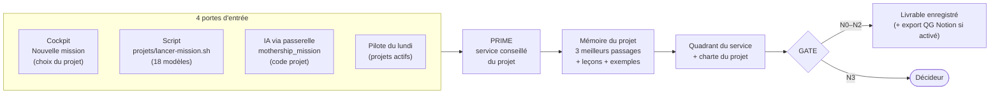

# 05 — Projets servis par SYFER

> Sources : `nexus-core/projets.yaml` (registre), `nexus-core/chartes/*.yaml`, `projets/`,
> `nexus-bridge/app/config.py` (codes de la passerelle). État au 04/11/2026. **[FAIT]**

## 1. Registre des projets

| Code | Nom | Actif au pilote du lundi | Description | Charte | Fiche mémoire `projets/` |
|---|---|---|---|---|---|
| `nexus` (alias `syfer`) | NEXUS MOTHERSHIP / SYFER | **oui** | Organisation d'agents IA, un seul humain valide | `nexus.yaml` | via `tous-les-projets.md` |
| `poker-winners` (alias `poker-vitrine`) | Poker Winners | **oui** | Site vitrine poker et bêta privée | `poker-winners.yaml` | `poker-winners.md` |
| `poker-feeling` | Poker Feeling | **oui** | Livre de poker | `poker-feeling.yaml` | `poker-feeling.md` |
| `redkards` (alias `red-card`) | REDKARDS / Red Card | **oui** | Bande dessinée | `redkards.yaml` | `redkards.md` |
| `top-solver` (alias `solver`, `pw-solver`) | Top Solver | **oui** | Solver GTO de poker en français, outil d'analyse de main | `top-solver.yaml` | — |
| `freelance-ia` | Freelance IA | non | Activité de développeur d'applications et d'automatisation IA | `freelance-ia.yaml` | — |
| `youtube-poker-winner` | Chaîne YouTube Poker Winner | non | Chaîne de poker éducatif | commune seulement | — |
| `paradoxx` | PARADOXX SYSTÈME | non | Pilotage multi-projets et VPS dédié | commune seulement | — |
| `esct-boxe` (alias `siteesctboxe`) | Site ESCT Boxe | non | Site web du club | commune seulement | — |
| `turf` | TURF | non | Projet TURF | commune seulement | — |
| `divers` | Divers | non | **Obligatoire** : projet par défaut | commune seulement | — |

**11 projets**, dont **5 actifs**. Tous héritent de `_commun.yaml`.

## 2. Services conseillés par projet

| Projet | Services conseillés (`projets.yaml`) |
|---|---|
| nexus | AGENT-FACTORY/evaluation · CODE-CORE/conception · CODE-CORE/revue · LEX-GUARD/droit-europe · CYBER-FORTRESS/audit · CYBER-FORTRESS/veille |
| poker-winners | LEX-GUARD/droit-france · CONTENT-ARENA/redaction · DESIGN-SYSTEM/ui · CODE-CORE/revue · REVENUE-CORE/propositions · CYBER-FORTRESS/audit |
| poker-feeling | CONTENT-ARENA/redaction · DESIGN-SYSTEM/ui · R&D-PARADOX/veille · LEX-GUARD/droit-france |
| redkards | DESIGN-SYSTEM/ui · CONTENT-ARENA/redaction · OPS-CORE/projets · LEX-GUARD/droit-france |
| top-solver | CODE-CORE/conception · CODE-CORE/revue · DESIGN-SYSTEM/ui · LEX-GUARD/droit-france · R&D-PARADOX/veille |
| freelance-ia | PILOT-CORE/etudes · PILOT-CORE/pilotage · REVENUE-CORE/propositions · LEX-GUARD/droit-france · LEX-GUARD/droit-europe · CODE-CORE/conception · CYBER-FORTRESS/audit |
| youtube-poker-winner | CONTENT-ARENA/redaction · R&D-PARADOX/veille · PILOT-CORE/pilotage · LEX-GUARD/droit-france |
| paradoxx | OPS-CORE/projets · PILOT-CORE/pilotage · CODE-CORE/conception · CODE-CORE/revue · GREEN-CORE/environnement · CYBER-FORTRESS/audit · CYBER-FORTRESS/veille |
| esct-boxe | DESIGN-SYSTEM/ui · CODE-CORE/conception · CODE-CORE/revue · CONTENT-ARENA/redaction · LEX-GUARD/droit-europe |
| turf | R&D-PARADOX/veille · PILOT-CORE/etudes · LEX-GUARD/droit-france · OPS-CORE/projets |
| divers | OPS-CORE/projets |

## 3. Chartes : l'essentiel par projet

Contrôle **par le code**, avant le CHECKER. « Bloquant » = retour à l'ANALYST avec la liste précise.

| Charte | Marques à ne pas mélanger | Termes interdits (extraits) | Mentions obligatoires | Ton |
|---|---|---|---|---|
| `_commun` (tous) | — | « garanti à 100 % » (bloquant) | « ne remplace pas l'avis d'un avocat » pour tout livrable juridique ; marqueurs « À COMPLÉTER », « TODO », « lorem ipsum »… **bloquants en publication** | — |
| `nexus` | Poker Winners, Red Cards (avertissement) | « mise en production automatique », « désactiver le gate » (bloquants) ; « sans validation » | — | vouvoiement |
| `poker-winners` | Red Cards (bloquant), Poker Feeling (avertissement) | « liste d'attente », « gain garanti », « gagnez de l'argent », « argent facile », « bonus de dépôt » (bloquants) ; « premium », « code promo », « disponible maintenant » | **Prévention du jeu excessif** (09 74 75 13 13) **et** « réservé aux majeurs » en publication et commercial | vouvoiement |
| `poker-feeling` | Poker Winners | « gagnez de l'argent », « zéro tilt », « précommande », « disponible en librairie », « liste d'attente » (bloquants) | Prévention du jeu excessif (09 74 75 13 13) **et** « réservé aux majeurs » en publication et commercial | vouvoiement |
| `redkards` | Poker Winners, Poker Feeling, circuits ou marques réelles | « argent facile », « gain garanti », « liste d'attente » (bloquants) ; « infaillible » | Prévention du jeu excessif en communication publique | **tutoiement permis** (dialogues de BD) |
| `top-solver` | PW Solver, Red Cards | « stratégie imbattable », « gain garanti », « aide en temps réel » (bloquants : outil d'étude hors partie) | Prévention du jeu excessif | vouvoiement |
| `freelance-ia` | Poker Winners | « résultats garantis » (bloquant) ; « garanti », « certifié », « nos clients », « SIRET » (pas de faux numéro) | « brouillon » sur tout document commercial (avertissement) | vouvoiement |

> **Avis d'expert** (certitude élevée) — Les projets poker partagent un univers mais pas une marque :
> les chartes empêchent le mélange (le dossier ATLAS a relevé des **confusions de marques** avec l'IA
> locale 3B). Avant de rendre public `youtube-poker-winner` ou `esct-boxe`, donnez-leur une charte
> (procédure 11) : sans elle, seules les règles communes s'appliquent.

## 4. Comment un projet utilise SYFER

| Porte | Pour qui | Comment |
|---|---|---|
| **Cockpit** | Vous | *Nouvelle mission* : titre, consigne, projet, service (facultatif), niveau F. |
| **Script de modèles** | Vous, au terminal | `cd projets && ./lancer-mission.sh --liste redkards` puis `SIMULATION=1 ./lancer-mission.sh redkards 1 …` (6 modèles par projet poker). |
| **Passerelle** | Claude, ChatGPT, Gemini | Outil `mothership_mission` avec le code projet ; suivi par `mothership_statut`. Passations par projet (`passation_ecrire`, `passation_derniere`). |
| **Pilote du lundi** | Automatique | Pour chaque projet `actif: true` : 3 priorités, 1 à 5 missions proposées, **tout décoché** par défaut. |

**Mémoire d'un projet** : la fiche `projets/<code>.md` (faits durables, aucun secret) est importée au
démarrage ; les livrables validés sont résumés automatiquement (`NEXUS_MEMOIRE_AUTO=1`). Les IA y
accèdent par l'outil `projet_connaissances`.

**Export QG** **[EN COURS]** : un résumé court (≤ 600 caractères, sans secret) de chaque mission terminée
peut être envoyé au QG Notion via `NEXUS_WEBHOOK_QG` (signé HMAC). Vide par défaut : rien n'est envoyé.

## 5. Cycle de vie d'un projet dans SYFER

| Étape | Action | Procédure |
|---|---|---|
| Création | Bloc dans `projets.yaml` (`actif: false`), fiche `projets/<code>.md` | 10 |
| Cadrage | Charte en **avertissement** | 11 |
| Activation | `actif: true` → entre dans le pilote du lundi | 10 |
| Durcissement | Charte en **bloquant** après 2 semaines d'observation | 11 |
| Mise en sommeil | `actif: false` (la mémoire reste) | 10 |
| Fin | Archiver ; effacement RGPD des missions si nécessaire | 9 |

> **Point incertain** — Le code `syfer` est un **alias** de `nexus` : SYFER et NEXUS MOTHERSHIP sont
> suivis comme un seul projet. Si vous voulez suivre séparément le **produit commercial** SYFER et
> l'**architecture** NEXUS MOTHERSHIP, il faudra créer un code distinct.
