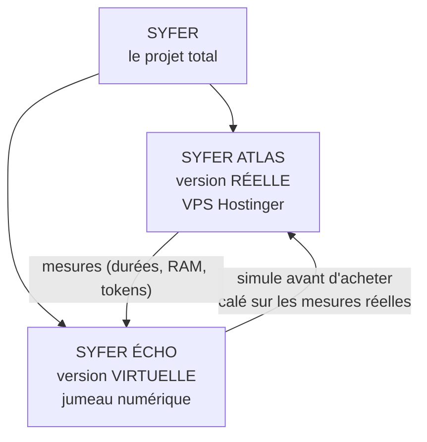
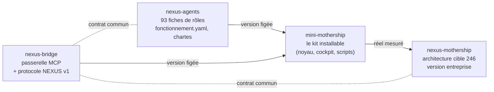
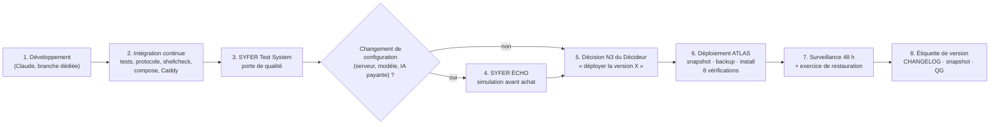

# 06 — Produits et versions

> Sources : `outils-depots/separer.sh`, `protocole/README.md` et `protocole/VERSION`,
> `syfer-test-system/`, `jumeau-numerique/README.md`, fiches des projets Claude (4 produits),
> dossier « SYFER ATLAS » du 04/11/2026.

## 1. Les trois noms de SYFER

| Nom | Ce que c'est | État au 04/11/2026 |
|---|---|---|
| **SYFER** | Le projet total : 4 produits, outils de test, documentation, plan commercial. | — |
| **SYFER ATLAS** | L'instance réelle. Aujourd'hui : KVM 2 (2 vCPU, 8 Go), SYFER v1.0.0 déployée le 03/11 (93 rôles). Demain : **KVM 8 neuf** (8 vCPU, 32 Go), l'ancien KVM 2 devenant la **vitrine** publique. Budget retenu ≈ 90 € TTC/mois. | **[FAIT]** v1.0.0 · **[EN COURS]** V2 non déployée · **[PRÉVU]** migration avant le 30/11 |
| **SYFER ÉCHO** | Le jumeau numérique (`jumeau-numerique/`) : simulation à événements discrets et Monte Carlo d'un mois de missions, 92 hypothèses, 19 scénarios ; écart visé ≤ 5 % avec les mesures réelles. Sert à **dimensionner ATLAS avant tout achat**. | **[FAIT]** outil prêt |

## 2. Les quatre produits

| Produit | Contenu (d'après `separer.sh`) | Rôle | Dépôt privé prévu | Règle de version propre |
|---|---|---|---|---|
| **nexus-bridge** | `nexus-bridge/` + `protocole/` | Passerelle commune : serveur MCP (20 outils) et **protocole NEXUS v1** (schémas JSON) | `redkards/nexus-bridge` | Toute modification **incompatible** du protocole = version **majeure** + note de migration |
| **nexus-agents** | `nexus-core/agents/` → `agents/`, `fonctionnement.yaml`, `chartes/` | Bibliothèque des **93 rôles** (données seulement) | `redkards/nexus-agents` | Ajout d'agent = **mineure** ; changement de format ou de règle = **majeure** |
| **mini-mothership** | Tout le kit (nexus-core, install, compose, Caddy, cockpit, banc, automatisations, sauvegardes) sauf `outils-depots/` ; garde une **copie** de bridge, protocole et agents | Le produit installé sur ATLAS | `redkards/mini-mothership` | SemVer classique ; déclare les versions de bridge et d'agents qu'il embarque |
| **nexus-mothership** | `SPEC.md`, `README.md` → `docs/GUIDE-KIT.md`, `outils-depots/` | Architecture cible (246 agents), version entreprise, commercialisation | `redkards/nexus-mothership` | Suit les jalons d'architecture |

**État de la séparation** : **[EN COURS]**. Aujourd'hui, tout vit dans **un seul dépôt** (monodépôt
`espacetravail-public`, branche `v2`). `outils-depots/separer.sh` sait produire les 4 dépôts en gardant
l'historique git de chaque partie, avec licence propriétaire, `CHANGELOG.md`, `VERSION` et l'étiquette
`v1.0.0` ; il **n'envoie rien** sur GitHub. Les règles GATE et PRIME sont du **code** : elles restent dans
mini-mothership, pas dans nexus-agents.

## 3. Versionnement SemVer

Format **MAJEURE.MINEURE.CORRECTIF** (ex. `1.4.2`).

| Changement | Exemple SYFER | Version |
|---|---|---|
| Correctif sans effet visible sur ce qui est accepté | faute dans une consigne, motif GATE corrigé, bug du cockpit | **correctif** (1.0.**1**) |
| Ajout compatible | nouvel agent, nouveau service, outil MCP ajouté, champ **facultatif** ajouté, nouvelle valeur de statut | **mineure** (1.**1**.0) |
| Rupture | champ retiré ou renommé, type changé, champ facultatif devenu obligatoire, règle de décision changée, format YAML d'agent changé | **majeure** (**2**.0.0) |

Règles du **protocole NEXUS v1** (version **1.0.0**, indépendante des produits) :
- **compatibilité ascendante** : un producteur 1.y reste lisible par un consommateur 1.x (x ≤ y) ;
- **lecture tolérante** : un champ inconnu est ignoré ;
- une **majeure** impose une période où le serveur sert les deux formes.

## 4. Compatibilité

Tableau à tenir à jour à chaque livraison. **[EN COURS]** : les numéros des produits ne sont pas encore
figés séparément (une seule étiquette pour le monodépôt).

| Livraison SYFER | mini-mothership | nexus-agents | nexus-bridge | Protocole | Déployée sur ATLAS |
|---|---|---|---|---|---|
| **V1** (03/11/2026) | 1.0.0 | 1.0.0 (93 rôles) | 1.0.0 | — (non figé) | **oui**, KVM 2, branche `nexus-mothership-kit` / `release-v1.0.0` |
| **V2** (branche `v2`) | à figer (proposé : 2.0.0, car l'API ne peut plus décider) | à figer (proposé : 1.1.0, chartes ajoutées) | à figer (proposé : 1.1.0, outils `memoire_collective_rechercher` et `lecons_lister`) | **1.0.0** | **non** (prévu) |

> **Point incertain** — Les numéros « proposés » ci-dessus sont une recommandation de ce document, pas
> une décision. La fiche projet de nexus-bridge mentionne **17 outils** ; le code V2 en compte **20** :
> la fiche est à mettre à jour.

## 5. Cycle de livraison

| Étape | Qui | Critère de sortie |
|---|---|---|
| 1. Développement | Claude | Code relu, aucun secret |
| 2. Intégration continue | GitHub Actions (`.github/workflows/ci.yml`) | Toutes les suites vertes |
| 3. Porte de qualité | Claude (`syfer_test.py porte`) | `Déploiement AUTORISÉ.` |
| 4. Jumeau numérique | Claude (`jumeau-numerique/lancer.py`) | Le scénario retenu tient les objectifs (délais, RAM, coût) |
| 5. Décision | **Décideur** | Accord explicite |
| 6. Déploiement | Décideur (console), guidé par Claude | 8 vérifications OK (procédure 2B) |
| 7. Surveillance | Décideur + alertes | 48 h sans incident, exercice OK |
| 8. Clôture | Claude prépare, Décideur valide | Étiquette, CHANGELOG, snapshot neuf, résumé QG |

**Rythme conseillé** : un **correctif** quand il faut ; une **mineure** au plus toutes les deux semaines ;
une **majeure** seulement avec une note de migration et un créneau de déploiement réservé.

> **Avis d'expert** (certitude élevée) — Le risque principal n'est pas technique mais **de rythme** :
> le code évolue plus vite que le serveur (V2 prête, non déployée). Gelez les nouveautés jusqu'à la
> migration vers le KVM 8 ; déployez la V2, migrez, **puis** reprenez les évolutions. Une seule
> nouveauté à la fois sur ATLAS, toujours derrière la porte de qualité.
