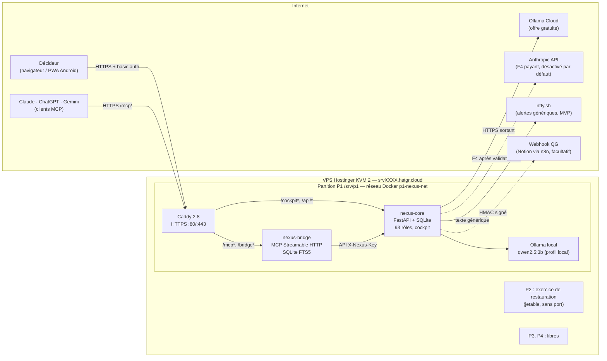
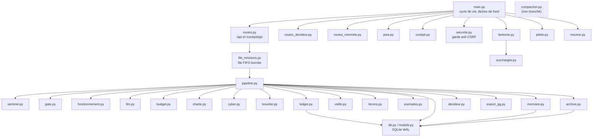
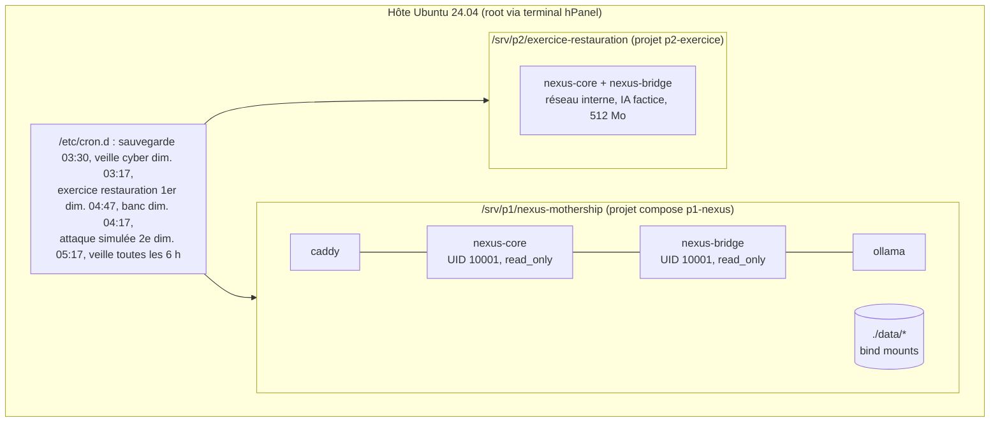
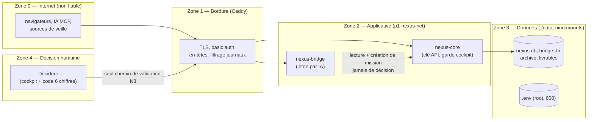
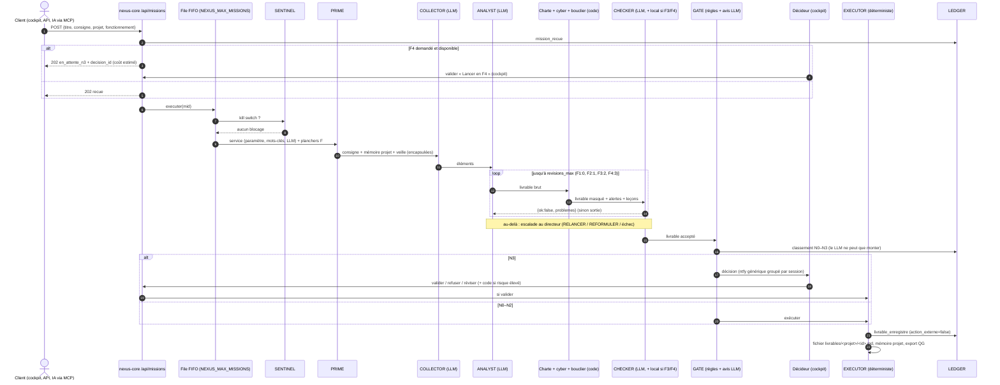

# 01 — Architecture

## 1. Vue d'ensemble

SYFER ATLAS est un système multi-agents **mono-serveur** : un noyau Python (nexus-core) orchestre 93 rôles d'agents qui produisent des livrables (textes, plans, analyses). Les IA appellent des modèles de langage **gratuits par défaut** (Ollama Cloud en offre gratuite, repli sur un modèle local). Aucune action externe engageante (envoi, publication, paiement, mise en production) n'est exécutée par le système : tout livrable sensible devient une **décision N3** que seul le Décideur valide, depuis un **cockpit** web protégé et installable sur Android.

Une **passerelle MCP** (nexus-bridge) donne à Claude, ChatGPT et Gemini une mémoire commune, des tâches, des messages et des passations, et leur permet de confier des missions au noyau **sans jamais pouvoir décider**.

## 2. Composants

| Composant | Rôle | Technologie | Données | Statut | Preuve |
|---|---|---|---|---|---|
| **Caddy** | seul point d'entrée Internet ; TLS Let's Encrypt ; basic auth du cockpit ; injection de l'en-tête interne `X-Cockpit-Auth` ; en-têtes de sécurité ; journaux filtrés | Caddy 2.8 | `data/caddy/` | [FAIT] | `Caddyfile.mvp`, `Caddyfile.complet` |
| **nexus-core** | pipeline des missions, 93 rôles, GATE, LEDGER, BUDGET, SENTINEL, Décideur, mémoire projet, mémoire collective, archive, test fantôme, pilote, export QG, cockpit HTML | Python 3.12, FastAPI, SQLAlchemy 2, 1 worker Uvicorn | `data/nexus-core/nexus.db`, `livrables/`, `archive/` | [FAIT] | `nexus-core/app/*.py` |
| **nexus-bridge** | serveur MCP « Streamable HTTP » (JSON-RPC 2.0), 20 outils, mémoire commune versionnée, journal append-only, page `/bridge` en lecture seule | Python 3.12, FastAPI, SQLite WAL + FTS5 | `data/nexus-bridge/bridge.db` | [FAIT] | `nexus-bridge/app/*.py` |
| **Ollama local** | IA de secours, F1 et double contrôle F3/F4 | Ollama 0.40.12, `qwen2.5:3b` | `data/ollama/` | [FAIT] (profil `local`) | `docker-compose.yml` |
| **Veille** | collecte de 322 sources publiques (flux, API), fiches courtes A–D, base `veille.db` lue par nexus-core en lecture seule | Python (stdlib), SQLite FTS5, cron | `data/veille/veille.db` | [FAIT] côté collecteur et recherche ; [EN COURS] intégration (2 tests rouges, voir 08) | `veille/`, `nexus-core/app/veille.py` |
| **Compaction** | archivage par paliers chaud / tiède / froid, blocs compressés, Merkle | Python (stdlib) | `archive/compact/` | [EN COURS] : module testé, **non branché** au noyau | `nexus-core/app/compaction.py` (bloc « INTÉGRATION ») |
| **PostgreSQL + pgvector, Redis, n8n, Uptime Kuma, ntfy** | mode complet : base serveur, automatisations, supervision, notifications auto-hébergées | images officielles | `data/<service>/` | [FAIT] (mode `--complet`) ; pgvector et Redis **réservés, non exploités** | `docker-compose.complet.yml`, `SPEC.md` |
| **Scripts d'exploitation** | installation, partitions, sauvegarde, restauration, exercice mensuel, désinstallation, veille cyber | Bash `set -euo pipefail` | `backups/` | [FAIT] | `install.sh`, `backup.sh`, `restore.sh`, `exercice-restauration.sh`, `automatisations/veille-cyber.sh` |
| **SYFER ÉCHO** | jumeau numérique (19 scénarios, 92 hypothèses) | Python (stdlib, matplotlib facultatif) | `jumeau-numerique/resultats/` | [FAIT] (exécution rapide 20 tirages) | `jumeau-numerique/` |
| **SYFER Test System** | orchestration des épreuves, score par axes, porte de qualité, rapport PDF | Python | bac à sable jetable | [EN COURS] : code et configuration présents, aucun passage archivé dans le dépôt | `syfer-test-system/` |

### 2.1 Modules de nexus-core

Tâches de fond (déclarées dans `nexus-core/app/main.py`, désactivables par `NEXUS_TACHES_FOND=0`) :

| Boucle | Période | Travail |
|---|---|---|
| `_boucle_fond` | 10 min | contrôle de régression des leçons, expiration des décisions N3, création des fiches N3 mises en file |
| `_boucle_minute` | 1 min | sessions et rappels du Décideur, pilote hebdomadaire (lundi), test fantôme (fenêtre de nuit), revue hebdomadaire des leçons, résumé quotidien, envoi de la file d'export QG |

Au démarrage : création des tables et migrations douces, chargement des agents, du registre `projets.yaml` (échec explicite si invalide), import des connaissances, chargement de `fonctionnement.yaml`, refus d'Anthropic sans budget, reprise des missions interrompues (`pipeline.reprendre_au_demarrage`).

## 3. Déploiement

### 3.1 Partitions du VPS

Le VPS (2 vCPU, 8 Go RAM, 100 Go disque) est découpé par `partitions.sh` en 4 fichiers image ext4 de 20 Go montés en boucle sur `/srv/p1` à `/srv/p4`. Le disque système n'est pas modifié ; Docker ne démarre pas si une partition manque (`x-systemd.before=docker.service`, `RequiresMountsFor`).

| Partition | Usage | RAM | vCPU | Disque |
|---|---|---|---|---|
| P1 `/srv/p1/nexus-mothership` | SYFER ATLAS | 5 Go | 1,5 | 20 Go |
| P2 | libre ; héberge l'exercice de restauration mensuel (jetable) | 0,75 Go | ~0,15 | 20 Go |
| P3, P4 | libres (futurs projets : compose `pN-xxx`, réseau `pN-xxx-net`) | 0,75 Go chacune | ~0,15 | 20 Go |

### 3.2 Modes et budgets de ressources

| Mode | Services | RAM plafonnée | vCPU | Fichiers |
|---|---|---|---|---|
| **MVP cloud seul** (`--sans-repli`) | caddy 64m/0,10 · nexus-core 384m/0,20 · nexus-bridge 128m/0,10 | 576 Mo | 0,4 | `docker-compose.yml`, `Caddyfile.mvp` |
| **MVP + repli local** (défaut) | + ollama 3584m/1,10 | ≈ 4,1 Go | 1,5 | idem, profil `local` |
| **Complet** (`--complet`) | ollama 2944m/0,8 · postgres 640m/0,2 · n8n 640m/0,15 · nexus-core 384m/0,1 · nexus-bridge 128m/0,1 · redis 128m/0,05 · uptime-kuma 128m/0,03 · caddy 64m/0,05 · ntfy 48m/0,02 | 5 104 Mo | 1,5 | + `docker-compose.complet.yml`, `Caddyfile.complet` |

Toutes les données persistantes sont en **bind mounts** `./data/<service>` (aucun volume nommé), ce qui les garde dans la partition P1 et simplifie la sauvegarde.

### 3.3 Diagramme de déploiement

### 3.4 Installation

`install.sh` (idempotent, 13 étapes ; 14 en mode complet) : vérifie root et Ubuntu, installe Docker si besoin, détecte `NEXUS_HOST` (`hostname -f`), demande l'e-mail ACME et la clé Ollama Cloud (saisie masquée ou fichier, validée par un appel authentifié avant enregistrement), génère `.env` avec des secrets aléatoires (`openssl rand`) et le hash bcrypt par `caddy hash-password` (entrée standard), vérifie `ufw` **sans le modifier**, lance `docker compose up -d --build`, télécharge le modèle local, lance une mission de test, propose les tâches planifiées. Aucun secret n'est affiché ni écrit dans `install.log` : seules les commandes `grep … .env` sont indiquées.

## 4. Réseau et ports

| Port hôte | Service | Mode | Exposition | Protection |
|---|---|---|---|---|
| 80 | Caddy (défi ACME, redirection) | MVP, complet | Internet | — |
| 443 | Caddy : `/cockpit*`, `/bridge*`, `/mcp*`, `/api/*`, `/` | MVP, complet | Internet | voir tableau des routes |
| 8443 | Caddy → n8n | complet | Internet | basic auth `admin` + compte n8n |
| 8444 | Caddy → Uptime Kuma | complet | Internet | basic auth cockpit + compte Kuma |
| 8445 | Caddy → ntfy | complet | Internet | `deny-all` par défaut, lecture réservée à `NTFY_USER` |
| 22 | SSH (hôte) | — | Internet | hors périmètre du kit |

Les ports sont liés à `NEXUS_BIND_IP` (détectée si vide). Aucun autre service n'expose de port : nexus-core et nexus-bridge écoutent sur `:8000` dans le réseau Docker `p1-nexus-net`. Le réseau n'est pas `internal` car nexus-core doit sortir vers Ollama Cloud.

Routage Caddy sur `:443` (`Caddyfile.mvp`) :

| Chemin | Cible | Authentification ajoutée par Caddy |
|---|---|---|
| `/mcp`, `/mcp/*` | nexus-bridge | aucune (jeton MCP vérifié par nexus-bridge) ; corps ≤ 128 Ko |
| `/bridge`, `/bridge/*` | nexus-bridge | basic auth du cockpit |
| `/cockpit`, `/cockpit/*` | nexus-core | basic auth + en-tête `X-Cockpit-Auth: <COCKPIT_INTERNAL>` + `X-Cockpit-Utilisateur` |
| tout le reste (`/api/*`, `/`) | nexus-core | aucune (clé `X-Nexus-Key` vérifiée par nexus-core ; `/api/sante` publique) |

Les en-têtes `X-Cockpit-Auth` et `X-Cockpit-Utilisateur` envoyés par un client sont **supprimés** avant tout routage.

Flux sortants :

| Origine | Destination | Usage | Condition |
|---|---|---|---|
| nexus-core | `https://ollama.com` | inférence F2/F3 | `LLM_PROVIDER=ollama_cloud` et clé valide |
| nexus-core | API Anthropic | inférence F4 | `BUDGET_MONTHLY_EUR>0`, clé présente, décision N3 « Lancer en F4 » validée |
| nexus-core | `https://ntfy.sh` (MVP) ou `http://ntfy` (complet) | alertes génériques | `NTFY_URL` et `NTFY_TOPIC` non vides |
| nexus-core | `NEXUS_WEBHOOK_QG` | export QG signé HMAC | URL et secret non vides |
| hôte (cron) | 322 sources publiques | veille | cron proposé par `install.sh` |
| hôte | Google Drive (rclone) | copie hors serveur des sauvegardes | `backup.sh --hors-serveur` |

## 5. Zones de sécurité

Règle structurante : **la frontière de décision** (validation N3, acceptation d'une leçon, effacement RGPD) n'est franchissable que par `/cockpit/api/*`, c'est-à-dire derrière le basic auth, l'en-tête interne et les contrôles anti-CSRF. Détails : [`06-securite.md`](06-securite.md).

## 6. Flux d'une mission

## 7. Décisions d'architecture (ADR courts)

| ADR | Décision | Contexte | Conséquences | Statut |
|---|---|---|---|---|
| **ADR-01** | SQLite (WAL, `busy_timeout` 30 s) par défaut ; PostgreSQL seulement en mode complet | KVM 2, 384 Mo pour nexus-core, mono-utilisateur | Sauvegarde simple (`.backup`), pas de serveur de base ; écritures sérialisées, d'où ADR-02 | Acceptée, [FAIT] (`db.py`) |
| **ADR-02** | Un seul worker Uvicorn, file FIFO bornée en mémoire (`NEXUS_MAX_MISSIONS`, défaut 1 en local, 2 sinon), reprise au démarrage | Le goulot est le LLM, pas l'API ; éviter les verrous SQLite | Missions interrompues → `echouee` « interrompue par un redémarrage » ; en file → relancées dans l'ordre | Acceptée, [FAIT] (`file_missions.py`, `pipeline.reprendre_au_demarrage`) |
| **ADR-03** | GATE **déterministe** ; l'avis du LLM ne peut que **monter** le niveau | Un LLM peut être manipulé (injection) ou se tromper | Faux positifs N3 assumés (charge Décideur) ; listes de mots à maintenir | Acceptée, [FAIT] (`gate.py`) ; complétude en cours (défauts iterations-100) |
| **ADR-04** | Les décisions (N3, leçons, effacement) se prennent **uniquement dans le cockpit** ; la clé API et la passerelle ne décident jamais | Les IA connectées et n8n sont des acteurs automatisés | `NEXUS_API_PEUT_DECIDER=0` en production (1 réservé aux tests) | Acceptée, [FAIT] (`routes._api_peut_decider`) |
| **ADR-05** | EXECUTOR **sans action externe** : il enregistre le livrable et décrit l'action à faire par un humain ou n8n | Aucune action engageante automatique | Le système ne « fait » rien hors du VPS ; la valeur est dans le livrable | Acceptée, [FAIT] (`pipeline.executer_livrable`) |
| **ADR-06** | LEDGER append-only chaîné, HMAC-SHA256 avec `LEDGER_HMAC_KEY` hors base ; déclassement vers SHA-256 interdit | Traçabilité infalsifiable par qui n'a que la base | Perte de la clé = journal non vérifiable : la clé est sauvegardée chiffrée avec `.env` | Acceptée, [FAIT] (`ledger.py`) |
| **ADR-07** | IA gratuite par défaut ; F4 (Anthropic) payante, plafonnée (≤ 0,50 €/mission) et soumise à une décision N3 préalable ; `BUDGET_MONTHLY_EUR=0` rend F4 indisponible | Budget mensuel fixe ; refus de toute dépense implicite | Repli F3 par défaut ; F4 jamais lancé par relance automatique | Acceptée, [FAIT] (`fonctionnement.py`, `routes.creer_mission`) |
| **ADR-08** | MCP « Streamable HTTP » sans session ni SSE, JSON-RPC écrit à la main, un jeton par identité | Compatibilité Claude/ChatGPT/Gemini CLI, empreinte mémoire 128 Mo | GET/DELETE → 405 ; jeton dans le chemin pour les clients sans en-tête, masqué dans tous les journaux | Acceptée, [FAIT] (`nexus-bridge/app/main.py`) |
| **ADR-09** | Partitions par fichiers image en boucle, bind mounts, aucun volume nommé | Isolement disque entre projets sans repartitionner le VPS | Restauration et exercice sur P2 triviaux ; Docker bloqué si une partition manque | Acceptée, [FAIT] (`partitions.sh`) |
| **ADR-10** | Protocole NEXUS v1 en JSON Schema 2020-12, SemVer, lecture tolérante, écriture stricte | Préparer la séparation en 4 produits | Toute évolution d'objet impose schéma + exemples + VERSION | Acceptée, [FAIT] (`protocole/`) |
| **ADR-11** | Séparer le monodépôt en 4 dépôts privés en conservant l'historique (`git filter-repo`) | Versionnement et commercialisation séparés | `mini-mothership` garde des copies de `nexus-bridge/`, `protocole/`, `agents/` | Acceptée, [EN COURS] (script prêt, non exécuté) |
| **ADR-12** | Compaction de l'archive par paliers (chaud ≤ 30 j, tiède 31–180 j zlib + dictionnaire, froid > 180 j lzma), blocs avec racine de Merkle | Projection ×4,6 à ×6,5 de gain disque (voir 09) | Effacement RGPD = réécriture de bloc (~0,5 s) | Proposée, [EN COURS] (module testé, non intégré) |
| **ADR-13** | Bouclier anti-injection déterministe (stdlib) en défense en profondeur, encapsulation systématique des données externes | Veille, mémoire et documents sont des vecteurs d'injection indirecte | Détection par motifs contournable : ne remplace ni CHECKER, ni GATE, ni décision humaine | Acceptée, [FAIT] (`bouclier.py`) |
| **ADR-14** | Recommandation d'infrastructure V2 : rester sur KVM 2 avec optimisations V2 (scénario S2 du jumeau), KVM 4 + 7B (S3) en alternative | Score robuste S3 95,1 / S2 94,7 pour 10 €/mois (S2) | Optimisations « COLLECTOR sans LLM, gabarits, cache, priorité jour/nuit » à implémenter | Proposée, [PRÉVU] (`jumeau-numerique/resultats/rapport.md`) |
