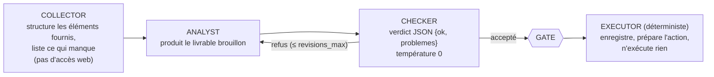
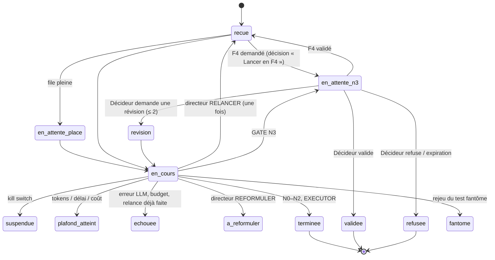

# 02 — Agents et pipeline

## 1. Organisation des 93 rôles

Les rôles sont décrits par **93 fiches YAML** dans `nexus-core/agents/` (chargées et validées par `nexus-core/app/agents.py` : champs obligatoires, rôle connu, type `llm`/`deterministe`, identifiant unique ; test `tests/test_agents_gate.py::test_chargement_93_agents`). **[FAIT]**

| Ensemble | Nombre | Rôles | Appelle un LLM |
|---|---|---|---|
| Noyau | 5 | NEXUS-PRIME (routage), NEXUS-GATE (classement N0–N3), NEXUS-SENTINEL (arrêt d'urgence), NEXUS-LEDGER (journal), NEXUS-BUDGET (tokens, coûts) | PRIME et GATE oui ; SENTINEL, LEDGER, BUDGET **non** (déterministes) |
| Directeurs | 8 | DIR-STRATEGIE, DIR-CROISSANCE, DIR-CREATION, DIR-TECH, DIR-OPERATIONS, DIR-SAVOIR, DIR-AGENTOPS, DIR-IMPACT (9 directions avec le noyau) | oui (arbitrage d'escalade) |
| Services × quadrant | 20 × 4 = 80 | COLLECTOR, ANALYST, CHECKER, EXECUTOR | COLLECTOR, ANALYST, CHECKER oui ; EXECUTOR **non** |
| **Total** | **93** | 70 rôles LLM, 23 déterministes (20 EXECUTOR + SENTINEL, LEDGER, BUDGET) | |

Comptage vérifié sur les fiches de `v2` : collector 20, analyst 20, checker 20, executor 20, directeur 8, prime/gate/sentinel/ledger/budget 1 chacun ; 70 `llm`, 23 `deterministe`.

### 1.1 Les 20 services

| Direction | Service | Département | Plancher F | Plancher GATE |
|---|---|---|---|---|
| STRATÉGIE | LEX-GUARD/conformite | Conformité | — | N2 (N3 si tiers) |
| STRATÉGIE | LEX-GUARD/droit-france, droit-europe, droit-international | Droit | F3 | N2 (N3 si tiers) |
| CROISSANCE | REVENUE-CORE/propositions | Ventes | — | — |
| CRÉATION | CONTENT-ARENA/redaction | Contenus | — | N2 (service de publication) |
| CRÉATION | DESIGN-SYSTEM/ui | Design | — | — |
| TECH | CODE-CORE/revue, CODE-CORE/conception | Ingénierie | — | N2 si code |
| TECH | CYBER-FORTRESS/audit, veille, conformite, incident | Cybersécurité (16 agents) | F3 | N2 ; N3 si action production ou notification |
| OPÉRATIONS | OPS-CORE/projets | Projets | — | — |
| OPÉRATIONS | PILOT-CORE/etudes, PILOT-CORE/pilotage | Pilotage | F3 | N3 si engagement financier |
| SAVOIR | R&D-PARADOX/veille | Recherche | — | — |
| AGENTOPS | AGENT-FACTORY/evaluation | Qualité agents | — | — |
| IMPACT | GREEN-CORE/environnement, GREEN-CORE/rse | Environnement | — | RSE : N3 si communication externe |

Sources : `nexus-core/app/pipeline.py` (`MOTS_SERVICES`, `appliquer_planchers`), `nexus-core/app/gate.py` (`classer_regles`).

### 1.2 Format d'une fiche agent

```yaml
id: LEX-GUARD-DROIT-FRANCE-CHECKER       # unique
nom: LEX-GUARD-DROIT-FRANCE Contrôleur
role: checker                            # prime|gate|sentinel|ledger|budget|directeur|collector|analyst|checker|executor
type: llm                                # facultatif ; « deterministe » pour EXECUTOR, SENTINEL, LEDGER, BUDGET
direction: STRATEGIE
departement: Droit
service: LEX-GUARD/droit-france
mission: '…'
consignes: |-                            # prompt système en français
  …
outils_autorises: [lecture_livrable]
modele: null                             # facultatif : modèle imposé pour ce rôle
```

Le schéma correspondant est `protocole/schemas/agent.schema.json` ; la CI valide les 93 fiches (`python protocole/valider.py --agents nexus-core/agents`).

### 1.3 Quadrant d'un service



Un agent déterministe ne peut pas appeler de modèle : `Contexte.appel` lève une erreur si on le tente (`tests/test_agents_gate.py::test_agent_deterministe_jamais_appele`).

## 2. Pipeline d'une mission

Entrée : `POST /api/missions` (ou `/cockpit/api/missions`, ou l'outil MCP `mothership_mission`). Traitement en tâche de fond par la file FIFO (`file_missions.py`) puis `pipeline.traiter(mid)`. Prise **atomique** (`transition recue|en_attente_place → en_cours`) : une mission soumise deux fois n'est traitée qu'une fois (`tests/test_concurrence.py::test_mission_traitee_une_seule_fois`). **[FAIT]**

### 2.1 Statuts d'une mission



Statuts finaux : `terminee`, `validee`, `refusee`, `echouee`, `plafond_atteint`, `a_reformuler`, `suspendue`, `fantome`. Au redémarrage, une mission `en_cours` devient `echouee` (« interrompue par un redémarrage ») ; les missions `recue` / `en_attente_place` sont remises en file dans l'ordre (`pipeline.reprendre_au_demarrage`, `tests/test_file_reprise.py`).

### 2.2 Étapes détaillées (`pipeline._executer`, `_boucle_qualite`)

| N° | Étape | Responsable | Comportement | Journal LEDGER |
|---|---|---|---|---|
| 1 | Contrôle d'arrêt | SENTINEL (code) | `kill:grille`, `kill:dir:<DIR>`, `kill:agent:<id>` dans la table `etat` → `suspendue` | `controle_ok`, `mission_suspendue` |
| 2 | Vérification F4 au lancement | BUDGET (code) | budget et clé revérifiés ; sinon repli F3 ou refus | `fonctionnement_repli_f3` |
| 3 | Disponibilité locale | PRIME (code) | F1 sans IA locale joignable → F2 | `fonctionnement_releve` |
| 4 | Routage | PRIME | service explicite > mots-clés (mots entiers, poids = nombre de mots) > départage par LLM limité aux ex aequo > priorité de prudence > LLM sur toute la liste > `OPS-CORE/projets` | `routage`, `routage_departage` |
| 5 | Planchers F | PRIME (code) | droit, pilotage, cyber → F3 ; pré-classement GATE N2/N3 → F2 | `fonctionnement_releve` |
| 6 | Contexte | COLLECTOR | 3 extraits FTS de la mémoire du projet (budget 800 à 3 000 caractères selon F), fiches de veille ; tout passe par le bouclier puis est encapsulé « DONNÉES NON FIABLES » | `connaissances_fournies` |
| 7 | Brouillon | ANALYST | consigne + éléments + rappel de charte + leçons acceptées (≤ 5, ≤ 800 car.) + exemple validé du service (≤ 1 500 car.) | `appel_analyst` |
| 8 | Contrôles par code | charte, cyber, veille | voir § 4 ; un bloquant renvoie à l'ANALYST sans appel LLM | `verdict` (source `charte`, `garde_fou_cyber`, `veille_confiance_d`) |
| 9 | Contrôle qualité | CHECKER (+ local) | voit le livrable **masqué** (secrets, canaris), les alertes du bouclier, les connaissances à ne pas contredire ; F3/F4 : second CHECKER local, les deux doivent valider | `verdict`, `verdict_double_controle`, `double_controle_indisponible` |
| 10 | Boucle de correction | ANALYST ⇄ CHECKER | `revisions_max` : F1 0, F2 1, F3 2, F4 3 | `appel_analyst` |
| 11 | Escalade | directeur | au-delà : `DECISION: RELANCER / REFORMULER / …` | `escalade_n2`, `relance_automatique` |
| 12 | Classement | GATE | règles sur consigne **et** livrable ; avis LLM ne peut que monter ; suspicion d'injection → plancher N2 | `classement` |
| 13 | Décision ou exécution | GATE / EXECUTOR | N3 → décision ; N0–N2 → EXECUTOR | `decision_n3_creee`, `livrable_enregistre` |
| 14 | Bilan | BUDGET | tokens entrée/sortie, coût, durée, révisions ; archive et leçons | `mission_bilan` |

### 2.3 Taille des messages

`pipeline.assembler` construit chaque message sous la limite `llm_max_chars` du niveau (F1 4 000, F2 12 000, F3 16 000, F4 24 000 caractères) en attribuant la place par priorité : le livrable reste entier tant qu'il tient, la consigne est tronquée en premier pour le CHECKER, un livrable trop long garde début et fin (`tests/test_fiche_technique.py`). **[FAIT]**

## 3. GATE : niveaux de décision N0–N3

| Niveau | Signification | Effet |
|---|---|---|
| N0 | simple lecture ou synthèse interne | EXECUTOR direct |
| N1 | livrable interne | EXECUTOR direct |
| N2 | publication selon charte, production de code, avis juridique, cybersécurité, contenu suspect | EXECUTOR direct ; plancher F2 |
| N3 | engagement externe (argent, envoi, publication, signature, suppression, production, données sensibles) | **décision humaine obligatoire** |

Règles (`nexus-core/app/gate.py`, ordre d'évaluation) :

1. `montant_eur > 0` → N3.
2. `action ∈ {envoyer_client, publier, signer, mise_en_production, depense, supprimer, donnees_sensibles}` → N3.
3. Montant écrit dans la consigne (`€`, `euros`, `$`, `USD`, `k€`…) → N3.
4. Mot-clé N3 non nié dans la consigne puis dans le livrable (publication, envoi, paiement, devis, contrat, suppression, déploiement, équivalents anglais, racines verbales conjuguées). Négations étroites reconnues (« aucun paiement », « ne pas publier ») ; « envoyez-moi » neutralisé ; « ligne de commande » neutralisée.
5. Règles par service : LEX-GUARD N2 minimum (N3 si tiers) ; CYBER-FORTRESS N2 minimum (N3 si action production / notification) ; PILOT-CORE N3 si engagement ; GREEN-CORE/rse N3 si communication externe.
6. N2 si service de publication, code, script, charte ; N0 si synthèse/lecture ; sinon N1.
7. `classer()` : niveau final = max(règles, avis LLM) ; si `suspect` (bouclier) → au moins N2.

Statut : **[FAIT]** pour les règles ci-dessus (tests `test_agents_gate.py`, `test_gate_audit.py`, `test_gate_commande.py`, `test_fiche_technique.py`). **[EN COURS]** : la campagne `iterations-100` du 4 novembre 00 h 51 a relevé des contournements (montants en lettres « mille cinq cents euros », « 1,2 M€ », impératifs « vire », « efface », « mets en ligne ») ; `gate.py` a été modifié à 00 h 52 (racines verbales `_RACINES_N3`) : la correction doit être re-mesurée.

## 4. Contrôles déterministes avant le CHECKER

| Contrôle | Module | Bloquant → | Détails |
|---|---|---|---|
| **Charte du projet** | `charte.py` + `nexus-core/chartes/<projet>.yaml` + `_commun.yaml` | retour ANALYST | marques d'autres projets, termes interdits (« garanti à 100 »…), mentions obligatoires par type de livrable (juridique, publication, commercial), vouvoiement, marqueurs d'inachevé (bloquants en publication, avertissements ailleurs). 7 chartes : `_commun`, `freelance-ia`, `nexus`, `poker-feeling`, `poker-winners`, `redkards`, `top-solver`. Surcharge par `/config/chartes`, `NEXUS_CHARTES_DIR` ou variante du test fantôme. |
| **Garde-fou cyber** | `cyber.py` | refus pour CYBER-FORTRESS | secret (clé privée, `sk-…`, jetons GitHub/Slack/JWT, AWS, bcrypt, affectations `password=`) ou action offensive (reverse shell, metasploit, contournement d'authentification…) ; le secret est masqué `<SECRET MASQUÉ>` avant tout stockage |
| **Veille confiance D** | `veille.affirmations_d` | retour ANALYST | une ligne qui cite une fiche de réseau social sans formule de prudence (« selon », « non vérifié »…) est refusée |
| **Masquage universel** | `pipeline._assainir` | — | secrets et canaris masqués pour **tous** les services avant stockage et avant envoi au CHECKER |
| **Mention juridique** | `pipeline.garantir_mention_juridique` | — | ajout automatique de « Information générale, ne remplace pas l'avis d'un avocat » pour tout LEX-GUARD/* |

## 5. Bouclier anti-injection

`nexus-core/app/bouclier.py` (stdlib uniquement) **[FAIT]** :

- `nettoyer_contenu` : HTML/scripts, commentaires, texte caché (CSS, blanc sur blanc), caractères invisibles et bidi, tags Unicode, base64 et `data:`, homoglyphes, NFKC, troncature à 20 000 caractères.
- `detecter_injection` : score 0–100, distinction injonction / mention (facteur 0,25 pour un motif cité), bonus de combinaison (+15) et de canal caché (+25).
- Politique : score ≥ 60 → **rejet** (non transmis, journalisé) ; ≥ 30 → encapsulé + alerte (CHECKER, carte Décideur) ; sinon encapsulé sans alerte.
- `encapsuler` : délimiteurs aléatoires « DONNÉES NON FIABLES ».
- `verifier_sortie` : signes d'injection réussie dans le livrable (canari, action N3 non demandée, secret) → plancher GATE N2, risque au moins moyen sur la décision.

Points d'application : connaissances (ajout manuel → 422 si ≥ 60), import, mémorisation automatique, extraits pour le COLLECTOR, fiches de veille, leçons, exemples, variantes du test fantôme, propositions du pilote (`tests/test_bouclier_integration.py`, 19 tests).

## 6. Niveaux de fonctionnement F1–F4

Source unique : `nexus-core/fonctionnement.yaml` (chargé par `fonctionnement.py`). **[FAIT]**

| | F1 Éclair | F2 Standard (défaut) | F3 Renforcé | F4 Expert |
|---|---|---|---|---|
| Fournisseur | Ollama local | courant (Ollama Cloud si clé, sinon local) | courant | Anthropic |
| Modèles | `NEXUS_MODEL_LOCAL` | `NEXUS_MODEL`, par rôle | idem | Sonnet (ANALYST, CHECKER), Haiku (autres) |
| Budget tokens | 6 000 | 20 000 (`BUDGET_TASK_TOKENS`) | 40 000 | 80 000 |
| Corrections | 0 | 1 | 2 | 3 |
| Double contrôle local | non | non | oui | oui |
| `llm_max_chars` / `num_ctx` | 4 000 / 4 096 | 12 000 / 8 192 | 16 000 / 8 192 | 24 000 / 8 192 |
| Délai max | 180 s | 600 s | 1 200 s | 1 800 s |
| Coût max | 0 € | 0 € | 0 € | 0,50 € |

Règles :

- **Le niveau ne descend jamais** (`Contexte.relever`) ; chaque relèvement est tracé (`fonctionnement_raison`, LEDGER `fonctionnement_releve`).
- **F4** : indisponible si `BUDGET_MONTHLY_EUR=0`, clé absente ou budget restant insuffisant → repli F3 (`repli_f3=true`, défaut) ou HTTP 422. Disponible → décision N3 `objet=lancement_f4` « Lancer en F4 — coût estimé X € » ; **aucun appel avant validation** ; révision impossible ; disponibilité revérifiée au démarrage. Le coût maximal de chaque appel (entrée estimée + sortie maximale) est contrôlé **avant** l'appel ; aucune relance automatique ne monte en F4.
- **Plafonds** (tokens, délai global, coût) → statut `plafond_atteint`, livrable partiel conservé, proposition de relance au niveau supérieur.
- Coût F4 : tarifs $/MTok de `fonctionnement.yaml` × `EUR_PAR_USD` (défaut 0,92). Coût F1–F3 : 0 € (sauf tarif `LLM_EUR_PAR_1K_TOKENS` configuré pour Ollama Cloud).

### 6.1 Choix des modèles par rôle

`llm.modele_pour` : fiche agent > `NEXUS_MODELES_ROLES` (`role=modele` ou `role@fournisseur=modele`) > `NEXUS_MODEL_CHECKER` > **diversité** (en Ollama Cloud, le CHECKER prend le premier modèle de `NEXUS_MODELES_CLOUD` différent de celui de l'ANALYST ; défaut `gemma4:31b,gpt-oss:120b`) > `NEXUS_MODEL`. Les modèles réellement utilisés sont enregistrés par rôle (`missions.modeles_json`). Bascule automatique sur le modèle local si le cloud répond 429/erreur (`LLM_FALLBACK=ollama`), journalisée `bascule_llm` (`tests/test_llm_cloud.py`, `tests/test_modeles_roles.py`).

## 7. Double contrôle

En F3/F4, après un verdict positif du CHECKER principal, un second CHECKER est exécuté **avec le modèle local** (température 0). Les deux doivent valider ; un refus du second est préfixé `[double contrôle]` et renvoie à l'ANALYST. Si le modèle local est injoignable, le double contrôle est **tracé comme indisponible** (`double_controle_indisponible`, message sur la mission) : jamais silencieux (`pipeline._controler`, `tests/test_fonctionnement.py::test_double_controle_f3_refus_puis_revision`). **[FAIT]**

## 8. Révisions et directeur

| Mécanisme | Déclencheur | Limite | Effet |
|---|---|---|---|
| Correction automatique | refus CHECKER | `revisions_max` du niveau | nouvel ANALYST avec la liste des problèmes |
| Escalade au directeur | refus au-delà de la limite | — | le directeur répond `DECISION: RELANCER / REFORMULER / …` et `CONSIGNE:` |
| Relance automatique | `RELANCER` | **une seule** par mission (`relance_auto`) | niveau +1 si F2/F3 (jamais F4), consigne complétée, retour en file |
| Reformulation | `REFORMULER` | — | statut `a_reformuler` + suggestion |
| Révision humaine | Décideur « réviser » (motif 3–200 caractères) | **2** par mission (`MAX_REVISIONS`) | nouvel ANALYST avec le commentaire prioritaire, puis CHECKER et GATE |

Tests : `tests/test_directeur.py` (5), `tests/test_fiche_technique.py::test_revision_relance_la_mission_et_limite`. **[FAIT]**

## 9. Décisions N3 et Décideur

- Création : `pipeline.creer_decision_si_possible` ; plafond `N3_DAILY_CAP` (15/jour) — au-delà la mission reste `en_attente_n3` sans fiche, la fiche est créée par la maintenance dès que possible.
- Fiche : résumé 3 lignes, recommandation, coût estimé, **risque explicable** (`decideur.evaluer_risque` : montant ≥ `NEXUS_SEUIL_RISQUE_ELEVE_EUR` → élevé ; irréversibilité, production, données sensibles → élevé ; tiers/publication → moyen ; alertes du bouclier → au moins moyen), sources, avis du CHECKER.
- Notification : regroupée par **session** (`NEXUS_SESSIONS_N3`, défaut 12 h 30 et 19 h, Europe/Paris) ; immédiate si l'expiration est à moins de 4 h ; rappel 2 h avant le refus automatique ; texte ntfy **générique**.
- Expiration : `N3_TIMEOUT_HOURS` (24 h) → `expiree` = refus par défaut (atomique face à une décision concurrente).
- Action : en deux temps (jeton à usage unique de 120 s), **code Décideur** à 6 chiffres pour valider un risque élevé (5 erreurs → verrou 15 min), appliquée par `UPDATE … WHERE statut='en_attente'` (un seul gagnant en cas de double clic).
- Types de décision : `livrable`, `lancement_f4`, `plan_semaine` (pilote : cases à cocher, tout décoché par défaut, révision impossible).

Tests : `tests/test_decideur.py` (19), `tests/test_concurrence.py`, `tests/test_pilote.py`. **[FAIT]**

## 10. EXECUTOR

`pipeline.executer_livrable` (déterministe) **[FAIT]** :

1. écrit `livrables/<projet>/<id>.md` (en-tête : mission, projet, service, niveau, action préparée « à réaliser par un humain ou un workflow n8n ») ;
2. passe la mission à `terminee` (ou `validee` après N3) avec le message « Aucune action externe exécutée » ;
3. journalise `livrable_enregistre` avec `action_externe=false` ;
4. mémorise un résumé du livrable dans la mémoire du projet (`NEXUS_MEMOIRE_AUTO=1`), sauf livrable suspect ;
5. met en file l'export QG signé (si configuré).

Aucun EXECUTOR n'envoie, ne publie, ne paie ni ne déploie (`tests/test_pipeline.py::test_executor_aucune_action_externe`).

## 11. LEDGER

Journal **append-only** (aucune route de modification ni de suppression), une entrée par événement : `horodatage`, `acteur`, `action`, `mission_id`, `details_json`, `hash_prec`, `hash`, `algo`. L'empreinte couvre `[horodatage, acteur, action, mission_id, details_json, hash_prec]` en JSON canonique.

- `algo=hmac` : HMAC-SHA256 avec `LEDGER_HMAC_KEY` (64 hex, hors base) ; `algo=sha256` : mode ancien sans clé, signalé dans `/api/sante` (`ledger_hmac=false`, `avertissements`).
- Une entrée SHA-256 après une entrée HMAC invalide la chaîne (pas de déclassement) ; passage SHA-256 → HMAC accepté.
- Écritures sérialisées par verrou (1 worker).
- Vérification : `GET /api/ledger/verifier` → `{valide, entrees, premiere_erreur, motif, hmac_actif, entrees_signees, entrees_non_signees}`.

Principales actions journalisées : `demarrage`, `mission_recue`, `controle_ok`, `routage`, `fonctionnement_applique|releve|repli_f3`, `appel_<role>`, `verdict`, `classement`, `decision_n3_creee`, `decision_validee|refusee|revision`, `decision_expiree`, `decision_api_refusee`, `livrable_enregistre`, `plafond_atteint`, `mission_bilan`, `killswitch_on|off`, `bascule_llm`, `sortie_suspecte`, `connaissance_rejetee`, `archive_effacement`, `code_decideur_errone|verrou`, `notification_echec`.

Tests : `tests/test_ledger_hmac.py` (6), `tests/test_pipeline.py::test_ledger_chaine_et_alteration`. **[FAIT]**

## 12. Fonctions d'amélioration continue

| Fonction | Module | Principe | Statut |
|---|---|---|---|
| Leçons apprises | `lecons.py` | signaux déterministes (refus CHECKER, charte, refus/révision Décideur, plafonds, directeur, avis négatifs) → candidate → proposée (≥ `NEXUS_LECONS_SEUIL`) → acceptée/rejetée par le Décideur ; injection ≤ 5 leçons / 800 car. ; suspension automatique si la note du banc baisse de plus de `NEXUS_LECONS_BAISSE` points | [FAIT] (`tests/test_memoire_collective.py`) |
| Exemples | `exemples.py` | livrable N3 validé, noté ≥ 4/5 ou marqué ; ≤ 3 actifs par service ; filtres secret, charte, bouclier | [FAIT] (`tests/test_exemples.py`) |
| Note en un geste | `avis.py` | 👍/👎 + motif sur un échantillon stable (20 %) des missions des 14 derniers jours | [FAIT] (`tests/test_avis.py`) |
| Test fantôme | `fantome.py`, `surcharges.py` | rejoue K=5 missions avant/après une variante (leçon, exemple, charte, modèles), la nuit, sans effet de bord ; gain < 0 → déconseillé | [FAIT] (`tests/test_fantome.py`) |
| Pilote hebdomadaire | `pilote.py` | lundi 07 h 30, une mission PILOT-CORE/pilotage par projet actif, consolidée en une décision « Plan de la semaine » | [FAIT] (`tests/test_pilote.py`) |
| Résumé quotidien | `resume.py` | ntfy générique à 19 h | [FAIT] (`tests/test_pwa_resume.py`) |
| Export QG | `export_qg.py` | webhook signé HMAC, file avec reprise exponentielle (1 min → 6 h, 10 tentatives) | [FAIT] (`tests/test_export_qg.py`) |
