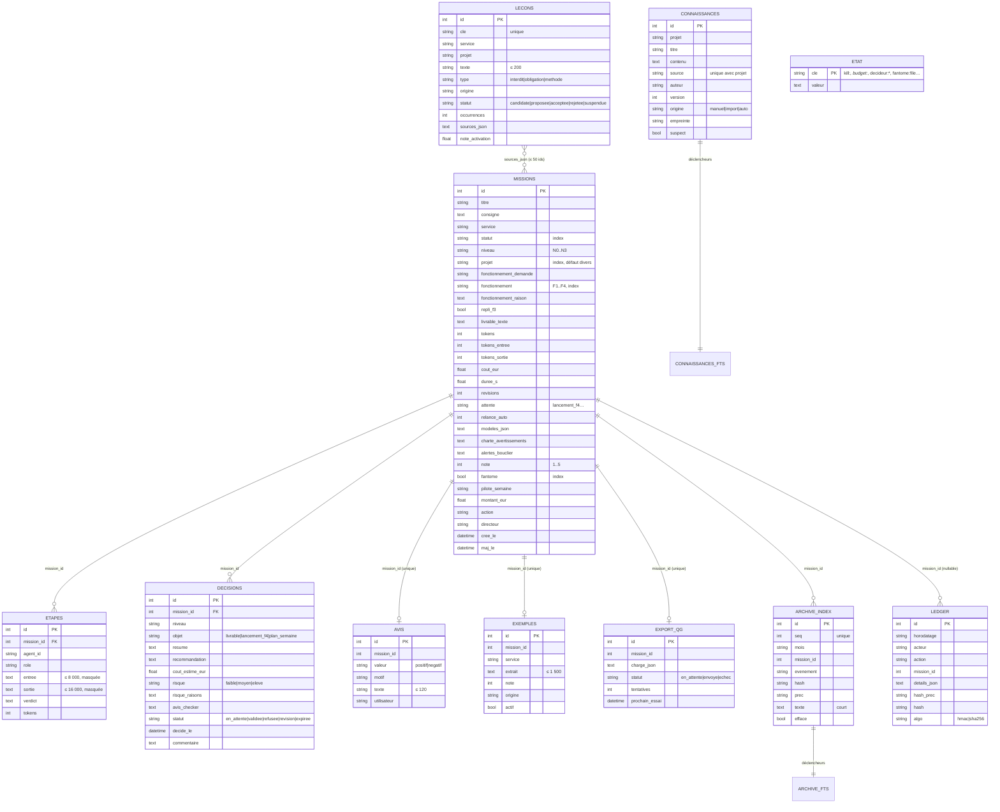
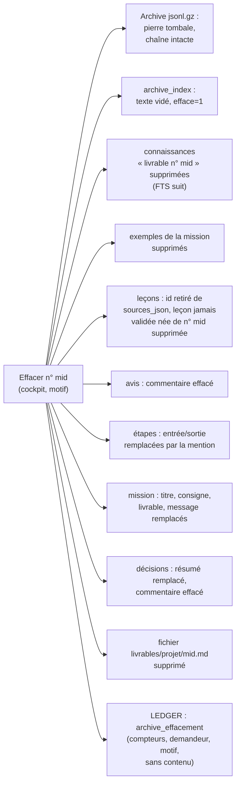

# 03 — Données

## 1. Inventaire des stockages

| Stockage | Emplacement (hôte) | Propriétaire | Format | Sauvegardé | Statut |
|---|---|---|---|---|---|
| Base du noyau | `data/nexus-core/nexus.db` | nexus-core | SQLite WAL (PostgreSQL en mode complet) | oui (copie cohérente) | [FAIT] |
| Livrables | `data/nexus-core/livrables/<projet>/<id>.md` | EXECUTOR | Markdown | oui | [FAIT] |
| Archive immuable | `data/nexus-core/archive/AAAA-MM.jsonl.gz` | `archive.py` | JSONL gzip, chaîné HMAC | oui | [FAIT] |
| Leçons ajoutées aux chartes | `data/nexus-core/chartes_ajouts/` | `lecons.py` | YAML | oui | [FAIT] |
| Archive compactée | `<archive>/compact/` (`blocs/`, `dictionnaires/`, `compaction.db`) | `compaction.py` | blocs zlib/lzma + index SQLite | à ajouter à `backup.sh` | [EN COURS] (non branché) |
| Mémoire commune des IA | `data/nexus-bridge/bridge.db` | nexus-bridge | SQLite WAL + FTS5 | oui | [FAIT] |
| Veille | `data/veille/veille.db` (monté `:ro` dans nexus-core) | collecteur (cron hôte) | SQLite + FTS5, publication atomique | oui | [FAIT] |
| Connaissances sources | `projets/*.md`, `tests-poker/contexte/*.md` (montés `:ro`) | Décideur | Markdown | dans le dépôt | [FAIT] |
| Configuration métier | `nexus-core/projets.yaml`, `fonctionnement.yaml`, `chartes/*.yaml`, `agents/*.yaml` | dépôt | YAML | dans le dépôt | [FAIT] |
| Secrets | `.env` (root, lecture root seule) | `install.sh` | clé=valeur | chiffré (`env.sauvegarde.gpg` ou `.age`) | [FAIT] |
| Sauvegardes | `backups/<AAAA-MM-JJ_HHMMSS>/` (7 gardées) ; option Google Drive | `backup.sh` | tar.gz + gpg | — | [FAIT] |
| Mode complet | `data/postgres`, `data/redis`, `data/n8n`, `data/uptime-kuma`, `data/ntfy` | services | natifs | PostgreSQL et n8n oui | [FAIT] |

## 2. Modèle de données de nexus-core

Défini par SQLAlchemy 2 dans `nexus-core/app/models.py`. Horodatages en UTC sans fuseau (`models.maintenant`). Pragmas SQLite : `journal_mode=WAL`, `synchronous=NORMAL`, `busy_timeout=30000`, `foreign_keys=ON` (`db.py`).

Table `etat` : clés utilisées — `kill:grille`, `kill:dir:<DIR-X>`, `kill:agent:<ID>` (SENTINEL) ; `budget:<AAAA-MM>:tokens|eur` (BUDGET, incrément atomique `INSERT … ON CONFLICT DO UPDATE`) ; `decideur:echecs`, `decideur:verrou` (code Décideur) ; `fantome:file` ; états du pilote et des tâches quotidiennes.

### 2.1 Migrations

Pas d'outil de migration externe : `db.migrer` ajoute les colonnes manquantes (`ALTER TABLE … ADD COLUMN`, portable SQLite/PostgreSQL) à partir de la liste `COLONNES_AJOUTEES` (21 colonnes à ce jour : `missions.projet`, `fonctionnement_*`, `repli_f3`, `tokens_entree|sortie`, `duree_s`, `revisions`, `attente`, `relance_auto`, `modeles_json`, `charte_avertissements`, `note`, `fantome`, `pilote_semaine`, `alertes_bouclier`, `decisions.objet`, `decisions.risque_raisons`, `ledger.algo`, `connaissances.suspect`). `init_db` réessaie 30 fois (PostgreSQL peut démarrer après nexus-core). Les tables FTS5 et leurs déclencheurs sont créés par `memoire.initialiser_fts` et `archive.initialiser_fts` (SQLite uniquement ; repli `LIKE` sous PostgreSQL). Tests : `test_fonctionnement.py::test_migration_colonnes_fonctionnement`, `test_projets.py::test_migration_colonne_projet`. **[FAIT]**

Limite connue : aucune migration descendante ni renommage de colonne ; toute évolution doit rester additive (cohérent avec la règle de compatibilité du protocole, voir 05).

## 3. Base de la passerelle (`bridge.db`)

Schéma dans `nexus-bridge/app/db.py` :

| Table | Rôle | Particularités |
|---|---|---|
| `memoires` | mémoire commune | versions chaînées (`racine_id`, `remplace_id`, `remplacee_par`), statut `active\|remplacee\|archivee` ; le contenu n'est **jamais modifié** |
| `memoires_fts` | index plein texte | FTS5 `unicode61 remove_diacritics 2`, déclencheurs |
| `taches`, `taches_notes` | tâches partagées | statut `a_faire\|en_cours\|a_valider\|fait`, verrou `pris_par` |
| `messages`, `messages_lus` | messagerie entre IA | lecture par destinataire |
| `passations` | reprise de travail par projet | résumé, état, prochaines étapes |
| `journal` | journal sans contenu (qui, outil, objet, résultat) | **append-only** imposé par déclencheurs SQL (`RAISE(ABORT)` sur UPDATE/DELETE) |

## 4. Archive immuable de la mémoire collective

`nexus-core/app/archive.py` **[FAIT]** :

- un enregistrement JSON complet par événement de mission (`fin_execution`, décisions humaines) : consigne, projet, service, niveau F, modèles, étapes (sorties ≤ 2 000 car.), livrable (≤ 20 000), verdicts, violations de charte, décisions, révisions, tokens, durée, note ;
- un fichier par mois `AAAA-MM.jsonl.gz` (ajout de membres gzip, aucune réécriture hors effacement) ;
- chaînage : empreinte = HMAC-SHA256(`LEDGER_HMAC_KEY`) sur « seq | précédente | empreinte du contenu | référence LEDGER » ; l'empreinte du contenu est conservée à part, ce qui permet de remplacer le contenu par une **pierre tombale** sans casser la chaîne ;
- filtre anti-secret (`cyber.masquer`) sur toutes les chaînes avant écriture ;
- index `archive_index` + `archive_fts` (texte court) pour la recherche ;
- vérification : `GET /api/archive/verifier`.

Tests : `tests/test_memoire_collective.py` (archive chaînée, altération détectée, sans secret, pierre tombale).

## 5. Compaction par paliers

`nexus-core/app/compaction.py` (1 674 lignes, stdlib) et banc `compaction/mesure.py` **[EN COURS]** — le module est complet et couvert par 22 tests (`tests/test_compaction.py`), mais **aucun appel n'existe dans `main.py`, `archive.py`, `memoire.py`, `backup.sh`, `restore.sh` ni `veille/collecteur.py`** : les 5 points d'intégration sont décrits dans l'en-tête du module.

| Palier | Âge | Contenu conservé | Compression | Ratio mesuré (fichiers) |
|---|---|---|---|---|
| Chaud | ≤ 30 j | inchangé (missions SQLite + archive jsonl.gz + FTS) | gzip par ligne | 3,45 |
| Tiède | 31–180 j | livrable complet, étapes réduites (agent, rôle, verdict, tokens, avis tronqué à 300 car.) | blocs zlib + dictionnaire entraîné | 12,91 |
| Froid | > 180 j | résumé ≤ 600 car., métriques, empreintes, signaux de mémoire collective, extrait d'exemple | blocs lzma | 23,15 |

Index `compaction.db` : `meta`, `dictionnaires`, `blocs` (racine de Merkle), `enregs` (bloc, position, offset, feuille), `fragments` (déduplication des segments ≥ 64 car. vus ≥ 2 fois), `journal` (chaîné HMAC), `agregats` (par période et service), `cfts` (FTS5 `detail=none` par défaut). Effacement RGPD : réécriture atomique du bloc avec pierre tombale (~0,5 s mesuré). Mesures complètes : [`09-performance-et-capacite.md`](09-performance-et-capacite.md).

## 6. Mémoire projet

`nexus-core/app/memoire.py` **[FAIT]** :

- **Sources** : ajout manuel (API ou cockpit, refus 422 si secret ou injection ≥ 60), import idempotent au démarrage depuis `NEXUS_CONNAISSANCES_DIR` (découpage par titres, morceaux ≤ 1 500 car., secrets masqués), résumé automatique (≤ 800 car.) des livrables enregistrés (`NEXUS_MEMOIRE_AUTO=1`, jamais pour un livrable suspect ou refusé).
- **Unicité** : (`projet`, `source`) ; empreinte SHA-256 pour l'idempotence ; versionnement.
- **Recherche** : FTS5 classée bm25, accents ignorés ; `extraits()` renvoie les 3 passages les plus pertinents avec leur source, dans un budget de 800 (F1), 2 000 (F2, F3) ou 3 000 (F4) caractères.
- **Protection** : chaque extrait repasse par le bouclier et est encapsulé avant d'atteindre COLLECTOR et CHECKER ; une connaissance de score ≥ 30 est stockée avec `suspect=true`.

## 7. Mémoire collective

Vue unifiée (`routes_memoire.recherche_commune`, outil MCP `memoire_collective_rechercher`) : connaissances des projets + leçons acceptées + exemples actifs + archive. Les **décisions** sur la mémoire collective (accepter/rejeter une leçon, effacer) sont réservées au cockpit. **[FAIT]**

| Objet | Cycle de vie | Bornes |
|---|---|---|
| Leçon | candidate → proposée (≥ 3 missions distinctes) → acceptée / rejetée ; acceptée → suspendue si régression > 10 points sur ≥ 3 mesures du banc | texte ≤ 200 car. ; injection ≤ 5 leçons, ≤ 800 car. ; jamais supprimée (sauf leçon jamais validée née d'une mission effacée) |
| Exemple | créé par validation N3, note ≥ 4 ou marquage manuel ; retiré manuellement ou par test fantôme défavorable | ≤ 3 actifs par service ; extrait ≤ 1 500 car. |
| Avis | un par mission | texte ≤ 120 car. ; motifs fermés (faux, incomplet, hors ton, mauvaise marque, trop long, autre) |

## 8. Veille

Base `veille.db` produite par `veille/collecteur.py` (cron hôte toutes les 6 h) **[FAIT]** :

- Table `fiches` : `source_id`, `titre`, `resume`, `url`, `url_canonique` (unique), `empreinte` (unique), `date`, `domaines`, `services`, `projets`, `confiance` (A officielle, B expert, C communauté/presse, D réseau social), `score_injection`, `licence`, `stockage` (`integral`, `extrait`, `metadonnees`, `agrege`), `texte`, `ref`, `autorite`, `tonalite`, `expire_le` ; FTS5 `fiches_fts` ; tables `etat_sources`, `quotas`, `passages`.
- Catalogue : **322 sources** (`veille/catalogue.yaml`), `robots.txt` respecté, délai ≥ 2 s par domaine, quotas, bouclier à l'ingestion, anonymisation des contenus sociaux.
- Stockage selon la **licence** (droit d'auteur) : intégral pour Etalab/CC/RFC/W3C/EUR-Lex ; extrait ≤ 500 car. (≤ 300 pour la presse) ; métadonnées seules pour ISO/ETSI ; agrégats pour les réseaux sociaux.
- Lecture par nexus-core : `nexus-core/app/veille.py` (`VEILLE_LECTURE_SEULE=1`, montage `:ro`), au plus `NEXUS_VEILLE_MAX` (5) fiches par mission, citées `[veille:<source> · confiance X · date]`.

Intégration au COLLECTOR **[EN COURS]** : 2 tests de `nexus-core/tests/test_veille.py` échouent sur la branche `v2` au 4 novembre (les fiches n'arrivent plus dans le message du COLLECTOR) ; la suite propre de `veille/` (206 tests) est verte.

## 9. Rétention

| Donnée | Durée | Mécanisme | Source |
|---|---|---|---|
| Missions, étapes, décisions, LEDGER | illimitée (append-only pour le LEDGER) | — ; compaction tiède/froid prévue au-delà de 30 j | `models.py`, `compaction.py` |
| Archive mensuelle | illimitée ; paliers à 30 j et 180 j **[EN COURS]** | `compaction.py` | |
| Fiches de veille | 180 jours (`VEILLE_RETENTION_JOURS`) ; sociales 30 jours (`VEILLE_RETENTION_SOCIAL_JOURS`) | purge par le collecteur ; archivage froid prévu | `veille/collecteur.py` |
| Sauvegardes locales | 7 dernières (`--garder N`) | rotation `backup.sh` | `backup.sh` |
| Sauvegardes Google Drive | 7 dernières | rclone | `backup.sh --hors-serveur` |
| Journaux Docker | 3 × 10 Mo par service | `logging` json-file | `docker-compose.yml` |
| Exécutions n8n | 336 h (14 jours) | `EXECUTIONS_DATA_MAX_AGE` | `docker-compose.yml` |
| Jetons de confirmation Décideur | 120 s, en mémoire | `decideur.JETON_TTL_S` | `decideur.py` |
| Échantillon de notation | 14 jours | `avis.FENETRE_JOURS` | `avis.py` |

## 10. RGPD et effacement en cascade

Base légale et registre : voir `veille/RGPD_social.md` pour la veille sociale (modèle de fiche de registre et mention d'information). Le système ne traite pas de données de clients finaux par conception ; les données personnelles possibles sont celles que le Décideur saisit dans une consigne.

Effacement d'une mission (`POST /cockpit/api/memoire/archive/effacer/{mid}`, **cockpit uniquement**) — `archive.effacer` puis `archive._effacer_cascade` **[FAIT]** :

Limites connues :

- les **sauvegardes** gardent l'ancien contenu jusqu'à leur rotation (7 jours ; copie Drive en clair hors `.env`) ;
- la **mémoire commune de la passerelle** (`bridge.db`) n'est pas couverte par la cascade (archivage par l'auteur ou le propriétaire uniquement, contenu conservé) ;
- l'archive **compactée** devra appeler `compaction.effacer_mission` (point d'intégration n° 1) **[EN COURS]** ;
- le LEDGER conserve, par construction, les `details_json` des événements antérieurs (titre de mission à la réception, commentaires de décision) : ces champs ne sont pas effacés pour préserver la chaîne. **Point à arbitrer** (minimisation des `details_json`).

Test : `tests/test_bouclier_integration.py::test_effacement_rgpd_en_cascade`, `tests/test_memoire_collective.py::test_effacement_pierre_tombale_chaine_intacte`, oracle O13 de `iterations-100` (191 mini-scénarios en violation lors de la campagne du 4 novembre : défauts ouverts, voir 08).
