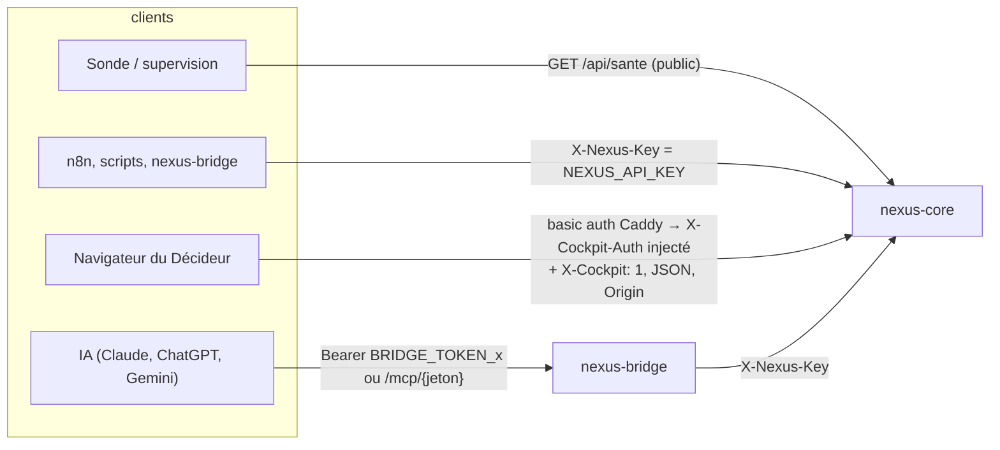

# 04 — API

Toutes les réponses sont en JSON UTF-8 et en français. Les erreurs de FastAPI ont la forme `{"detail": "<message>"}` (422 de validation Pydantic : `detail` est une liste). Aucune documentation OpenAPI n'est exposée en production (`docs_url=None`, `openapi_url=None` dans `nexus-core/app/main.py`) : ce document et le Protocole NEXUS v1 (`protocole/schemas/`) font référence.

## 1. Modèle d'authentification

| Surface | Préfixe | Authentification | Peut décider (N3, leçons, effacement) |
|---|---|---|---|
| API machine | `/api/*` | en-tête `X-Nexus-Key` comparé à temps constant (`main.verifier_cle`) ; `/api/sante` publique | **non** (403, sauf `NEXUS_API_PEUT_DECIDER=1`, réservé aux tests) |
| API cockpit | `/cockpit/api/*` | basic auth Caddy + `X-Cockpit-Auth` (secret interne) ; en écriture : `X-Cockpit: 1`, `Content-Type: application/json`, corps JSON valide, `Origin` = `https://NEXUS_HOST` s'il est présent (`securite.garde_cockpit`, appliqué en middleware **avant** le routage) | **oui** (seule surface) |
| Pages | `/cockpit`, `/cockpit/decideur`, PWA | basic auth Caddy | — |
| MCP | `/mcp`, `/mcp/<jeton>` | jeton par identité (≥ 32 car.) | **non** (aucun outil de décision) |
| Page passerelle | `/bridge` | basic auth Caddy | lecture seule |

Codes d'erreur d'authentification :

| Code | Cas |
|---|---|
| 401 | `/api/*` sans clé ou clé invalide (« Clé API absente ou invalide (en-tête X-Nexus-Key). ») ; `/mcp` sans jeton valide (`WWW-Authenticate: Bearer realm="nexus-bridge"`) |
| 403 | `/cockpit/api/*` : `COCKPIT_INTERNAL` non configuré (cockpit verrouillé), `X-Cockpit-Auth` absent ou faux, `X-Cockpit` absent en écriture, origine non autorisée, corps non JSON ; décision tentée par la clé API |

## 2. Routes métier (montées deux fois : `/api` et `/cockpit/api`)

Définies dans `nexus-core/app/routes.py` (`creer_routeur`). Les colonnes « API » et « Cockpit » indiquent la disponibilité sur chaque préfixe.

| Méthode | Chemin | API | Cockpit | Entrée | Sortie | Erreurs |
|---|---|---|---|---|---|---|
| GET | `/sante` | public (version courte, route déclarée avant le routeur protégé) | oui | — | `/api/sante` : `{statut, service, llm, fonctionnement_defaut, ledger_hmac, avertissements}` ; `/cockpit/api/sante` : `+ agents, arret_urgence` (vérifie aussi l'accès à la base) | — |
| POST | `/missions` | oui | oui | `{titre (1–200), consigne (1–20 000), service?, montant_eur? ≥ 0, action? ^[a-z_]+$ ≤ 40, projet? ≤ 60, fonctionnement? F1–F4, repli_f3=true}` | **202** `{id, statut (recue\|en_attente_n3), projet, fonctionnement_demande, fonctionnement, message, decision_id?, cout_estime_eur?}` | 422 service inconnu, projet inconnu, F4 indisponible sans repli |
| GET | `/missions` | oui | oui | `?statut=&projet=&limit=50 (1–500)` ; `statut=fantome` pour voir les rejeux | liste de missions (`protocole/schemas/mission.schema.json`) | 422 projet inconnu |
| GET | `/missions/{mid}` | oui | oui | — | mission + `etapes[]` | 404 |
| POST | `/missions/{mid}/note` | oui | oui | `{note: 1–5}` | `{mission_id, note, exemple}` | 404 |
| POST | `/missions/{mid}/exemple` | oui | oui | — | exemple créé | 422 secret, charte violée, mission non validée |
| GET | `/decisions` | oui | oui | `?statut=&projet=&limit=100 (1–500)` | liste (`decision.schema.json`) | 422 |
| POST | `/decisions/{did}/valider` | **403** | oui | `{commentaire? ≤ 4 000, code? ≤ 12}` (code exigé si risque élevé) | `{decision_id, mission_id, statut, relance, lancer, missions_creees?}` | 403/423 code ; 404 ; 409 déjà traitée ou mission modifiée |
| POST | `/decisions/{did}/refuser` | **403** | oui | `{commentaire?}` | idem | 404, 409 |
| POST | `/decisions/{did}/reviser` | **403** | oui | `{commentaire?}` | idem, `relance=true` | 404 ; 409 lancement F4, plan de la semaine, limite de 2 révisions |
| POST | `/killswitch` | oui | oui | `{portee: grille\|direction\|agent, cible?, actif}` | `{cle, actif, interrupteurs}` | 422 cible manquante, agent inconnu |
| GET | `/ledger` | oui | oui | `?limit=50 (1–500)` | entrées (`evenement-ledger.schema.json`) | — |
| GET | `/ledger/verifier` | oui | oui | — | `{valide, entrees, premiere_erreur, motif, hmac_actif, entrees_signees, entrees_non_signees}` | — |
| GET | `/agents` | oui | oui | — | 93 agents `{id, nom, role, direction, departement, service, mission, outils_autorises, type, appelle_llm, statut actif\|suspendu}` | — |
| GET | `/projets` | oui | oui | `?recharger=1` relit `projets.yaml` | projets + compteurs (`missions`, `missions_en_cours`, `decisions_en_attente`) | 500 fichier invalide (ancien registre conservé) |
| GET | `/projets/{code}/connaissances` | oui | oui | `?q (≤ 300)&limite=10 (1–50)` | connaissances (`connaissance.schema.json`) | 404 projet |
| POST | `/projets/{code}/connaissances` | oui (auteur `api`) | oui (auteur `proprietaire`) | `{titre 1–200, contenu 1–20 000, source? ≤ 300}` | **201** connaissance | 404 ; 422 secret détecté ou injection (score ≥ 60) |
| GET | `/export-qg` | oui | oui | — | état de la file d'export | — |
| GET | `/exemples` | oui | oui | `?service=&tous=false` | exemples | — |
| POST | `/exemples/{eid}/retirer` | oui | oui | — | `{id, actif:false}` | 404 |
| GET | `/fonctionnement` | oui | oui | — | grille F1–F4, tarifs, estimation F4, `f4_indisponible`, consommation du mois par niveau (`fonctionnement.schema.json`) | — |
| GET | `/budget` | oui | oui | — | dépense du mois (tokens, €), fournisseur | — |

Remarque : les routes d'écriture non décisionnelles (`/killswitch`, `/missions/{mid}/note`, `/missions/{mid}/exemple`, `/exemples/{eid}/retirer`, ajout de connaissance) restent accessibles avec la clé API. **Point à arbitrer** : le kill switch et la gestion des exemples relèvent du Décideur selon la règle d'or du README (`README.md` § 14) ; la restriction au cockpit n'est pas appliquée dans `routes.py`.

## 3. Mémoire collective

`nexus-core/app/routes_memoire.py`.

| Méthode | Chemin | API | Cockpit | Entrée | Sortie | Erreurs |
|---|---|---|---|---|---|---|
| GET | `/memoire/recherche` | oui | oui | `?q (2–300)&projet=&service=&limite=5 (1–20)` | `{q, projet, service, connaissances[], lecons[], exemples[], archive[]}` | 404 projet, 422 |
| GET | `/memoire/lecons` | oui | oui | `?statut=acceptee&service=&projet=&q=` | leçons | — |
| GET | `/memoire/rapport` | oui | oui | `?jours=7 (1–90)` | rapport des leçons + satisfaction | — |
| GET | `/memoire/fantome` | oui | oui | — | file et résultats du test fantôme | — |
| GET | `/archive/verifier` | oui | oui | — | vérification de la chaîne de l'archive | — |
| POST | `/cockpit/api/memoire/lecons/{lid}/accepter` | — | **seul** | `{texte? ≤ 300, terme_charte? ≤ 80, confirmation_fantome=false}` | leçon | 404 ; 409 statut ; 422 texte suspect ou test fantôme défavorable non confirmé |
| POST | `/cockpit/api/memoire/lecons/{lid}/rejeter` | — | **seul** | `{motif? ≤ 300}` | leçon | 404, 409 |
| POST | `/cockpit/api/memoire/fantome` | — | **seul** | `{type: charte\|modeles, valeur 1–500, service?, projet?}` | tâche planifiée | 422 |
| POST | `/cockpit/api/memoire/archive/effacer/{mid}` | — | **seul** | `{motif? ≤ 300}` | `{mission_id, lignes_effacees}` | 404 aucune archive |

## 4. Décideur mobile

`nexus-core/app/routes_decideur.py` — toutes sous `/cockpit/api/decideur/` (garde cockpit).

| Méthode | Chemin | Entrée | Sortie | Erreurs |
|---|---|---|---|---|
| GET | `/etat` | — | cartes des décisions en attente (résumé 3 lignes, risque et raisons, expiration, propositions du plan), historique, compteurs, `a_noter`, `lecons_proposees`, `motifs_avis` | — |
| POST | `/avis/{mid}` | `{valeur: positif\|negatif, motif? ≤ 20, texte? ≤ 120}` | avis enregistré | 404, 409 déjà noté ou non terminé, 422 motif |
| POST | `/decisions/{did}/preparer` | `{choix: valider\|refuser\|reviser, commentaire? ≤ 200}` | `{jeton, expire_s: 120, libelle, code_requis, code_configure, verrou_restant_s}` | 404 ; 409 déjà traitée, révision impossible ; 422 motif de révision < 3 car. |
| POST | `/decisions/{did}/confirmer` | `{choix, commentaire?, jeton (10–64), code? ≤ 12, missions: [int] ≤ 50}` | résultat de `pipeline.decider` | 403 code faux / non configuré ; 423 verrou (5 erreurs, 15 min) ; 409 jeton expiré, déjà utilisé, décision concurrente |

L'identité de l'utilisateur provient de `X-Cockpit-Utilisateur` (posé par Caddy, motif `[\w.@-]{1,40}`, sinon `decideur`) et est journalisée (`decideur_action`).

## 5. Pages et PWA

| Méthode | Chemin | Contenu | Cache |
|---|---|---|---|
| GET | `/` | redirection 307 vers `/cockpit` | — |
| GET | `/cockpit`, `/cockpit/` | cockpit complet (HTML autonome, aucune ressource externe) | `no-store` |
| GET | `/cockpit/decideur` | Décideur mobile (une décision par écran) | `no-store` |
| GET | `/cockpit/manifest.webmanifest` | manifeste PWA (`start_url=/cockpit/decideur`, `scope=/cockpit/`) | — |
| GET | `/cockpit/sw.js` | service worker : cache **uniquement** icônes, manifeste et page hors ligne ; jamais `/api/` ni `/cockpit/api/` | `no-cache`, `Service-Worker-Allowed: /cockpit/` |
| GET | `/cockpit/hors-ligne` | page « Pas de connexion » | — |
| GET | `/cockpit/icones/{nom}` | 5 icônes en liste blanche (404 sinon) | 7 jours |

## 6. Passerelle MCP (nexus-bridge)

### 6.1 Transport

`nexus-bridge/app/main.py` — MCP « Streamable HTTP », réponses JSON, **sans session ni SSE**.

| Méthode | Chemin | Comportement |
|---|---|---|
| POST | `/mcp` (jeton `Authorization: Bearer`) ou `/mcp/{jeton}` | JSON-RPC 2.0 : `initialize`, `notifications/initialized`, `ping`, `tools/list`, `tools/call` ; lots acceptés (≤ 10 éléments, chacun compté dans la limite de débit) |
| GET, DELETE | `/mcp…` | **405** `Allow: POST` (après authentification) |
| GET | `/bridge` | page HTML lecture seule (dernières mémoires, tâches, messages, passations, journal) |
| GET | `/sante` | sonde interne (non publiée par Caddy) |

| Statut HTTP | Code JSON-RPC | Cas |
|---|---|---|
| 200 | — / erreurs d'outil | réponse normale (une erreur métier d'outil est renvoyée dans le résultat) |
| 202 | — | notification ou lot sans réponse attendue |
| 400 | -32700 / -32600 | JSON invalide, lot vide ou > 10, version `MCP-Protocol-Version` non prise en charge |
| 401 | — | jeton absent, faux ou non configuré |
| 403 | -32600 | `Origin` hors `BRIDGE_ORIGINES` (si défini) |
| 413 | -32600 | corps > 64 Ko (Caddy coupe à 128 Ko) |
| 429 | -32029 | plus de `BRIDGE_LIMITE_PAR_MINUTE` (60) appels par minute et par identité ; `Retry-After` |
| — | -32601 / -32602 / -32603 | méthode inconnue, paramètres invalides (paramètre inconnu refusé), erreur interne |

### 6.2 Les 20 outils

Entrées strictes (`additionalProperties: false`), synchronisées avec `protocole/schemas/mcp-outils.schema.json` (test `protocole/tests/test_protocole.py::test_entrees_mcp_synchronisees_avec_la_passerelle`). Tout texte est limité à 8 Ko et refusé s'il ressemble à un secret (`garde.detecter_secret` : clés API Anthropic/OpenAI/Google/Stripe/HF, jetons GitHub/GitLab/Slack/JWT/Bearer, AWS, PEM, bcrypt, URL avec identifiants, mots de passe, cartes bancaires (Luhn), jetons du Mothership lui-même).

| Outil | Écrit | Entrée (obligatoire en gras) | Effet |
|---|---|---|---|
| `memoire_ecrire` | oui | **sujet** ≤ 200, **contenu** ≤ 8 192, **etiquettes** [], projet, remplace_id | nouvelle mémoire ou nouvelle version |
| `memoire_chercher` | non | **requete** ≤ 300, projet, limite | FTS5, accents ignorés, préfixes |
| `memoire_lire` | non | **id** | entrée + historique des versions |
| `memoire_oublier` | oui | **id**, **raison** ≤ 500 | archive (auteur ou propriétaire seulement) |
| `tache_creer` | oui | **titre**, **description**, **assigne_a** (claude/chatgpt/gemini/proprietaire), projet, priorite | tâche `a_faire` |
| `tache_lister` | non | statut, assigne_a, projet | tâches par priorité |
| `tache_prendre` | oui | **id** | verrou `en_cours` (refus si déjà prise) |
| `tache_mettre_a_jour` | oui | **id**, **statut**, **note** | réservé à l'IA qui l'a prise, au créateur ou au propriétaire |
| `message_envoyer` | oui | **destinataire** (… ou `tous`), **sujet**, **contenu** | message |
| `messages_lire` | oui (marque lu) | depuis, non_lus_seulement | messages du destinataire |
| `passation_ecrire` | oui | **projet**, **resume**, **etat**, **prochaines_etapes** | note de passation |
| `passation_derniere` | non | **projet** | dernière passation |
| `projets_lister` | non | — | `GET /api/projets` (repli liste fixe de 11 codes) |
| `projet_connaissances` | non | **projet**, q, limite | `GET /api/projets/{code}/connaissances` |
| `memoire_collective_rechercher` | non | **q**, projet, service, limite | `GET /api/memoire/recherche` |
| `lecons_lister` | non | statut, projet, service | `GET /api/memoire/lecons` (acceptées par défaut) |
| `mothership_mission` | oui | **titre**, **consigne**, service, projet, fonctionnement | `POST /api/missions` (un F4 reste soumis à la décision du Décideur) |
| `mothership_statut` | non | **id** | `GET /api/missions/{id}` |
| `mothership_decisions_en_attente` | non | — | `GET /api/decisions?statut=en_attente` (lecture seule) |
| `journal_lister` | non | limite | journal append-only sans contenu |

Tests : `nexus-bridge/tests/test_bridge.py` (28, verts).
