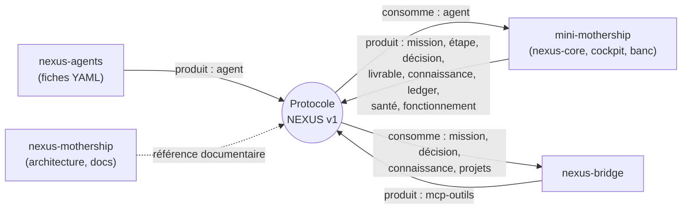

# 05 — Protocole NEXUS v1

Source : `protocole/` (`README.md`, `VERSION` = **1.0.0**, `schemas/*.schema.json`, `exemples/`, `valider.py`, `produire_exemples.py`, `tests/test_protocole.py`). **[FAIT]**

## 1. Rôle

Le Protocole NEXUS v1 est le **contrat d'échange commun aux quatre produits** (nexus-bridge, nexus-agents, mini-mothership, nexus-mothership). Il décrit en **JSON Schema draft 2020-12** les objets qui circulent entre le noyau, la passerelle MCP, la bibliothèque d'agents et les outils (banc d'essai, automatisations, cockpit). Les schémas ont été **déduits du code** (routes FastAPI, modèles SQLAlchemy, outils MCP) puis vérifiés sur des réponses réelles du noyau exécuté avec le LLM factice.



## 2. Objets

| Schéma (`protocole/schemas/`) | Objet | Champs obligatoires | Source dans le code |
|---|---|---|---|
| `commun` | types partagés : horodatage ISO 8601 (avec ou sans fuseau), code projet, service, N0–N3, F1–F4, statuts | — | — |
| `mission-creation` | requête `POST /api/missions` | `titre`, `consigne` | `routes.NouvelleMission` |
| `mission-creation-reponse` | réponse 202 | `id`, `statut`, `projet`, `fonctionnement_demande`, `fonctionnement` | `routes.creer_mission` |
| `mission` (+ `#liste`) | état d'une mission | `id`, `projet`, `titre`, `consigne`, `statut`, `cree_le`, `maj_le`, `tokens`, `cout_eur`, `fonctionnement_demande`, `fonctionnement` | `routes._mission`, `models.Mission` |
| `etape` | étape du pipeline | `id`, `agent_id`, `role`, `tokens`, `cree_le` | `models.Etape` |
| `decision` (+ `#liste`, `#action`, `#actionReponse`) | décision N3 et action humaine | `id`, `mission_id`, `niveau`, `objet`, `resume`, `recommandation`, `cout_estime_eur`, `risque`, `statut`, `cree_le` | `routes._decision`, `pipeline.decider` |
| `livrable` | vue normalisée du livrable (porté par la mission en v1) | `mission_id`, `projet`, `statut`, `texte`, `valide_par_humain` | `Mission.livrable_texte`, outil `mothership_statut` |
| `connaissance` (+ `#liste`, `#ajout`, `#ajoutReponse`) | mémoire projet | `id`, `projet`, `titre`, `contenu`, `source`, `auteur`, `version`, `origine` | `memoire.py` |
| `agent` (+ `#publique`, `#liste`) | fiche YAML et vue `GET /api/agents` | `id`, `nom`, `role`, `direction`, `departement`, `service`, `mission`, `consignes`, `outils_autorises` | `agents.py` |
| `evenement-ledger` (+ `#liste`, `#verification`) | journal chaîné | `id`, `horodatage`, `acteur`, `action`, `details`, `hash_prec`, `hash`, `algo` | `ledger.py` |
| `sante` | `GET /api/sante` | `statut`, `service`, `llm` | `main.sante_publique` |
| `fonctionnement` | `GET /api/fonctionnement` | `defaut`, `niveaux`, `mois`, `consommation` | `routes.lire_fonctionnement` |
| `mcp-outils` | 20 outils : `<outil>.entree`, `<outil>.sortie`, `erreur` ; liste dans `x-outils` | — | `nexus-bridge/app/outils.py` |

Identifiants `$id` : `https://protocole.nexus.redkards.local/v1/<objet>.schema.json` (espace de noms, non résolu sur le réseau).

Extensions non standard (ignorées par les validateurs) : `x-valeurs-connues` (valeurs connues d'une chaîne ouverte), `x-valeurs-dynamiques`, `x-ecriture` (l'outil écrit dans le journal de la passerelle), `x-outils`.

## 3. Principes de conception

1. **Versionnement SemVer du protocole**, indépendant des versions des produits :
   - correctif `1.0.x` : description, exemple, motif corrigé sans changer ce qui est accepté ;
   - mineure `1.x.0` : champ facultatif, objet, outil MCP ou valeur de statut ajouté ;
   - majeure `2.0.0` : champ retiré ou renommé, type changé, champ devenu obligatoire, sémantique modifiée ; impose une période où le serveur sert les deux formes.
2. **Compatibilité ascendante** : un producteur 1.y reste lisible par un consommateur 1.x (x ≤ y).
3. **Lecture tolérante** : les schémas de **réponse** ne ferment pas les objets (`additionalProperties` absent) ; un champ inconnu est ignoré. Statuts de mission et objets de décision sont des chaînes **ouvertes** (motif + `x-valeurs-connues`) : une valeur inconnue se traite comme « en cours ». Énumérations fermées réservées aux valeurs stables (N0–N3, F1–F4, risque, rôles d'agent).
4. **Écriture stricte** : les **entrées** des outils MCP gardent `additionalProperties: false` (paramètre inconnu refusé, message en français).
5. **Aucun secret** dans un objet du protocole ; `sante` ne divulgue que le fournisseur et le nom du modèle.
6. **Validation humaine** : aucun objet ne permet à une IA de valider une décision N3 ; les outils MCP sont en lecture ou en création de mission uniquement.
7. **Horodatages** ISO 8601 UTC : nexus-core sans fuseau, nexus-bridge avec `+00:00` ; le motif commun accepte les deux.

## 4. Compatibilité produits ↔ protocole

| Produit | Version produit | Plage de protocole acceptée | Produit / consomme |
|---|---|---|---|
| mini-mothership | 1.0.0 | `>=1.0 <2.0` | produit mission, étape, décision, livrable, connaissance, ledger, santé, fonctionnement ; consomme agent |
| nexus-bridge | 1.0.0 | `>=1.0 <2.0` | produit mcp-outils ; consomme mission, décision, connaissance, projets |
| nexus-agents | 1.0.0 | `>=1.0 <2.0` | produit agent |
| nexus-mothership | 1.0.0 | `>=1.0 <2.0` | référence documentaire |

Tant que la majeure est 1, les quatre dépôts peuvent évoluer séparément.

## 5. Validation

```bash
cd protocole
python3 valider.py --liste                                  # cibles disponibles
python3 valider.py mission reponse.json                     # 0 si conforme, 1 sinon
python3 valider.py "mcp-outils#mothership_mission.entree" args.json
python3 valider.py --agents ../nexus-core/agents            # 93 fiches YAML
python3 valider.py --verifier-schemas                       # $ref, mots-clés pris en charge, méta-schéma
python3 -m pytest -q                                        # tests (nexus-core et nexus-bridge réels, LLM factice)
```

Deux moteurs : interne (sous-ensemble 2020-12, bibliothèque standard) et `jsonschema` ≥ 4.18 si installé (`--moteur auto`). La CI exécute les deux (`.github/workflows/ci.yml`, tâches `tests/protocole` et `protocole-sans-dependance`).

Régénération de l'instantané après une évolution volontaire :

```bash
rm -rf exemples && python3 produire_exemples.py core exemples && python3 produire_exemples.py bridge exemples
```

## 6. État au 4 novembre 2026

| Contrôle | Résultat | Commentaire |
|---|---|---|
| Schémas cohérents, SemVer, exemples figés, invalides refusés, champs inconnus ignorés, entrées MCP synchronisées, fiches agents | verts | |
| `test_exemples_reels_conformes[jsonschema]`, `test_exemples_reels_couvrent_les_objets` (3 erreurs de mise en place) | **rouges** | `produire_exemples.py` valide une décision par l'API (`POST /api/decisions/1/valider`) ; depuis que `NEXUS_API_PEUT_DECIDER=0` est le défaut (ADR-04), l'appel renvoie **403**. Correctif attendu : poser `NEXUS_API_PEUT_DECIDER=1` dans l'environnement du générateur (cas de test) ou valider via `/cockpit/api` avec les en-têtes du cockpit. **[EN COURS]** |

## 7. Procédure d'évolution

1. Modifier le code **et** le schéma dans la même demande de fusion ; régénérer `exemples/`.
2. Ajuster `VERSION` selon SemVer et noter le changement dans le CHANGELOG du dépôt concerné.
3. `python3 valider.py --verifier-schemas && python3 -m pytest -q` doivent passer (CI).
4. Tout ajout de colonne en base reste additif (voir `03-donnees.md` § 2.1) pour rester compatible 1.x.

### Évolutions identifiées (non publiées)

| Évolution | Type SemVer | Statut |
|---|---|---|
| Exposer `alertes_bouclier`, `charte_avertissements`, `modeles`, `note` de la mission (déjà renvoyés par l'API, non décrits) | mineure 1.1.0 | [PRÉVU] |
| Objet `decision.objet = plan_semaine` et `missions_creees` (déjà produits) dans `x-valeurs-connues` | mineure | [PRÉVU] |
| Objets `lecon`, `exemple`, `avis`, `recherche-memoire` (routes `/memoire/*`) | mineure | [PRÉVU] |
| Objet `fiche-veille` (veille.db) | mineure | [PRÉVU] |
