# 06 — Sécurité

## 1. Actifs à protéger

| Actif | Impact d'une compromission | Emplacement |
|---|---|---|
| **Pouvoir de décision N3** (envoi, publication, paiement, signature, production) | engagement juridique ou financier sans accord | cockpit, `pipeline.decider` |
| **Budget IA** (F4 payant) | dépense non voulue | `fonctionnement.py`, `budget.py`, `ANTHROPIC_API_KEY` |
| **Secrets** (`.env` : clé API, `COCKPIT_INTERNAL`, `LEDGER_HMAC_KEY`, jetons de passerelle, clé Ollama, code Décideur, phrase de sauvegarde) | prise de contrôle, falsification du journal | `.env` (root) |
| **Intégrité du LEDGER et de l'archive** | perte de la preuve de qui a décidé quoi | `ledger`, `archive/*.jsonl.gz` |
| **Comportement des agents** (leçons, exemples, chartes, modèles) | dérive silencieuse de la qualité, contournement des règles | `lecons.py`, `exemples.py`, `chartes/` |
| **Données des projets et mémoire commune** | fuite d'informations stratégiques ou personnelles | `nexus.db`, `bridge.db`, sauvegardes |
| **Disponibilité** du cockpit et des missions | retard des décisions, expirations | services Docker |

## 2. Acteurs et modèle de menace

| Menace | Vecteur | Hypothèse |
|---|---|---|
| M1 — Attaquant Internet | ports 80/443 (8443–8445 en complet) | ne connaît aucun secret |
| M2 — Site tiers malveillant | navigateur du Décideur authentifié (CSRF, clickjacking) | le Décideur visite d'autres sites |
| M3 — Injection de consignes indirecte | pages de veille, documents, connaissances, mémoire commune, résultats d'IA | un contenu externe contient des ordres adressés à l'IA |
| M4 — IA connectée détournée | passerelle MCP (Claude, ChatGPT, Gemini) | une IA tente d'agir au-delà de son rôle (valider, exfiltrer) |
| M5 — Fuite de jeton | URL `/mcp/<jeton>` copiée, journaux | un jeton circule hors de son IA |
| M6 — Accès à la base sans la clé | sauvegarde Drive en clair, copie de `data/` | l'attaquant lit/écrit la base mais pas `.env` |
| M7 — Erreur ou hallucination du modèle | ANALYST/CHECKER/GATE LLM | le modèle se trompe sans malveillance |
| M8 — Automatisation trop zélée | n8n, scripts, clé API | un workflow tente de décider |
| M9 — Panne, saturation, redémarrage | `kill -9`, disque plein, LLM en panne | perte ou duplication de missions |

```mermaid
flowchart TB
    M1["M1 Internet"] --> C["Caddy : TLS, basic auth,<br/>en-têtes, filtrage"]
    M2["M2 CSRF / clickjacking"] --> G["garde cockpit : X-Cockpit-Auth,<br/>X-Cockpit: 1, JSON, Origin ;<br/>frame-ancestors 'none'"]
    M3["M3 injection indirecte"] --> B["bouclier : nettoyage, score,<br/>rejet / encapsulation ; plancher N2"]
    M4["M4 IA détournée"] --> P["passerelle : aucun outil de décision,<br/>clé API sans pouvoir de décider"]
    M5["M5 jeton fuité"] --> J["un jeton par IA, masqué partout,<br/>rotation par install.sh"]
    M6["M6 base copiée"] --> H["HMAC LEDGER/archive<br/>clé hors base"]
    M7["M7 erreur du modèle"] --> D["règles GATE déterministes,<br/>CHECKER + double contrôle,<br/>décision humaine N3"]
    M8["M8 automatisation"] --> R["NEXUS_API_PEUT_DECIDER=0,<br/>n8n en lecture seule"]
    M9["M9 panne"] --> F["file FIFO, reprise,<br/>transitions atomiques, sauvegardes"]
```

## 3. Mesures par couche

### 3.1 Hôte et conteneurs

| Mesure | Détail | Preuve |
|---|---|---|
| Partitions isolées | fichiers image ext4 en boucle, Docker bloqué si une partition manque | `partitions.sh` |
| Pare-feu non modifié par le kit | `install.sh` affiche les `ufw allow` manquants ; ouverture dans hPanel | `install.sh`, `README.md` § 4 |
| Utilisateur non root | UID/GID 10001 dans nexus-core et nexus-bridge | `nexus-core/Dockerfile`, `nexus-bridge/Dockerfile` |
| Capacités | `cap_drop: [ALL]` (nexus-core, nexus-bridge) | `docker-compose.yml` |
| Système de fichiers | `read_only: true` + `tmpfs /tmp` (64 Mo / 16 Mo) ; montages de configuration en `:ro` | `docker-compose.yml` |
| Pas d'escalade | `security_opt: no-new-privileges:true` sur **tous** les services | `docker-compose.yml` (`x-commun`) |
| Limites de ressources | `mem_limit` / `cpus` sur chaque service (P1 ≤ 5 Go, 1,5 vCPU) | `docker-compose*.yml` |
| Exposition minimale | seul Caddy publie des ports, liés à `NEXUS_BIND_IP` | `docker-compose.yml` |
| Journaux bornés | json-file 3 × 10 Mo | `docker-compose.yml` |
| Images épinglées | Caddy 2.8, Ollama 0.40.12, n8n 2.45.6, ntfy v2.11.0, dépendances Python épinglées | `docker-compose.yml`, `requirements.txt` |

### 3.2 Bordure (Caddy)

- HTTPS Let's Encrypt automatique ; HSTS 1 an.
- En-têtes : `Content-Security-Policy: frame-ancestors 'none'`, `X-Frame-Options: DENY`, `X-Content-Type-Options: nosniff`, `Referrer-Policy: no-referrer`, suppression de `Server`.
- Basic auth (bcrypt) sur `/cockpit*` et `/bridge*` ; n8n protégé **en plus** de son propre compte.
- Suppression de `X-Cockpit-Auth` et `X-Cockpit-Utilisateur` venant du client ; ajout après authentification.
- Journaux filtrés : URI `/mcp*` → `/mcp/***` ; en-têtes `X-Nexus-Key`, `X-Cockpit-Auth`, `Authorization`, `Cookie` supprimés.
- Corps `/mcp` ≤ 128 Ko.

Amélioration identifiée **[PRÉVU]** : la CSP ne restreint que `frame-ancestors` ; le cockpit étant autonome (aucune ressource externe), une CSP `default-src 'self'` (avec les empreintes des scripts en ligne) réduirait l'impact d'une éventuelle injection HTML dans un livrable affiché.

### 3.3 Application nexus-core

| Mesure | Détail | Preuve |
|---|---|---|
| Clé API | `X-Nexus-Key` comparée à temps constant ; vide → tout refusé sauf `/api/sante` | `main.verifier_cle`, `tests/test_api.py::test_cle_obligatoire_sur_api` |
| Garde cockpit / anti-CSRF | middleware **avant** routage et validation : `X-Cockpit-Auth` = `COCKPIT_INTERNAL` (temps constant) ; en écriture `X-Cockpit: 1`, `Origin` ∈ {`https://NEXUS_HOST`, `:443`} s'il est présent, `Content-Type: application/json`, corps JSON valide. `COCKPIT_INTERNAL` absent → cockpit verrouillé | `securite.py`, `tests/test_securite_cockpit.py` (8 tests) |
| Séparation du pouvoir de décision | valider/refuser/réviser via `/api` → 403 et journal `decision_api_refusee` ; leçons et effacement uniquement sous `/cockpit/api` | `routes._api_peut_decider`, `routes_memoire.cockpit` |
| Confirmation en deux temps | jeton `secrets.token_urlsafe(18)`, 120 s, usage unique, lié à (décision, choix) | `decideur.preparer/consommer` |
| **Code Décideur** | 6 chiffres (`COCKPIT_CODE_DECIDEUR`, généré une fois, affiché une fois hors `install.log`) exigé pour **valider** une décision à risque élevé (montant ≥ 1 000 €, irréversibilité, production, données sensibles) ; comparaison à temps constant ; 5 erreurs → verrou 15 min (HTTP 423) ; code non configuré → validation à risque élevé impossible | `decideur.verifier_code`, `tests/test_decideur.py` |
| Atomicité | `UPDATE … WHERE statut='en_attente'` : un seul gagnant (double clic, expiration concurrente) | `pipeline.decider`, `tests/test_concurrence.py` |
| Validation des entrées | Pydantic (longueurs, motifs, énumérations) ; projet et service vérifiés contre les registres | `routes.py` |
| Liste blanche de fichiers | icônes PWA servies par nom en liste blanche | `pwa.py`, `tests/test_pwa_resume.py::test_icones_liste_blanche` |
| Pas d'OpenAPI public | `docs_url`, `redoc_url`, `openapi_url` désactivés | `main.py` |
| Notifications génériques | ntfy : « Décision N3 en attente #id », aucun contenu métier | `decideur.py`, `tests/test_decideur.py::test_contenu_ntfy_generique_et_lien` |
| Garde-fou « tout gratuit » | Anthropic refusé si `BUDGET_MONTHLY_EUR=0` ou clé vide ; F4 soumis à N3 ; plafond par appel vérifié avant l'appel | `llm.refus_anthropic`, `fonctionnement.disponibilite_f4`, `tests/test_fonctionnement.py` |

### 3.4 Passerelle nexus-bridge

- Un jeton par identité (`claude`, `chatgpt`, `gemini`, `proprietaire`), ≥ 32 caractères (64 hex générés), comparaison à temps constant ; le jeton **fixe l'auteur** de chaque écriture.
- Jeton jamais journalisé : filtre `MasqueJeton` sur uvicorn/httpx, journal d'accès propre avec chemin masqué (`tests/test_bridge.py::test_jeton_jamais_dans_les_logs`).
- Limite 60 appels/min par identité (fenêtre glissante, lots comptés élément par élément, tout ou rien) ; 8 Ko par champ ; corps ≤ 64 Ko ; lots ≤ 10.
- Refus des contenus ressemblant à des secrets (16 motifs + Luhn + jetons du Mothership) avec un message pédagogique.
- Journal append-only imposé par déclencheurs SQL.
- Aucun outil de décision ; `mothership_decisions_en_attente` en lecture seule.
- Origines autorisées configurables (`BRIDGE_ORIGINES`).

### 3.5 Données

- **LEDGER HMAC-SHA256** (clé hors base) ; détection de toute réécriture, d'une mauvaise clé, d'un déclassement (`tests/test_ledger_hmac.py`, 6 tests). Ne jamais supprimer `LEDGER_HMAC_KEY` (journal non vérifiable).
- **Archive** chaînée avec la même clé ; effacement par pierre tombale vérifiable.
- **Masquage des secrets** avant tout stockage : étapes, livrables, archive, connaissances importées, exemples, export QG (`cyber.masquer`, `pipeline._assainir`).
- **Sauvegardes** : `.env` chiffré (gpg avec `BACKUP_PASSPHRASE`, ou age) ; bases en clair (y compris sur Google Drive : **risque accepté et documenté**, `README.md` § 8).
- **Export QG** : jamais envoyé sans secret HMAC ; signature `X-Nexus-Signature: sha256=<hex>` sur « horodatage.corps » ; résumé ≤ 600 caractères masqué.

### 3.6 Couche IA

| Mesure | Rôle |
|---|---|
| GATE déterministe, LLM ne peut que monter | une injection ne peut pas abaisser le niveau |
| Bouclier anti-injection | nettoyage, détection, rejet ≥ 60, alerte ≥ 30, encapsulation systématique (§ 5 de `02-agents-et-pipeline.md`) |
| Plancher N2 si suspect, risque au moins moyen | un livrable influencé ne passe jamais en N0/N1 |
| Canaris | motif `CANARI-…` masqué et signalé : preuve d'exfiltration |
| CHECKER avec livrable masqué et double contrôle local (F3/F4) | diversité de modèles, pas de secret vu par le contrôleur |
| Diversité de modèles ANALYST / CHECKER en cloud | réduit les erreurs corrélées |
| EXECUTOR sans action externe | aucune conséquence directe d'une sortie de modèle |
| CYBER-FORTRESS strictement défensif | garde-fou déterministe contre secrets et contenus offensifs |
| Leçons, exemples, variantes : bouclier + test fantôme + acceptation humaine | pas de dérive silencieuse du comportement |

## 4. Gestion des secrets

| Secret | Généré par | Longueur / forme | Consommateurs | Rotation |
|---|---|---|---|---|
| `NEXUS_API_KEY` | `install.sh` (`openssl rand`) | aléatoire | nexus-core, nexus-bridge, n8n (identifiant chiffré « NEXUS API »), scripts | supprimer la ligne puis `install.sh` |
| `COCKPIT_PASSWORD` / `COCKPIT_PASSWORD_HASH` | `install.sh` ; hash bcrypt par `caddy hash-password` (entrée standard) | hash entre apostrophes | Caddy | idem |
| `COCKPIT_INTERNAL` | `install.sh` | 64 hex | Caddy, nexus-core | idem |
| `LEDGER_HMAC_KEY` | `install.sh` | 64 hex | nexus-core (LEDGER, archive, compaction) | **ne pas changer** (chaîne existante) |
| `COCKPIT_CODE_DECIDEUR` | `install.sh` (une fois, affiché une fois) | 6 chiffres | nexus-core | supprimer la ligne puis `install.sh` |
| `BRIDGE_TOKEN_CLAUDE|CHATGPT|GEMINI|PROPRIETAIRE` | `install.sh` | 64 hex | nexus-bridge, `bridge-connecteurs.sh` | supprimer la ligne, `install.sh`, recoller l'URL |
| `OLLAMA_API_KEY` | saisie masquée (`read -rs`) ou `--cle-fichier` ; enregistrée seulement après un appel authentifié HTTP 200 | ≥ 20 car. | nexus-core | `install.sh --cloud --cle-fichier …` |
| `ANTHROPIC_API_KEY` | jamais proposé par `install.sh` | — | nexus-core (F4) | manuel |
| `NEXUS_WEBHOOK_SECRET` | `install.sh` | aléatoire | export QG | manuel |
| `NTFY_TOPIC` | `install.sh` | `nexus-` + 16 hex | nexus-core, appli ntfy | supprimer la ligne puis `install.sh` |
| `NTFY_PASSWORD`, `POSTGRES_PASSWORD`, `N8N_*`, `BACKUP_PASSPHRASE` | `install.sh` | aléatoire | services du mode complet, gpg | manuel |

Règles : aucun secret à l'écran ni dans `install.log` (un ancien journal qui en contient est réécrit après accord) ; les secrets passent par l'entrée standard ou des fichiers temporaires, jamais en ligne de commande (`tests/test_veille_cyber.py::test_cle_jamais_en_ligne_de_commande`) ; `.env` lisible par root seul ; n8n lancé avec `N8N_BLOCK_ENV_ACCESS_IN_NODE=true`. La CI construit un `.env` factice (`.github/scripts/env-factice.sh`) ; le SYFER Test System contrôle « 0 secret dans le dépôt » (`syfer-test-system/config/secrets_autorises.json`).

## 5. Tests de sécurité et résultats

| Épreuve | Contenu | Résultat (date) | Source |
|---|---|---|---|
| Tests unitaires sécurité nexus-core | anti-CSRF (8), Décideur (19), LEDGER HMAC (6), bouclier (25), intégration bouclier (19), cyber (13), LLM cloud sans fuite de clé (10) | verts (4 nov.) | `nexus-core/tests/` |
| Tests passerelle | jeton, journaux, secrets, débit, lots, journal append-only | 28/28 verts (4 nov.) | `nexus-bridge/tests/test_bridge.py` |
| Attaque simulée (hors ligne) | 40 attaques en 9 catégories (injection directe/indirecte, exfiltration, encodage, jailbreak, validation N3, niveau F, charte, connaissance) + 10 cas légitimes | **40/40 au niveau attendu (100 %)**, rejet strict 52,5 %, **0/10 faux positif** (4 nov. 00 h 08) | `securite-ia/resultats/2026-11.md` |
| Simulations « Sécurité IA / injection » et « Cybersécurité défensive » | 20 scénarios | 20/20 (4 nov. 00 h 23) | `simulations/resultats/2026-11-04_0023.md` |
| Oracles de sécurité `iterations-100` | O05 code exigé, O06 aucune N3 par clé API, O07 aucun secret stocké, O08 contenu piégé ≥ N2, O12 LEDGER vérifiable, O13 effacement RGPD, O15 aucune dépense F4 sans validation, O18 double clic | O06, O12, O15, O18 : **0 violation** ; O05 (135), O07 (129), O08 (22), O13 (191) : **violations ouvertes** | `iterations-100/resultats/2026-11-04_0051.md` |
| Veille : XXE, robots.txt, politesse | flux XML piégé, respect `robots.txt` et délais | verts (206/206) | `veille/tests/` |
| Veille cyber hebdomadaire | collecte sans secret, missions CYBER-FORTRESS F3 | 7/7 verts | `automatisations/tests/test_veille_cyber.py` |

### 5.1 Défauts de sécurité ouverts (campagne `iterations-100` du 4 novembre)

| Défaut | Constat | Correction suggérée par l'outil | Statut |
|---|---|---|---|
| O07-956bdf2b | un secret présent dans la **consigne** est stocké en clair dans `missions.consigne` | appliquer `cyber.masquer` au titre et à la consigne dès la création (`routes.py`) | [EN COURS] |
| O02-* (8 défauts) | montants en lettres / « M€ » et impératifs (« vire », « efface », « mets en ligne ») non classés N3 | compléter `MOTS_N3` et la détection des montants | [EN COURS] (`gate.py` modifié après la campagne, à re-mesurer) |
| O04 / O05-* (12 défauts) | montant ≥ seuil non reconnu comme risque élevé → code non exigé | aligner `decideur._montant_cite` sur la détection GATE | [EN COURS] |
| O13-292151cc | traces de contenu après effacement RGPD | étendre la cascade (voir `03-donnees.md` § 10) | [EN COURS] |

## 6. Recommandations restantes

| N° | Recommandation | Priorité |
|---|---|---|
| R1 | Corriger les défauts critiques ouverts d'`iterations-100` et relancer jusqu'au critère de sortie (100 itérations sans nouveauté) | haute |
| R2 | Restreindre `/api/killswitch` et la gestion des exemples au cockpit, ou documenter explicitement ce pouvoir de la clé API | moyenne |
| R3 | CSP complète sur le cockpit (`default-src 'self'`) | moyenne |
| R4 | Chiffrer les bases dans la copie Google Drive (age/gpg) | moyenne |
| R5 | Minimiser les `details_json` du LEDGER (titres, commentaires) pour l'effacement RGPD | moyenne |
| R6 | Administration par VPN (Tailscale) et cloisonnement en 3 zones (profil D « Forteresse » du test system) | basse (coût RAM) |
