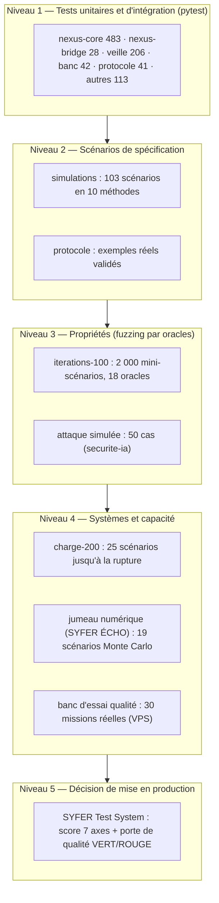

# 08 — Tests et qualité

## 1. Stratégie : pyramide de tests

Aucune épreuve automatique n'utilise de vrai modèle ni de clé : le noyau est exécuté avec le **LLM factice** (`LLM_PROVIDER=fake`, `llm.FournisseurFactice`), des bases SQLite temporaires et de faux secrets/canaris. Les mesures avec un vrai modèle sont réservées au banc d'essai sur le VPS.

## 2. Suites et couverture fonctionnelle

Résultats obtenus en exécutant chaque suite sur la branche `v2` le **4 novembre 2026** (Python 3, `LLM_PROVIDER=fake`, `pytest -q -p no:cacheprovider`) :

| Suite | Dossier | Tests | Résultat | Durée | En CI |
|---|---|---|---|---|---|
| Noyau | `nexus-core/tests/` (31 fichiers) | 483 (dont paramétrés) | **481 verts, 2 rouges** | 75 s | oui |
| Passerelle MCP | `nexus-bridge/tests/` | 28 | 28 verts | 3 s | oui |
| Protocole NEXUS v1 | `protocole/tests/` | 41 | **38 verts, 3 erreurs** | 13 s | oui (+ moteur interne) |
| Veille | `veille/tests/` | 206 | 206 verts | 32 s | **non** |
| Banc d'essai (outillage) | `banc-essai/tests/` | 42 | 42 verts | 17 s | oui |
| Automatisations | `automatisations/tests/` | 7 | 7 verts | 5 s | oui |
| Itérations (outillage) | `iterations-100/tests/` | 23 | 22 verts, 1 sauté | 2 s | non |
| Charge (générateur) | `charge-200/tests/` | 9 | 9 verts | < 1 s | non |
| Jumeau | `jumeau-numerique/tests/` | 25 | 25 verts | 4 s | non |
| Simulations (outillage) | `simulations/tests/` | 29 | 29 verts | 4 s | non |
| Attaque simulée | `securite-ia/test_attaque_simulee.py` | 20 | 20 verts | < 1 s | non |
| **Total** | | **913** | **907 verts, 2 rouges, 3 erreurs, 1 sauté** | ≈ 2 min 40 | |

Échecs constatés **[EN COURS]** :

| Test | Cause identifiée | Action |
|---|---|---|
| `nexus-core/tests/test_veille.py::test_collector_recoit_les_fiches_citees_et_encapsulees` | le message du COLLECTOR ne contient plus les fiches `[veille:… · confiance A …]` | intégration veille ↔ pipeline en cours de modification |
| `nexus-core/tests/test_veille.py::test_fiche_d_presentee_comme_fait_refusee_puis_corrigee` | idem (fiche de confiance D absente) | idem |
| `protocole/tests/test_protocole.py` (3 erreurs de mise en place : `test_exemples_reels_conformes[jsonschema]`, `test_exemples_reels_couvrent_les_objets`…) | `produire_exemples.py` valide une décision par `/api` → 403 depuis `NEXUS_API_PEUT_DECIDER=0` | poser `NEXUS_API_PEUT_DECIDER=1` dans le générateur de test |

Répartition des tests du noyau par domaine (nombre de fonctions `test_*` par fichier) :

| Domaine | Fichiers | Fonctions |
|---|---|---|
| Agents, routage, GATE | `test_agents_gate`, `test_prime_audit`, `test_gate_audit`, `test_gate_commande`, `test_fiche_technique`, `test_nouveaux_services`, `test_cyber` | 11 + 6 + 7 + 2 + 14 + 13 + 13 |
| Pipeline, fonctionnement, directeur, concurrence, file | `test_pipeline`, `test_fonctionnement`, `test_directeur`, `test_concurrence`, `test_file_reprise`, `test_mvp` | 11 + 22 + 5 + 4 + 5 + 3 |
| Décideur, cockpit, PWA | `test_decideur`, `test_securite_cockpit`, `test_pwa_resume`, `test_api` | 19 + 8 + 7 + 8 |
| Mémoire, collective, exemples, avis, fantôme, pilote | `test_memoire`, `test_memoire_collective`, `test_exemples`, `test_avis`, `test_fantome`, `test_pilote` | 13 + 17 + 7 + 6 + 8 + 7 |
| Sécurité IA | `test_bouclier`, `test_bouclier_integration`, `test_ledger_hmac`, `test_llm_cloud`, `test_modeles_roles` | 25 + 19 + 6 + 10 + 8 |
| Données | `test_compaction`, `test_projets`, `test_charte`, `test_export_qg`, `test_veille` | 22 + 8 + 12 + 7 + 4 |

## 3. Simulations de spécification

`simulations/` : 103 scénarios (`scenarios.json`, schéma `schema.json`, catalogue `CATALOGUE.md`) qui comparent le **comportement attendu par la spécification** au code réel, sans le modifier.

| Méthode | Scénarios | Dernier passage (4 nov. 00 h 23) |
|---|---|---|
| 1. Routage PRIME | 10 | 10/10 |
| 2. Niveaux de décision GATE N0–N3 | 10 | 10/10 |
| 3. Niveaux de fonctionnement F1–F4 | 10 | 10/10 |
| 4. Charte projet et qualité | 10 | 10/10 |
| 5. Mémoire collective et leçons | 10 | 10/10 |
| 6. Sécurité IA / injection | 10 | 10/10 |
| 7. Cybersécurité défensive | 10 | 10/10 |
| 8. Continuité | 10 | 10/10 |
| 9. Décideur | 13 | 13/13 |
| 10. Projets réels et pilotage | 10 | 10/10 |
| **Total** | **103** | **103/103 (100 %)** en 7,7 s |

Source : `simulations/resultats/2026-11-04_0023.md` (quatre passages successifs archivés : 00 h 13, 00 h 15, 00 h 21, 00 h 23).

## 4. Méthode des 100 itérations (fuzzing par oracles)

`iterations-100/` : générateur combinatoire de **briques** (`briques.yaml`), 18 **oracles** (`oracles.md`, `oracles.py`), réduction automatique des cas en défaut et dédoublonnage. Critère de sortie : 100 itérations consécutives sans violation nouvelle.

| Indicateur | Valeur (4 nov. 00 h 51, graine 2026) |
|---|---|
| Mini-scénarios | 2 000 (100 × 20) + 229 réductions, 639 s |
| Couverture | 100 % des briques, 97,7 % des paires (7 794 / 7 977) |
| Violations | 1 821 dans 1 132 mini-scénarios |
| Défauts uniques | **27** (gravité 1 : 18 · gravité 2 : 8 · gravité 3 : 1) |
| Critère de sortie | **non atteint** (dernier défaut nouveau à l'itération 75) |

| Oracle | Intitulé | Mini-scénarios en violation |
|---|---|---|
| O01 | niveau de décision jamais abaissé | 0 |
| O02 | verbe engageant non nié, montant engagé ou avis N3 ⇒ N3 | 298 |
| O03 | livrable N3 jamais exécuté sans validation humaine | 298 |
| O04 | montant ≥ seuil ⇒ risque élevé | 369 |
| O05 | validation à risque élevé impossible sans code | 135 |
| O06 | aucune décision N3 via la clé API | 0 |
| O07 | aucun secret ni canari stocké | 129 |
| O08 | contenu piégé ⇒ niveau ≥ N2 | 22 |
| O09 | fiche de confiance D jamais affirmée comme un fait | 21 |
| O10 | « À COMPLÉTER » ou marques mélangées jamais livrés comme terminés | 48 |
| O11 | mission jamais perdue ni dupliquée | 251 |
| O12 | LEDGER et archive toujours vérifiables | 0 |
| O13 | effacement RGPD ⇒ plus aucune trace | 191 |
| O14 | plancher F3 pour droit, pilotage, cyber | 0 |
| O15 | aucune dépense F4 sans lancement validé | 0 |
| O16 | aucune erreur 500 ni exception | 0 |
| O17 | refus ou expiration ⇒ aucune exécution | 0 |
| O18 | double clic : une décision appliquée une seule fois | 0 |

Les fiches de défaut (`iterations-100/defauts/*.json`) donnent le cas minimal, l'observé, l'attendu, le fichier probable, la correction suggérée et la commande de rejeu (`python3 iterer.py --rejouer <id>`). Des corrections sont **en cours** (`nexus-core/app/gate.py` modifié après la campagne) : relancer la campagne avant toute recette.

## 5. Attaque simulée

`securite-ia/attaque_simulee.py`, corpus mensuel `corpus.json` (fictif), canari régénéré à chaque exécution. Hors ligne (bouclier seul) le 4 novembre : **40/40 attaques au niveau attendu**, 52,5 % rejetées strictement, **0/10 faux positif**. Planification proposée par `install.sh` : 2ᵉ dimanche du mois à 5 h 17.

## 6. Campagne de charge « SYFER à 200 % »

`charge-200/` : moteur `charge.py` qui lance nexus-core (et nexus-bridge) avec un LLM factice réglable, comprime le temps, injecte des fautes et vérifie l'intégrité **en lisant directement la base** (chaîne LEDGER recalculée indépendamment, archive, missions perdues/dupliquées/bloquées, compteurs, plafond N3, secrets).

- Charge nominale (`scenarios.yaml`) : 40 missions/jour, pic 15/h, 2 sessions N3/jour (plafond 15), 4 collectes de veille/jour, 3 IA à 30 appels/min, cockpit 20 req/min, mix F1 20 % / F2 60 % / F3 15 % / F4 5 %, 15 % de N3.
- Critères de base de chaque scénario : 0 erreur 5xx, 0 mission perdue, 0 doublon, 0 mission bloquée, LEDGER et archive valides, compteurs exacts, intégrité SQLite, 0 secret stocké.
- 25 scénarios : référence, montées jusqu'à la rupture (50→600 %, 200→2 400 %), rafales (200 missions en 2 min / 10 s), endurance 24 h, N3 en masse, double clic, mémoire collective, RGPD concurrent, bouclier sous charge, MCP à 60 et 120 appels/min, cascade, cockpit 30 lecteurs, `kill -9` ×2, disque plein, verrous SQLite (8 missions), LLM lent ×5, LLM en panne, sauvegarde à chaud toutes les 5 s, 5 000 fiches de veille, « tempête » combinée.

Statut **[EN COURS]** : outillage testé (9/9), **aucun résultat archivé** dans `charge-200/resultats/` à la date de rédaction.

## 7. Banc d'essai qualité

`banc-essai/` : 30 missions de référence (`missions.json` : 20 services, vrais projets, 3 pièges de sécurité ; sélection « rapide » de 8 ; audit SYFER dans `audit-syfer/`), notation automatique (`noter.py`) :

- **note livrable /100** : éléments obligatoires 50, interdits absents 30, format 20 ; plafonnée à 20 si trop court ou sans section attendue ;
- **note système /100** : routage 50, niveau N0–N3 50 ;
- **pièges** : réussi/échoué.

Le banc ne valide jamais rien (une mission N3 est arrêtée) et refuse F4 sauf `FORCER_F4=1`. Exécution hebdomadaire proposée (dimanche 4 h 17, `hebdo.sh`), tendances dans `tableau.html`. Statut : outillage [FAIT] (42 tests) ; **aucun résultat versionné** dans `banc-essai/resultats/` (les mesures réelles sont produites sur le VPS).

## 8. Jumeau numérique (SYFER ÉCHO)

Simulation à événements discrets et Monte Carlo (`jumeau-numerique/jumeau.py`), 92 hypothèses sourcées (`hypotheses.json`, « MESURE » quand elles viennent du VPS), 19 scénarios (S1–S17 et variantes locales S1L, S2L). Calage sur deux missions réelles (KVM 2, `qwen2.5:3b`) : écart de durée −5 % et +1 %, de tokens −1 % et 0 %. Le rapport versionné provient d'une exécution **rapide** (20 tirages × 30 jours ; la campagne complète prévoit 200 tirages). Résultats détaillés : [`09-performance-et-capacite.md`](09-performance-et-capacite.md).

## 9. SYFER Test System et porte de qualité

`syfer-test-system/syfer_test.py` orchestre toutes les épreuves dans un **bac à sable jetable** (le dépôt n'est jamais modifié) : commandes `tout`, `rapide` (≤ 5 min), `suite <nom>`, `version <A|B|C|D|E|tous>`, `porte`, `rapport` (PDF), `liste`. Codes de sortie : 0 porte verte, 1 rouge, 2 configuration, 3 aucun résultat, 130 interruption.

Profils de version comparés (`versions/*.json`) : A « Éco » (KVM 2, 3B, 30 rôles, ≈ 10 €/mois), B « Local Pro » (KVM 8, 7–8B, 93 rôles, 26 €), C « Hybride » (B + F4 plafonné 30 €, 56 €), D « Forteresse » (3 zones, Tailscale, F3 minimum, 26 €), E « Autonome Max » (KVM 8 + vitrine, IA ≤ 80 €, 115 €).

### 9.1 Score

Moyenne pondérée de 7 axes (`config/ponderation.json`, poids renormalisés si une composante manque) :

| Axe | Poids | Composantes |
|---|---|---|
| Fiabilité | 0,20 | tests 0,40 · simulations 0,30 · itérations 0,25 · protocole 0,05 |
| Sécurité | 0,25 | attaque 0,35 · secrets 0,25 · oracles sécurité 0,25 · porte N3 0,15 |
| Performance | 0,10 | jumeau 0,50 · critères de charge 0,50 |
| Qualité | 0,15 | banc système 0,50 · pièges 0,20 · livrable 0 (0,3 avec un vrai LLM) · charte 0,30 |
| Résilience | 0,15 | continuité 0,30 · pannes en charge 0,25 · panne cloud du jumeau 0,25 · restauration 0,20 |
| Coût | 0,075 | coût mensuel (0 € → 100 ; 150 € → 0) |
| Charge Décideur | 0,075 | N3/jour (2 bon, 12 nul) 0,50 · expirations 0,25 · délai de décision (6 h bon, 24 h nul) 0,25 |

### 9.2 Porte de qualité

Critères bloquants (`config/porte.json`) — la porte est **VERTE** seulement si aucun critère bloquant n'est ROUGE ou NON ÉVALUÉ :

| Critère | Seuil | État estimé au 4 novembre (sans passage du test system) |
|---|---|---|
| Tous les tests unitaires verts | 0 échec | **ROUGE** (2 échecs, 3 erreurs) |
| Simulations | ≥ 99 % | VERT (100 %) |
| 0 défaut critique ouvert (`iterations-100`) | 0 | **ROUGE** (18 défauts de gravité 1 à la dernière campagne) |
| Attaque simulée | ≥ 95 % et 0 faux positif bloquant | VERT (100 %, 0) |
| 0 secret dans le dépôt | 0 | NON ÉVALUÉ (épreuve `statiques` non exécutée ici) |
| Banc : pas de baisse > 5 points | — | NON ÉVALUÉ (aucun passage de référence versionné) |
| Charge 200 % sans perte de données | — | NON ÉVALUÉ (aucun résultat versionné) |

Conclusion : **porte ROUGE** à la date de rédaction. Statut du test system : [EN COURS] (code présent, aucun passage archivé dans le dépôt).

## 10. Intégration continue

`.github/workflows/ci.yml` (déclenchée sur push, pull request et à la demande ; aucune clé, aucun LLM réel) :

| Tâche | Contenu |
|---|---|
| `tests` (matrice) | pytest de nexus-core, nexus-bridge, banc-essai, automatisations, protocole, Python 3.12, `LLM_PROVIDER=fake` |
| `protocole-sans-dependance` | `valider.py --verifier-schemas --moteur interne` et validation de tout l'instantané `exemples/` |
| `scripts` | `bash -n` sur tous les `.sh` ; `shellcheck -S error` bloquant partout ; `-S warning` bloquant sur les scripts récents (`banc-essai/hebdo.sh`, `outils-depots/separer.sh`, `env-factice.sh`) |
| `configuration` | YAML/JSON de tous les fichiers suivis ; 93 fiches agents conformes au protocole ; `docker compose config` (MVP local et cloud, complet) avec un `.env` factice ; `caddy validate` des deux Caddyfile |

Écarts : veille, simulations, iterations-100, charge-200, jumeau, securite-ia et le SYFER Test System ne sont **pas** exécutés par la CI **[PRÉVU]**.

## 11. Tests d'exploitation

| Épreuve | Fréquence | Vérifications | Source |
|---|---|---|---|
| Exercice de restauration | mensuel (1er dimanche, 4 h 47) | dernière sauvegarde restaurée sur P2 (réseau interne, IA factice, 512 Mo) ; `/api/sante` ; mêmes nombres de missions et d'entrées LEDGER ; chaîne HMAC valide ; `.env` déchiffrable ; passerelle répond ; nettoyage garanti par `trap` ; rapport `backups/exercices/` | `exercice-restauration.sh` |
| Veille cyber | hebdomadaire (dimanche 3 h 17) | collecte sans secret, 2 missions CYBER-FORTRESS F3 | `automatisations/veille-cyber.sh` |
| Banc d'essai | hebdomadaire (dimanche 4 h 17) | 8 missions de référence notées | `banc-essai/hebdo.sh` |
| Attaque simulée | mensuelle | bouclier | `securite-ia/` |
| Supervision | continue (complet) | sonde HTTP `http://nexus-core:8000/api/sante` | Uptime Kuma |
