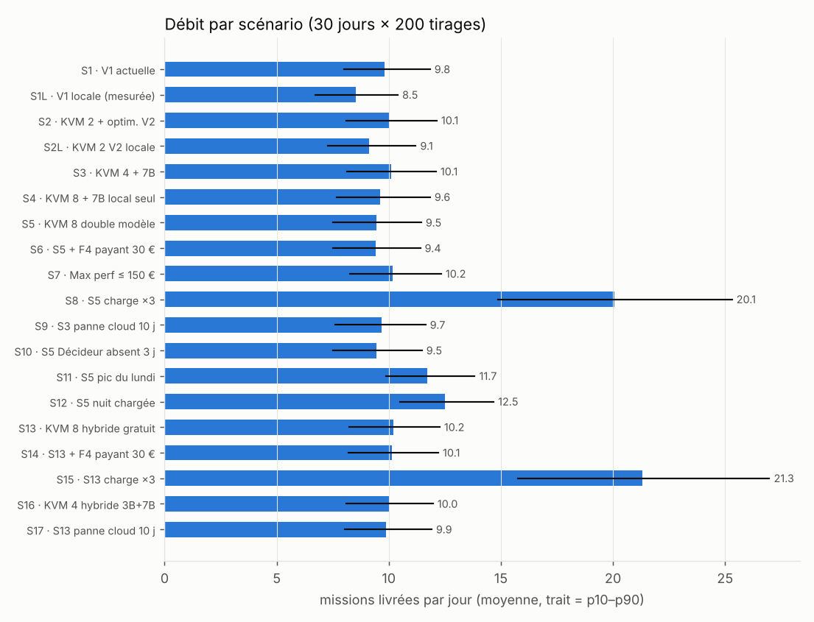
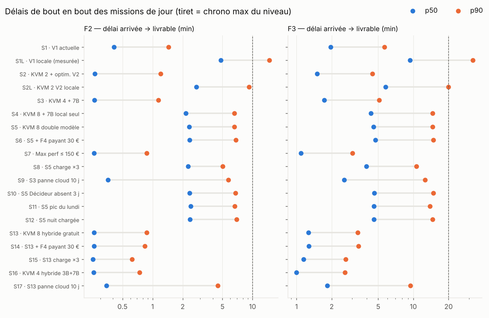
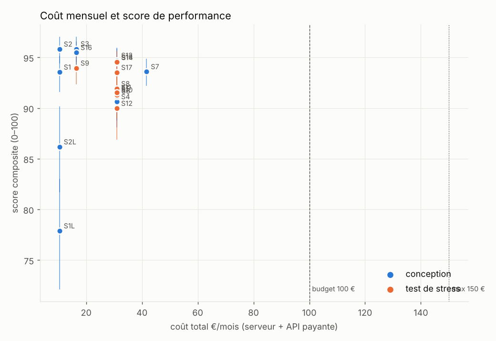
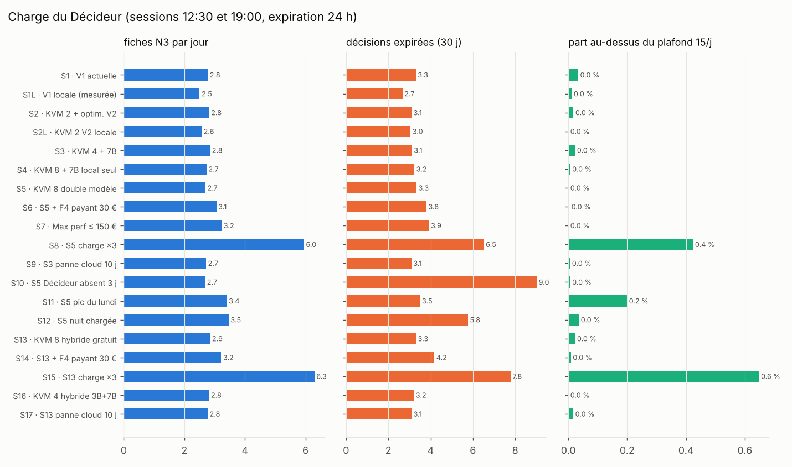
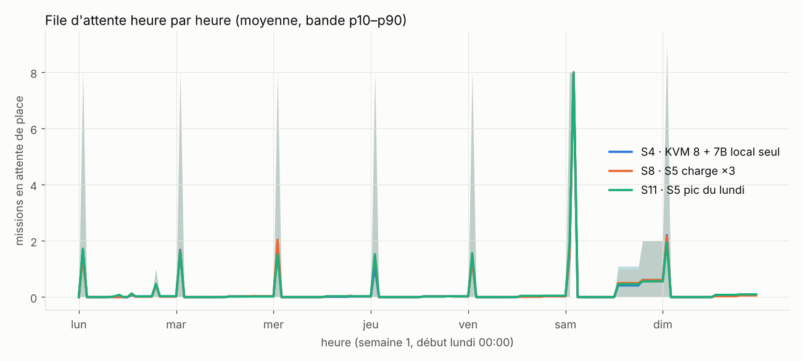
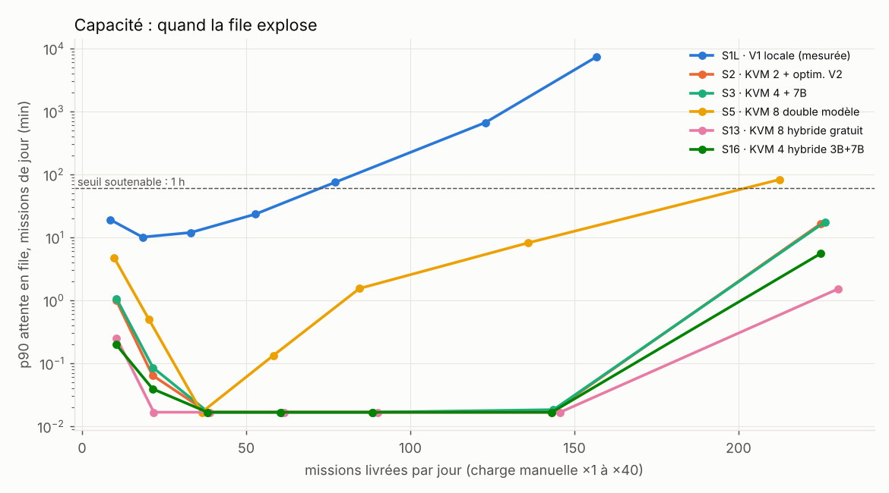

# Jumeau numérique SYFER V2 — rapport de simulation

19 scénarios × 200 tirages Monte Carlo × 30 jours simulés, graine 2026. Toutes les valeurs : moyenne [p10 – p90] sur les tirages. Les délais concernent les missions de jour (manuelles et pilote) : les missions de nuit attendent volontairement leur fenêtre.

## Calage sur les mesures réelles (KVM 2, qwen2.5:3b, 1,1 vCPU)

| Mission | Durée simulée | Mesurée | Tokens simulés | Mesurés |
|---|---|---|---|---|
| checklist N1 | 124 s (-5%) | 131 s | 1596 (-1%) | 1611 |
| post Poker Feeling | 486 s (+1%) | 480 s | 6412 (+0%) | 6396 |

## Tableau des scénarios

| Scénario | Livrées/j | p50 F2 | p90 F2 | p90 F3 | Attente file moy. | CPU LLM | RAM pic / P1 | Plafond atteint | N3/j | Expirées | Tokens/mois local · cloud · payant | Coût €/mois | €/mission | Qualité | Score | Score panne cloud · robuste |
|---|---|---|---|---|---|---|---|---|---|---|---|---|---|---|---|---|
| **S1** V1 actuelle | 9.8 [8.0–11.8] | 25 s | 87 s [36 s–3 min] | 6 min | 27 s | 1% | 3.1 / 5 Go | 3.7% | 2.8 | 3.3 | 0.41 M · 2.00 M · 0.00 M | 10 [8–13] | 0.04 | 90% | **93.5** [92–95] | 87.8 · **92.1** |
| **S1L** V1 locale (mesurée) | 8.5 [6.7–10.4] | 5 min | 15 min [8 min–26 min] | 32 min | 5 min | 7% | 3.1 / 5 Go | 12.2% | 2.5 | 2.7 | 2.38 M · 0.00 M · 0.00 M | 10 [8–13] | 0.04 | 57% | **77.9** [72–83] | 77.9 · **77.9** |
| **S2** KVM 2 + optim. V2 | 10.1 [8.1–12.1] | 16 s | 72 s [25 s–3 min] | 4 min | 20 s | 1% | 3.1 / 5 Go | 1.3% | 2.8 | 3.1 | 0.37 M · 1.21 M · 0.00 M | 10 [8–13] | 0.04 | 95% | **95.8** [94–97] | 92.5 · **95.0** |
| **S2L** KVM 2 V2 locale | 9.1 [7.3–11.2] | 3 min | 9 min [5 min–17 min] | 20 min | 3 min | 4% | 3.1 / 5 Go | 3.0% | 2.6 | 3.0 | 1.73 M · 0.00 M · 0.00 M | 10 [8–13] | 0.04 | 75% | **86.2** [82–90] | 86.2 · **86.2** |
| **S3** KVM 4 + 7B | 10.1 [8.1–12.1] | 16 s | 69 s [24 s–2 min] | 5 min | 23 s | 1% | 6.3 / 10 Go | 2.0% | 2.8 | 3.1 | 0.35 M · 1.16 M · 0.00 M | 16 [12–22] | 0.06 | 96% | **95.8** [95–97] | 93.9 · **95.4** |
| **S4** KVM 8 + 7B local seul | 9.6 [7.7–11.8] | 2 min | 7 min [4 min–12 min] | 15 min | 81 s | 3% | 6.3 / 22 Go | 4.2% | 2.7 | 3.2 | 1.58 M · 0.00 M · 0.00 M | 31 [24–39] | 0.11 | 90% | **90.6** [88–93] | 90.6 · **90.6** |
| **S5** KVM 8 double modèle | 9.5 [7.5–11.4] | 2 min | 7 min [4 min–10 min] | 15 min | 80 s | 3% | 12.6 / 22 Go | 4.8% | 2.7 | 3.3 | 1.62 M · 0.00 M · 0.00 M | 31 [24–39] | 0.11 | 94% | **91.4** [89–93] | 91.4 · **91.4** |
| **S6** S5 + F4 payant 30 € | 9.4 [7.5–11.4] | 2 min | 7 min [4 min–11 min] | 15 min | 16 min | 3% | 12.6 / 22 Go | 4.8% | 3.1 | 3.8 | 1.58 M · 0.00 M · 0.03 M | 31 [24–39] | 0.11 | 94% | **91.2** [89–93] | 91.2 · **91.2** |
| **S7** Max perf ≤ 150 € | 10.2 [8.3–12.3] | 16 s | 52 s [23 s–2 min] | 3 min | 15 min | 1% | 12.6 / 22 Go | 0.9% | 3.2 | 3.9 | 0.34 M · 0.37 M · 0.79 M | 42 [34–49] | 0.14 | 97% | **93.6** [92–95] | 93.1 · **93.5** |
| **S8** S5 charge ×3 | 20.1 [14.9–25.3] | 2 min | 5 min [4 min–6 min] | 11 min | 34 s | 6% | 12.6 / 22 Go | 3.5% | 6.0 | 6.5 | 3.01 M · 0.00 M · 0.00 M | 31 [24–39] | 0.05 | 93% | **91.9** [90–94] | test de stress |
| **S9** S3 panne cloud 10 j | 9.7 [7.6–11.6] | 21 s | 6 min [4 min–7 min] | 13 min | 67 s | 2% | 6.3 / 10 Go | 6.5% | 2.7 | 3.1 | 0.73 M · 0.75 M · 0.00 M | 16 [12–22] | 0.06 | 94% | **93.9** [92–96] | test de stress |
| **S10** S5 Décideur absent 3 j | 9.5 [7.5–11.5] | 2 min | 7 min [4 min–11 min] | 15 min | 82 s | 3% | 12.6 / 22 Go | 4.8% | 2.7 | 9.0 | 1.62 M · 0.00 M · 0.00 M | 31 [24–39] | 0.11 | 94% | **91.3** [89–93] | test de stress |
| **S11** S5 pic du lundi | 11.7 [9.9–13.8] | 2 min | 7 min [4 min–9 min] | 14 min | 69 s | 4% | 12.6 / 22 Go | 4.8% | 3.4 | 3.5 | 1.90 M · 0.00 M · 0.00 M | 31 [24–39] | 0.09 | 94% | **91.5** [90–94] | test de stress |
| **S12** S5 nuit chargée | 12.5 [10.5–14.7] | 2 min | 7 min [4 min–11 min] | 15 min | 81 s | 4% | 12.6 / 22 Go | 8.8% | 3.5 | 5.8 | 2.09 M · 0.00 M · 0.00 M | 31 [24–39] | 0.08 | 94% | **90.0** [87–92] | test de stress |
| **S13** KVM 8 hybride gratuit | 10.2 [8.2–12.3] | 16 s | 52 s [24 s–2 min] | 3 min | 9 s | 1% | 12.6 / 22 Go | 1.0% | 2.9 | 3.3 | 0.36 M · 1.17 M · 0.00 M | 31 [24–39] | 0.10 | 97% | **94.7** [93–96] | 93.5 · **94.4** |
| **S14** S13 + F4 payant 30 € | 10.1 [8.2–12.2] | 16 s | 50 s [24 s–2 min] | 3 min | 15 min | 1% | 12.6 / 22 Go | 1.0% | 3.2 | 4.2 | 0.36 M · 1.13 M · 0.03 M | 31 [24–39] | 0.10 | 97% | **94.5** [93–96] | 93.3 · **94.2** |
| **S15** S13 charge ×3 | 21.3 [15.8–27.0] | 15 s | 38 s [22 s–55 s] | 3 min | 4 s | 1% | 12.6 / 22 Go | 1.1% | 6.3 | 7.8 | 0.67 M · 2.16 M · 0.00 M | 31 [24–39] | 0.05 | 96% | **94.5** [93–96] | test de stress |
| **S16** KVM 4 hybride 3B+7B | 10.0 [8.1–12.0] | 15 s | 45 s [23 s–84 s] | 3 min | 7 s | 0% | 8.7 / 10 Go | 1.8% | 2.8 | 3.2 | 0.36 M · 1.19 M · 0.00 M | 16 [12–22] | 0.06 | 96% | **95.5** [94–97] | 93.2 · **94.9** |
| **S17** S13 panne cloud 10 j | 9.9 [8.0–11.9] | 21 s | 4 min [3 min–6 min] | 9 min | 28 s | 1% | 12.6 / 22 Go | 3.6% | 2.8 | 3.1 | 0.78 M · 0.76 M · 0.00 M | 31 [24–39] | 0.11 | 96% | **93.5** [92–95] | test de stress |

## Recommandation : S2 — KVM 2 + optim. V2

S1 + COLLECTOR sans LLM, contrôles par code, cache, gabarits, priorité jour/nuit.

Règle : meilleur score robuste (0,75 × nominal + 0,25 × avec 10 jours de panne du cloud gratuit) parmi les scénarios de conception (S1, S1L, S2, S2L, S3, S4, S5, S6, S7, S13, S14, S16), avec coût p90 ≤ 150 €/mois et RAM sous la limite P1 dans ≥ 95 % des tirages ; à 1 point près, le moins cher l'emporte.

Classement des scénarios éligibles : S3 (95.4) > S2 (95.0) > S16 (94.9) > S13 (94.4) > S14 (94.2) > S7 (93.5) > S1 (92.1) > S5 (91.4) > S6 (91.2) > S4 (90.6) > S2L (86.2) > S1L (77.9)

Le scénario retenu livre 10.1 missions/jour, p90 F2 = 72 s, qualité estimée 95%, pour 10 €/mois.

## Capacité (rampe de charge des missions manuelles)

Soutenable = p90 de l'attente en file (missions de jour) ≤ 1 h et part livrée ≥ part livrée à ×1 − 5 points. Cellule : livrées/jour · p90 attente.

| Scénario | ×1 | ×3 | ×6 | ×10 | ×15 | ×25 | ×40 | Soutenable |
|---|---|---|---|---|---|---|---|---|
| S1L | 9/j · 19 min | 18/j · 10 min | 33/j · 12 min | 53/j · 23 min | 77/j · 74 min ✗ | 123/j · 11.1 h ✗ | 157/j · 123.0 h ✗ | **≈ 53/j** (limite atteinte) |
| S2 | 10/j · 60 s | 21/j · 4 s | 38/j · 0 s | 61/j · 0 s | 88/j · 0 s | 143/j · 0 s | 225/j · 16 min | **≈ 225/j** (non saturé) |
| S3 | 10/j · 64 s | 22/j · 5 s | 38/j · 0 s | 61/j · 0 s | 89/j · 0 s | 144/j · 1 s | 226/j · 17 min | **≈ 226/j** (non saturé) |
| S5 | 10/j · 5 min | 20/j · 30 s | 36/j · 0 s | 58/j · 8 s | 85/j · 2 min | 136/j · 8 min | 212/j · 83 min ✗ | **≈ 136/j** (limite atteinte) |
| S13 | 11/j · 15 s | 22/j · 1 s | 39/j · 0 s | 62/j · 0 s | 90/j · 0 s | 146/j · 0 s | 230/j · 2 min | **≈ 230/j** (non saturé) |
| S16 | 10/j · 12 s | 22/j · 2 s | 38/j · 0 s | 61/j · 0 s | 88/j · 0 s | 143/j · 0 s | 225/j · 6 min | **≈ 225/j** (non saturé) |

## Sensibilités (tornade)

Candidats comparés : S2, S3, S16, S13, S14 ; 24 tirages par point. Chaque hypothèse est fixée à son min puis à son max (les autres restent tirées au hasard) ; score = score robuste ; « change la conclusion » = un autre candidat obtient le meilleur score.

| Hypothèse | Plage | Δ score du 1er candidat | Gagnant au min | Gagnant au max | Conclusion changée |
|---|---|---|---|---|---|
| `modele.3b.q` | 0.3 – 0.6 probabilité | 1.4 | S3 | S2 | oui |
| `modele.3b.fp` | 0.08 – 0.25 probabilité | 1.2 | S2 | S3 | oui |
| `modele.cloud.q` | 0.65 – 0.88 probabilité | 2.4 | S2 | S2 | non |
| `v2.gabarit_gain_q` | 0.03 – 0.15 probabilité | 1.6 | S2 | S2 | non |
| `qualite.gain_revision` | 0.05 – 0.2 probabilité | 0.9 | S2 | S2 | non |
| `offre.KVM2.prix_eur_mois` | 6.99 – 14.99 €/mois | 0.8 | S2 | S2 | non |
| `mix.p_F1` | 0.1 – 0.3 probabilité | 0.8 | S2 | S2 | non |
| `modele.cloud.se` | 0.6 – 0.85 probabilité | 0.7 | S2 | S2 | non |
| `modele.cloud.fp` | 0.04 – 0.14 probabilité | 0.7 | S2 | S2 | non |
| `cloud.duree_panne_h` | 0.5 – 12.0 h | 0.6 | S2 | S2 | non |
| `modele.3b.se` | 0.3 – 0.65 probabilité | 0.5 | S2 | S2 | non |
| `qualite.auto_biais` | 0.65 – 0.95 facteur | 0.5 | S2 | S2 | non |
| `v2.detection_code` | 0.2 – 0.5 probabilité | 0.5 | S2 | S2 | non |
| `cloud.pannes_mois` | 0.5 – 6.0 épisodes/mois | 0.5 | S2 | S2 | non |
| `v2.cache_taux` | 0.05 – 0.3 probabilité | 0.4 | S2 | S2 | non |

## Score composite

score = 100 × (0,30 × Débit + 0,25 × Délai + 0,30 × Qualité + 0,15 × Coût), × 0,5 si la RAM dépasse la limite P1.
- Débit = missions livrées / missions arrivées (hors tests fantômes).
- Délai = 1 si le p90 F2 ≤ 10 min, 0 si ≥ 4 h, interpolation logarithmique entre les deux.
- Qualité = part estimée de livrables « bons » parmi les livrés (modèle : bon 1er jet, détection du CHECKER, fausses alertes, révisions).
- Coût = 1 − coût mensuel / 150 € (budget maximum).

## Graphiques

## Limites — à mesurer en réel pour confirmer

- Vitesse réelle d'un 7–8B (prefill et génération) sur KVM 4 / KVM 8 : seules deux missions 3B sont mesurées ; l'extrapolation vCPU/taille repose sur des exposants supposés.
- Qualité par modèle (bon 1er jet, sensibilité et fausses alertes du CHECKER) : hypothèses ordonnées par taille ; à mesurer avec le banc d'essai (noter.py) sur 3B, 7B, 8B, cloud gratuit, Haiku, Sonnet.
- Quota, latence et pannes réelles d'Ollama Cloud gratuit (limites non publiées en chiffres).
- Volume réel de missions manuelles et part de N3 (publication/envoi) ; prix Hostinger réels.
- Le jumeau ne modélise ni la mémoire SQLite/PostgreSQL, ni n8n, ni la passerelle MCP (charge supposée faible, incluse dans la RAM de base).

